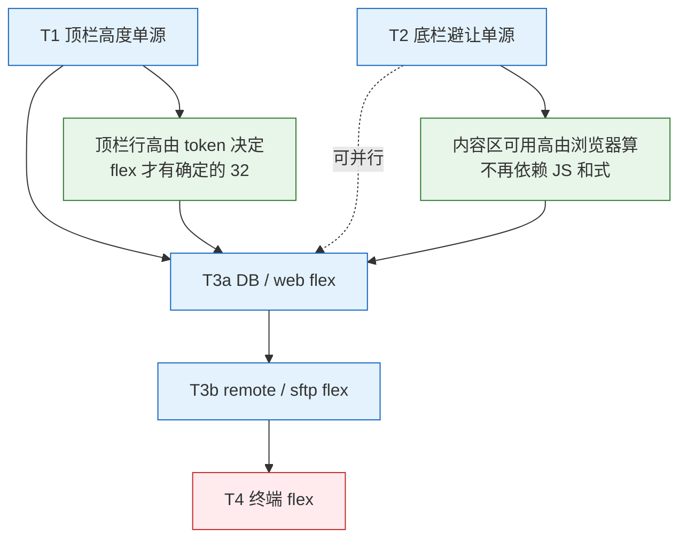

# TODO - 顶栏高度与底栏避让统一 - 2026-10-30

> 依据：[`分析-顶栏高度与底栏避让统一-2026-10-30.md`](./分析-顶栏高度与底栏避让统一-2026-10-30.md)（§4 五个决策、§7 确认门 D1~D8、§8 验证口径）。
> 基线：`master @ b83c5162`，`npm run test-unit-ci` 实测 **3582 pass / 0 fail**。
> 前置纪律：**D1~D8 拍板前不动代码**；每批可单笔 revert；UI 类改动按 `self-test/<批次>-shots/` 留截图。
> 标记：✅ 本轮代码可做 · 📱 需真机实测 · 📦 需打包实测 · 🔥 高优先 · ⚠️ 风险点

---

## 0. 批次总览

| 批次 | 目标 | 改动文件 | 落地面 | 验收一句话 | 回滚 |
|---|---|---|---|---|---|
| **T1** | 顶栏高度单源（5 类页面 → 32） | 12 + 1 spec | ✅ + 📱 换行观感 | 五类页面条高 `== 32`；窄窗 32 的整数倍 | 单笔 revert，旧 padding 复原 |
| **T2** | 底栏避让单源（一个纯函数 + 3 变量） | 12 + 2 spec | ✅ + 📱 软键盘 | 侧栏/右面板/qm/监控条 底缘互不重叠 | 单笔 revert，旧变量仍在 |
| **T3a** | DB / web 内容区 flex 化 | 4 | ✅ | DB `gapBelowBox == 0`；web 隐藏条后铺满 | 每片单独 revert |
| **T3b** | remote / sftp 内容区 flex 化 | 5 | ✅ + 📦 全屏 SFTP | sftp 列表底边 == 面板底边；全屏无留白 | 每片单独 revert |
| **T4** | 终端内容区 flex 化（xterm fit 改 RO） | 5 | ✅ + 📱📦 **全部** | 首挂载 fit / 隐藏标签不 fit / 分屏比例 | `computeHeight` 保留到最后一刻 |

依赖：`T1 → T3a → T3b → T4` 串行；`T2` 与 T3 无耦合，可与 T1 并行（不同文件）。



---

## 0.5 实施记录（2026-10-31 收口）

五批全部落地，按批次拆成 17 笔提交（每笔可独立 revert）：

| 批次 | 提交 | 一句话 |
|---|---|---|
| T1-1/2 | `f623a752` | 新增 `--session-bar-pad-x`；remote 条 `padding 0 var(--session-bar-pad-x)` + `min-height/line-height var(--session-bar-h)` + `row-gap 0`；删 `.session-v-info` 的 `line-height 30px` |
| T1-3 | `c2445dd7` | 新建 `web.styl`，`.web-address-bar` 42 → 32，jsx 去掉 `pd1` |
| T1-4 | `4a872dde` | sftp title / address 两行各 32；`list-table-ui` 的减式 `42` 补偿为 `32`（T3b 后整条不再存在） |
| T1-5 | `41f0d57a` | `session-control.styl` / `no-session.styl` / `mobile.styl` 三处裸值换 token |
| T2-1 | `61ac676e` | 新增 `bottom-stack.js` 纯函数 + 表驱动单测 |
| T2-2 | `a2c216d9` | `layout.jsx` 会话高改由 `resolveBottomStack().session` 算 |
| T2-4/5 | `9016e27c` | 六个消费方收敛到 `--below-footer-h` / `--below-monitor-h` / `--bottom-reserved-h`；删 `.shortcut-bar-on` 补位规则与 `sftpControlHeight` |
| T3a-1 | `deeeb889` | `.session-wrap` 改竖向 flex 容器（`session-batch-active` 同步改 `display flex`） |
| T3a-2 | `401c1b17` + `d62a8d38` | DB 页删 `height - tabsHeight` 与内联 height；旧断言随几何口径调整 |
| T3a-3 | `a31df6a3` | web 页不再接收 `height` 传参 |
| T3b-a | `8ef8ee46` | sftp 全链路 flex（`.term-sftp-box` → Splitter → `.sftp-wrap` → 列表）；删 `style.height`、删 `padding-bottom 42` |
| T3b-b | `c552ac4d` | 不再向 rdp/vnc/spice 下发 `width/height`（尺寸走 `SessionShell` 的 RO） |
| T4-a | `f04c27b1` | xterm fit 改由容器实测尺寸驱动 |
| T4-b | `0a884982` | 终止 `computeHeight` 与内联 px 链 |
| T4-c | `6634e756` | 删 `resizeTrigger` 1px 强制重排（D6 的评估点） |
| T3a-2 修复 | 本笔 | `.db-session-box` 补 `flex 1 1 0; min-height 0`：T3a-2 只删了内联 height，没补 flex，DB 内容区高度退化为内容高，`.db-body` 塌到 0（SQL 结果网格只剩 2px、虚拟化关闭、200 行全渲染） |

**与计划不同的三处（都以代码里的注释为准）**：

1. **T3b-a 的 `containerHeight` 不是"整条删除"**：虚拟列表要的是**数字**高度来算窗口，所以保留变量、把来源从"`height - 42 - 30 - 32 - 90` 连减"换成列表容器上的 `ResizeObserver` 实测（`list-table-ui.jsx:45`）。删掉的是那条连减与 `style.height`，不是"用一个数字算另一个数字"这件事本身。
2. **T2-4 的 `sidebar.styl` 是修漏项**：原来只减 footer，快捷键条 + 软键盘偏移都没算（z-index 400 会压住 200），现在与右面板同用 `--bottom-reserved-h`。
3. **T2 保留的 `resizeTrigger` 在 T4-c 被删掉**：flex 化之后终端尺寸由容器驱动，1px 强制重排既不再需要、也会和 RO 打架。`layout.jsx` 现在只剩 `height - stack.session`。

**验证（本轮实测）**：

- 单测：`npm run test-unit-ci` **3638 pass / 0 fail**（含 T1 的 `topbar-tokens.spec.js` 与 T2 的 `bottom-stack.spec.js` / `bottom-stack-wiring.spec.js`）；`npx standard` 干净。
- T2 组合避让 CDP：`self-test/topbar-unify-demo.js`，**14/14 PASS**，产物进 `self-test/topbar-unify-shots/`（stack-on/off × dark/light 4 张，另加 T3b/T4 的 term/sftp 5 张）。实测数：视口 999、footer 30、monitor **28**（计划文档按 30 估）、`--footer-stack-height` 58；快捷键条 44 + 软键盘偏移 240 时 `--below-footer-h` 284 / `--below-monitor-h` 314 / `--bottom-reserved-h` 342；`.sidebar-panel` / `.right-side-panel` / `.qm-wrap-tooltip` 底缘 657 与 `.remote-monitor-bar` 顶边 657 严格相等，`.main-footer` 顶边 685；五个浮层两两不重叠；qm 钉住后会话区 464 vs 工具条 180，会话区确实让位。
- T1/T3b/T4 的项高与内容区判据由并行批次各自的 CDP/单测覆盖（见各笔提交说明与 `self-test/t3b-sftp-flex.js`、T4 记录）。
- DB 内容区回归：修复前 `self-test/db-sql-workbench-demo.js` **79/84**（5 条几何断言红：基线虚拟化、F11c 1112 行、F14/G9 行号点击、G15 工具行），修复后 **84/84 PASS**；`content-flex.spec.js` 增加 `.db-session-box` 的 flex 反向断言（共 16 例）。
- 📱 窄窗换行、软键盘、真机分屏、📦 打包实测仍未做（环境不具备），按 §6 口径留待有设备时补。

**踩坑（自测层面，与产品无关但会让判据假红）**：

1. **单实例锁**：上一轮实例没退干净时，新进程打印 `DevTools listening` 后静默退出（exit 0）。杀进程要杀 `ps -eo pid,args | grep 'work/app/app[.]js'` 的那个真主进程，杀 `xvfb-run` / `setsid` 的包装 PID 没用。
2. **不要 `pkill -f "<端口>"`**：端口字面量常出现在自己的命令行里，`pkill` 会把当前 shell 一起带走（表现为 exit 143 + 半截输出）。
3. **ws 挂住事件循环**：CDP 自测脚本跑完必须 `process.exit(code)`，否则 `timeout` 把绿判据压成 exit 124。
4. **浮层判据要判"画在视口内"**：rc-motion 动画期间量到的是中间值，坐标连续两次一致才算稳定；重叠判据用 `getBoundingClientRect()` 且允许 1px 子像素误差。
5. **e2e 回放条件**：`src/test/e2e/0062.remote-monitor-visual.spec.js` 已改为驱动 `store.shortcutBarVisible` / `store.shortcutBarKbOffset`（不再依赖 body class），但本机无 Playwright，未执行。

---


目标（决策 A/B）：`--session-bar-h` 是**单行条**唯一高度来源，消费方式统一为 `flex none` + `min-height` + `line-height` + `padding 0 var(--session-bar-pad-x)` + `flex-wrap wrap`；**不写死 `height`**（换行必须是自然结果）。

### T1-1 · token 增补

- [x] `src/client/css/includes/tokens.styl`：在 `--session-bar-h` 之后新增 `--session-bar-pad-x 10px`，注释写明"终端/DB/remote/web/sftp 五类顶栏共用左右内边距（原 8/10/5 三套）"。
- [x] 不改 `--session-bar-h: 32px`（D1 已定；改 36 会连带 `termControlHeight` / `computeHeight` 与 6 处 spec）。
- 验收：`grep -n 'session-bar-pad-x' src/client/css/includes/tokens.styl` 命中且值与 `termControlHeight` 无冲突；`npx standard` 无输出。
- 落地面：✅

### T1-2 · remote 条（rdp / vnc / spice） → 32

- [x] `src/client/components/common/session-shell.styl` `.remote-session-control`：
  - `padding 4px 8px` → `padding 0 var(--session-bar-pad-x)`；
  - 增 `min-height var(--session-bar-h)`、`line-height var(--session-bar-h)`；
  - `row-gap 4px` → `row-gap 0`（**理由**：行盒 32 已含上下呼吸；保留 4px 会让换行后高度变成 `32n+4(n-1)`，无法用"32 的整数倍"验收）；`flex-wrap wrap` / `align-items center` / `z-index 300` 保留。
- [x] 同文件 `.remote-session-control-left/right` 的 `row-gap 4px` → `0`，否则条内二次换行仍不是 32 的倍数。
- [x] 删除 `src/client/components/session/session.styl:77` 的 `.session-v-info { line-height: 30px }`（38/40 抖动的直接来源）；`term-fullscreen.styl:9` 只是隐藏名单里的类名，不受影响。
- 预期：无 Select 38 → 32（−6），有 Select 40 → 32（−8）；VNC 单屏/多屏不再跳 2px（Select 32 恰等于 token）。
- 验收：✅ CDP 量 `.remote-session-control` 三协议各一次 == 32；VNC 切屏数后高度不变。📱 窄窗（≈500px）下 `height % 32 == 0` 且第二行按钮可点、两行图标不贴边。
- 风险：⚠️ 行距变紧（4px → 0），图标 16px 在 32 行盒里居中，观感需截图确认；若偏挤，退回方案是 `padding 4px 10px` + `row-gap 0` 且 token 记作 32（会破坏 32n 倍数验收，需在 spec 里改用 `>= 32` 断言）。

### T1-3 · web 条 → 32

- [x] 新建 `src/client/components/web/web.styl`（当前不存在），内容仅一条基类：

  ```styl
  .web-address-bar
    flex none
    display flex
    align-items center
    min-height var(--session-bar-h)
    line-height var(--session-bar-h)
    padding 0 var(--session-bar-pad-x)
  ```

- [x] `src/client/components/web/address-bar.jsx:50`：`className='web-address-bar pd1'` → `className='web-address-bar'`，并在文件头 `import './web.styl'`。
- 预期：42 → 32；`.web-address-bar` 首次拥有自己的规则，不再依赖 antd Input 默认尺寸漂移。
- 验收：✅ `grep -n "pd1" src/client/components/web/address-bar.jsx` 零命中；CDP web 页条高 == 32；`tab.hideAddressBar` 开/关均正常。
- 落地面：✅

### T1-4 · ftp / sftp 两行各 → 32（不合并，D3）

- [x] `src/client/components/sftp/sftp-entry.jsx:1294/1304`：`.sftp-panel-title pd1t pd1b` 去掉 `pd1t pd1b`，保留 `pd1x`；在 `sftp.styl` 给 `.sftp-panel-title` 加 `flex none; display flex; align-items center; min-height var(--session-bar-h); line-height var(--session-bar-h); padding 0 var(--session-bar-pad-x)`。
- [x] `src/client/components/sftp/address-bar.jsx:197`：`.pd1y sftp-title-wrap` 去掉 `pd1y`，类内补同样的 token 规则。
- [x] **同步算术**（避免行高变矮后列表底部留白）：`src/client/components/sftp/list-table-ui.jsx:366` 的 `height - 42 - 30 - 32 - 90` 第一项 `42` → `32`，并加一行注释"address 行 = --session-bar-h，T3b 整条删除"。这一步纯补偿，不改语义。
- 预期：title 36 → 32、address 42 → 32，两行 78 → 64（**仍是两行**；D8 合一行不在本轮）。
- 验收：✅ CDP `.sftp-panel-title` / `.sftp-title-wrap` 各 == 32；列表可视高 + 行高之和 == 面板高（无留白、无裁剪）。
- 风险：⚠️ `.sftp-panel` 外层还有 `pd1`（5px），两行同时减 14px，视觉上会明显"变紧"，📱 需看分屏（左右各一套）与过滤条出现时（+KeywordBar）的叠加效果。

### T1-5 · 裸值清理（守卫缺口）

- [x] `src/client/components/session/session-control.styl:4`：`line-height 32px` → `var(--session-bar-h)`（移动端这条此前没被 `s2-tokens.spec.js` 覆盖）。
- [x] `src/client/components/tabs/no-session.styl:10`：`top 36px` → `var(--tabs-bar-h)`。
- [x] `src/client/css/mobile.styl:97`：`line-height 36px` → `var(--tabs-bar-h)`。
- 验收：✅ 新 spec 反向断言（见 T1-6）；三处 grep 裸值零命中。

### T1-6 · 单测（新增 `src/test/unit-ci/topbar-tokens.spec.js`）

不改 `s2-tokens.spec.js`（避免削弱既有断言），新文件按同样的"源码契约"范式：

- [x] token 存在：`tokens.styl` 含 `--session-bar-h 32px` 与 `--session-bar-pad-x 10px`，且与 `constants.js` 的 `termControlHeight = 32` 同值（复用 s2 的镜像检查写法）。
- [x] `session-shell.styl` 的 `.remote-session-control` 块：含 `min-height var(--session-bar-h)` / `line-height var(--session-bar-h)` / `padding 0 var(--session-bar-pad-x)`；**不含** `4px 8px`、`38px`、`40px`。
- [x] `session.styl`：不含 `.session-v-info` + `line-height 30px` 组合。
- [x] `web/address-bar.jsx`：不含 `pd1`；`web.styl` 存在且含 `.web-address-bar` + `min-height var(--session-bar-h)`。
- [x] `sftp-entry.jsx`：不含 `pd1t pd1b`；`list-table-ui.jsx`：减式第一项为 `32`（T3b 后改为"整条不出现"，见 T3b-a）。
- [x] 反向断言：`session-control.styl` / `no-session.styl` / `mobile.styl` 不含 `32px` / `36px` 的裸值（白名单只留 token 行）。
- 验收：`npm run test-unit-ci` → **3582 + N pass / 0 fail**。

### T1 提交拆分

1. `tokens + remote 条 + 删 session-v-info 30px + spec`
2. `web 条 token 化（新 web.styl）`
3. `sftp 两行 token 化 + list-table-ui 42→32 + spec`
4. `裸值清理（session-control / no-session / mobile）+ spec 反向断言`

---

## 2. T2 · 底栏避让单源 🔥

目标（决策 D）：`resolveBottomStack` 一个和式，输出 4 个派生值；JS 只用 `session`，CSS 只用 3 个变量。

### T2-1 · 纯函数 + 单测

- [x] 新建 `src/client/common/bottom-stack.js`（与 `remote-adapt.js` 同风格：无副作用、无 store 依赖、默认值集中）：

  ```js
  export function resolveBottomStack ({
    footer = 0, monitor = 0, qm = 0, shortcut = 0, kbOffset = 0
  } = {}) {
    const belowFooter = shortcut + kbOffset
    const belowMonitor = footer + shortcut + kbOffset
    const reserved = footer + monitor + shortcut + kbOffset
    return { belowFooter, belowMonitor, reserved, session: reserved + qm }
  }
  ```

- [x] 新建 `src/test/unit-ci/bottom-stack.spec.js`：表驱动 ≥ 10 组（全 0 / 仅 footer / +monitor / +qm / +shortcut / +kb / 全开 / 省略参数 / 仅 qm / 数值为 0 的显式传入），断言四个派生值，并断言"返回值只增不减"（每加一项，`session` 单调增）。
- 验收：✅ 单测全绿。
- 落地面：✅

### T2-2 · JS 真源接线

- [x] `src/client/components/layout/layout.jsx:59`：改为

  ```js
  const stack = resolveBottomStack({
    footer: footerHeight,
    monitor: monitorHeight,
    qm: qmPinnedHeight,
    shortcut: shortcutBarVisible ? shortcutBarHeight : 0,
    kbOffset: shortcutBarVisible ? shortcutBarKbOffset : 0
  })
  const h = height - stack.session + resizeTrigger
  ```

  **保留** `+ resizeTrigger`（D6：T4 后再评估删除 → 已在 T4-c 删除，见 §5）。
- 验收：✅ 与旧式逐项等价（在 spec 里用同一组输入断言 `resolveBottomStack().session === footer+monitor+qm+shortcut+kb`）；CDP 量会话区高不变（T2 不改变任何几何）。

### T2-3 · CSS 变量注入

- [x] `src/client/components/main/main.jsx:213-217`：保留 `--footer-stack-height`、`--qm-bar-h`（过渡期兼容，T3 后清理），新增 `--below-footer-h`、`--below-monitor-h`、`--bottom-reserved-h`，值全部取自 `resolveBottomStack` 结果。
- 验收：✅ `document.documentElement.style.getPropertyValue('--bottom-reserved-h')` 与 JS 计算值一致（CDP）。

### T2-4 · 六个消费方收敛

| 文件:行 | 现状 | 改成 |
|---|---|---|
| `sidebar.styl:9` | `var(--footer-stack-height, 30px)` | `var(--bottom-reserved-h, var(--footer-stack-height, 30px))` ⚠️ **修漏项**（缺 shortcut + kb，z-index 400 压住 200） |
| `qm.styl:66` | `var(--footer-stack-height,30px)` + `.shortcut-bar-on` 补位 | `var(--bottom-reserved-h, …)` |
| `right-side-panel.styl:14` | 手写四段 calc | `var(--bottom-reserved-h, …)` |
| `shortcut-bar.styl:105-110` | `.main-footer` / `.remote-monitor-bar` 裸 `+30px` 两条特例 | `.main-footer { bottom: var(--below-footer-h) }`、`.remote-monitor-bar { bottom: var(--below-monitor-h) }`，**整段删除 `.shortcut-bar-on` 补位规则** |
| `remote-monitor-bar.styl:3` | `bottom 30px`（裸 footer 高） | `var(--below-monitor-h, var(--footer-h, 30px))` |
| `term-fullscreen.styl:84/94` | `calc(… + 180px)` 裸值 | `calc(100% - var(--bottom-reserved-h) - var(--qm-bar-h, 0px))` |
| `mobile.styl:126` | footer-stack + shortcut + kb | `var(--bottom-reserved-h, …)` |

- 验收：✅ CDP 组合验证（开快捷键条 + 钉住快捷命令带 + 开监控条）：`.sidebar-panel` / `.right-side-panel` / `.qm-wrap-tooltip` / `.remote-monitor-bar` / `.main-footer` 的 `getBoundingClientRect()` 两两不重叠，且相邻间隙 ≤ 1px；截图 4 张（组合开/关各 2）。
- 📱 移动端软键盘弹出（`kbOffset` 变化）需真机确认，不进本轮 CI。

### T2-5 · 删死常量与特例

- [x] `src/client/common/constants.js:39`：删除 `sftpControlHeight`（全仓库零引用）。
- [x] 删掉 `.shortcut-bar-on` 里为 qm/monitor 补位的整段规则（`shortcut-bar.styl:105-116` 中已被变量覆盖的部分，保留变量为 0 时自然退化的部分）。
- 验收：✅ `grep -rn 'sftpControlHeight' src/` 零命中；`grep -rn 'shortcut-bar-on' src/client` 只剩快捷键条自身的显隐规则。

### T2-6 · 接线单测（新增 `src/test/unit-ci/bottom-stack-wiring.spec.js`）

- [x] `layout.jsx` 含 `resolveBottomStack(` 且不再出现 `footerHeight - monitorHeight` 这类手写和式；仍含 `resizeTrigger`。
- [x] `main.jsx` 注入三个新变量名。
- [x] 六个 styl 文件：不含 `bottom 30px`、不含 `+ 30px`、不含 `180px`、`sidebar.styl` 用 `--bottom-reserved-h`。
- [x] `constants.js` 不含 `sftpControlHeight`。
- 验收：`npm run test-unit-ci` 全绿（含新增 spec）。

### T2 提交拆分

1. `bottom-stack.js + spec`（无接线，纯新增，可独立 revert）
2. `layout.jsx / main.jsx 接线 + 变量注入 + wiring spec`
3. `六个消费方收敛 + 删 .shortcut-bar-on 特例 + 删死常量 + spec 反向断言`

---

## 3. T3a · DB / web 内容区 flex 化

### T3a-1 · 容器 flex 列（视觉零变化）

- [x] `src/client/components/session/session.styl` `.session-wrap`：
  - 增 `flex-direction column`、`display flex`；
  - ⚠️ **必须同步改** `&.session-batch-active { display block }` → `display flex`（批处理视图靠这条显示，漏改会导致"批处理时整块不可见"）；
  - 增 `> * { flex 1 1 0; min-height 0 }`；
  - `padding-top var(--tabs-bar-h)` **保留**（标签栏不在流里）。
- 验收：✅ 全页面"看起来完全一样"（像素级截图对比 5 类页面 before/after 无差异）；`npm run test-unit-ci` 全绿。
- 这是 T3a/T3b/T4 共同的地基，先合入再分片。

### T3a-2 · DB 删算术

- [x] `session.jsx:239-247`：删除 `const height = this.props.height - this.props.tabsHeight`，DB 页根不再需要该值；`.db-session-box` 保留 `overflow hidden`，由 flex 决定高度。
- [x] `db-session.jsx` 页根：`display flex; flex-direction column`，`.db-head` 已 `flex none`。
- 验收：✅ CDP `gapBelowBox === 0`（沿用 `self-test/db-*.js` 的量法）；底栏不被覆盖、底部无留白。📱 全屏 DB 仍正常（`term-fullscreen.styl` 的 `.db-session-box { bottom }` 规则是否还需要，靠截图确认后决定删或留）。
- 风险：⚠️ DB 内部有多个 `height:100%` 链（pane/表格），flex 化后某一层若仍读内联高会变成 0 —— 分片验收必须逐 pane 看（`db-ui-regression.js` 可复用）。

### T3a-3 · web 删 height 链

- [x] `session.jsx` 里 web 分支不再依赖 `height` 传参（若仍有）；`.web-session-wrap` 已是 flex 列，根加 `flex 1 1 0; min-height 0`。
- 验收：✅ `tab.hideAddressBar` 开/关两种状态下 webview 高度 == 容器高；切换标签不闪白。
- 落地面：✅

---

## 4. T3b · remote / sftp 内容区 flex 化

### T3b-a · sftp：删两处 px（含全屏留白修复）

- [x] `sftp-entry.jsx`：`.sftp-wrap` 的 `style: { height }` → `className` 内由 CSS `height 100%` + flex 决定；外层 `term-sftp-box` 保持 `height 100%`（已在）。
- [x] `list-table-ui.jsx:366`：删除 `const containerHeight = height - 42 - 30 - 32 - 90` 整条，列表容器改 `flex 1 1 0; min-height 0`；该文件其余消费 `containerHeight` 的地方一并改（用 `height: 100%` 或 flex）。
- [x] `sftp.styl:184` 的 `padding-bottom 42px`（给 pager 留位）改由 pager 自身 `flex none` 占位。
- [x] `term-fullscreen.styl` 是否需要补 `.sftp-wrap` 规则：**预期不需要**（flex 铺满后自动正确），实测确认后不写规则。
- 验收：✅ sftp 列表底边 == 面板底边（CDP 量差 ≤ 1px）；分屏左右 sftp 高度相等。📦 **全屏 SFTP 底部无留白**（本轮新修的历史缺陷，必须打包实测 + 截图进 `self-test/topbar-unify-shots/`）。
- 风险：⚠️ 上游 `e369763f` 的四连减里 `90` 无出处，删掉后若某个"分页器 + 状态条 + 头部"的组合撑破容器，需要靠"pager `flex none` + 列表 `flex 1`"重排，不能靠加回魔法数。

### T3b-b · remote：清死参数

- [x] `session.jsx:281-299`：删除传给 rdp/vnc/spice 的 `width` / `height`（三个页面对 `props.width/height` 零引用，`SessionShell` 用 RO 实测）。
- 验收：✅ 三协议连接后画面比例不变；`grep -n 'props.width\|props.height' rdp-session.jsx vnc-session.jsx spice-session.jsx` 零命中（删之前已零命中，删的是传参侧）。
- 风险：⚠️ 上游后续可能重新引入 `props.height` 的用法 → 删除改用注释显式说明"尺寸走 RO，不要回传"。

---

## 5. T4 · 终端内容区 flex 化 ⚠️ 最高风险

- [x] `.term-wrap` / `term-sftp-box` 改 flex 列，内容 `flex 1 1 0; min-height 0`。
- [x] 删除 `sessions.jsx:32-39` 的 `computeHeight`；`session.jsx` 的 `onSplitResize` 分母改成 Splitter 实测 `clientWidth/clientHeight`；Splitter 尺寸交给 CSS（`.ant-splitter` 自带 `100%`）。
- [x] xterm `fit()` 的触发改成"容器尺寸变化 → 一次 fit"，ResizeObserver + 尺寸判等 + `proposeDimensions` 判等（后者补字体/连字异步加载造成的"量不变、单元格变"）。
- [x] **`isElementVisible()` 守卫（`term-resize.js:12`）原样保留**，并加 spec 反向断言（隐藏标签不得 fit）。
- 验收：📱📦 全部真机/打包：首挂载 fit 正确、隐藏标签不 fit、分屏拖拽比例正确、全屏进出不残留滚动条、软键盘弹出后行数正确、`triggerResize`（`event.js:30` 的 1px）在 flex 化后是否可以删除（D6 的评估点）。
- 风险：⚠️ 这是唯一"改错就整片终端不可用"的批次 → 单独分支、单独提交、`computeHeight` 与内联 px 链保留到最后一刻再删（先接入 RO，观察一版再删旧路径）。

### T4 实施记录（拆 3 笔，逐笔可 revert）

1. **T4-a** `f04c27b1` — fit 触发源换成 ResizeObserver（`terminal.jsx` 观察 `.term-wrap-2`，尺寸判等 + `proposeDimensions` 判等），保留 props 变化时的补 fit 与 `isElementVisible` 守卫。
2. **T4-b** `0a884982` — 删 `computeHeight` / `calcTermWidthHeight` / `computePosition` 与内联 `width/height` 传参链；`.term-sftp-box > .terms-box` 改 `flex 1 1 0; min-height 0`，分栏面板内 `height 100%`；`.term-wrap` 定位 `inset 0`。
3. **T4-c** — D6 结论：**1px 重排可删**。`layout.jsx` 的 `+ resizeTrigger` 去掉后，容器尺寸变化由 RO 直接变成 fit，不再需要"翻一下数字强制重排"；`Store.triggerResize` / `resizeTrigger` 状态一并退役。四处调用方各归其位：
   - `main.jsx` 启动校准改为 `store.onResize`（store 高初值是占位的 500，仍要量一次真实窗口高；这条与 fit 无关，不能连坐删掉）。
   - `startup-queue.runInitScript`、`session.handleSshSftpSplitView`、`toggleSessFullscreen` 里的触发全部删除（对应容器变化都会走 RO）。

验收实测（dev 1600×1000，`self-test/t4-term-flex.js`）：14/14 PASS —— 首挂载 `cols157/rows41`、隐藏标签行列不变、分屏 `box == pane0`、拖拽 ±150px 后 `rows 20→27`、字号 18 时 `cols 140`、全屏 `bottom 969 == 999-30`、进出全屏 `scrollHeight == innerHeight`。

---

## 6. 验证口径（每批都跑）

| 项 | 命令 / 方法 | 通过标准 |
|---|---|---|
| 行宽 | `npx standard <改动文件>` | 无输出 |
| 单测 | `npm run test-unit-ci` | **≥ 3582 pass / 0 fail**（T1 起含新增 spec） |
| 构建 | `npm run build` | 无新增 warning |
| CDP 量高 | `document.querySelector(sel).getBoundingClientRect().height` | T1：五类页面条高 == 32 |
| CDP 换行 | 窗口缩到 500px | `height % 32 == 0`，第二行按钮可点 |
| CDP 避让 | 快捷键条 + qm + 监控条组合开 | 五个浮层两两不重叠，间隙 ≤ 1px |
| CDP 内容区 | 各页"内容底边 vs 面板底边" | 差 ≤ 1px |
| 截图 | 新增 `self-test/topbar-unify-demo.js`（照 `db-ui-helpers.js` 范式），产物进 `self-test/topbar-unify-shots/` | 覆盖 8 张：term / db / rdp / vnc-multi / web / web-hidden / sftp-2row / narrow-wrap |

**一次性脚本纪律**：CDP 脚本不落 `.log`；临时目录用 `os.tmpdir()`；删除用 `fs.rmSync` / `/usr/bin/rm -rf`，不进回收站。

---

## 7. 回滚

| 批次 | 回滚动作 | 前置条件 |
|---|---|---|
| T1 | 按提交 4→1 逆序 revert | 无（纯 CSS + 类名） |
| T2 | 先 revert 消费方，再 revert 接线，最后 revert 纯函数 | 旧变量名在过渡期仍注入，故中间态可运行 |
| T3a-1 | 单独 revert（恢复 `.session-wrap` 的 `display block`） | 必须先回滚 T3a-2/T3a-3，否则它们的 flex 假设失效 |
| T3a-2/3 | 每片单独 revert（恢复该页内联 px） | 无 |
| T3b | 每片单独 revert | 无 |
| T4 | revert 单笔，`computeHeight` 自动复原 | 必须确认已删的 `containerHeight` 相关改动同步回退 |

---

## 8. 明确不做（与分析的 §3.3 一致）

- 不把 sftp/ftp 的两行合并成一行（D3；需另立需求 + 实测）。
- 不抽 `items: []` 式顶栏声明协议（L2 内容变化原因不同）。
- 不把 DB 只读/刷新、web url、sftp 路径上提到 `session.jsx` 或 store。
- 不动 L3（`session-bar-actions.jsx`）与 L4（三套查找引擎）。
- 不统一移动端收纳方式（Popover / wrap / `MobileAddressPrefix` 各自保留）。
- 移动端不覆盖 `--session-bar-h`（D8，会打破与 `termControlHeight` 的镜像）。

---

## 9. 待拍板（分析文档 §7）

| # | 问题 | 建议 |
|---|---|---|
| D1 | 单行条高 | 32 |
| D2 | 左右内边距 | 统一 10px（新增 `--session-bar-pad-x`） |
| D3 | sftp 两行是否合并 | 不合并 |
| D4 | flex 化范围 | T3a → T3b → T4 分批 |
| D5 | 是否引入 `bottom-stack.js` | 引入 |
| D6 | `resizeTrigger` 1px | T2 保留，T4 后评估 → **T4-c 已删除**（RO 接管 fit，`main.jsx` 启动校准改用 `store.onResize`） |
| D7 | 全屏 SFTP 留白 | 跟 T3b 一起修 |
| D8 | 移动端更大条高 | 不用 |

拍板后按 **T1 → T2 → T3a → T3b → T4** 顺序推进；每批完成即跑 §6 全部检查并留截图，再进入下一批。
