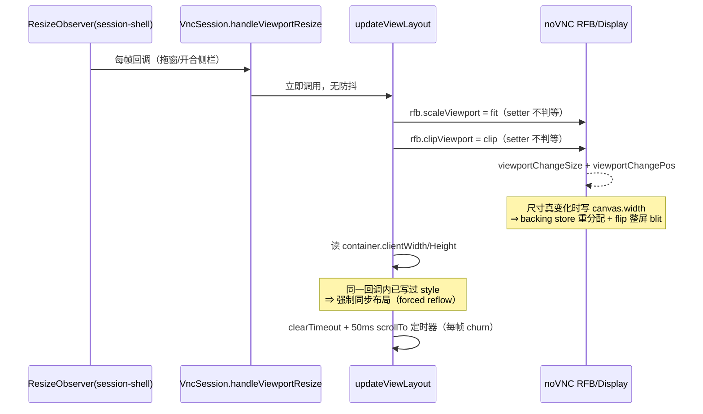

# 分析 - RDP/VNC 窗口自适应与资源开销 - 2026-10-30

> 任务来源：用户 2026-10-30 提出"RDP 连接主机后，软件窗口自适应显示区域？分辨率无需手动调整？侧边栏出现时，也和 VNC 一样能自适应？"，随后追加"**考虑资源开销再分析，先优化 RDP，然后看 VNC 是否需要优化、其他窗口自适应是否需要优化**"。
> 基线：`master @ 5650525a`。⚠️ 分析期间工作树被并行会话改写（HEAD 前移 11 笔提交），远程会话侧与依赖包的引用已按当前 HEAD 逐条重核实；终端/DB 侧存在基线漂移，见 §3.4。
> 配套：[`TODO-RDP自适应优先与自适应开销治理-2026-10-30.md`](./TODO-RDP自适应优先与自适应开销治理-2026-10-30.md)
> 状态：✅ **批次 A/B 已落地**（2026-10-30，D1/D2/D3 按建议执行）；批次 C（R5 真动态分辨率）与 V3 仍 ⏸ 待拍板。实施与本文的 5 处差异记在配套 TODO 的 §6。
> 图例：🔥 高优先 · ⏸ 待拍板 · ✅ 已核查无需改动

---

## 0. 一页结论

| # | 结论 | 资源开销 | 优先 |
|---|---|---|---|
| 1 | **RDP "自适应"默认是关的**（`scaleViewport` 默认 `false`），这是"看着完全不自适应"的第一根因 | 打开后仅 GPU 合成缩放，**不增加解码与内存** | 🔥 R1 |
| 2 | **RDP 连上的位图尺寸与窗口无关**（默认 1024x768，来自 localStorage），所以"自适应"只能是拉伸模糊 | 首连改按视口 = 位图面积按窗口增大，需上限护栏 | 🔥 R2 |
| 3 | **RDP 没接 `onViewportResize`**（VNC/SPICE 都接了），侧边栏开合、拖窗时协议层毫不知情 | 接线本身零成本；真动态分辨率才是成本项 | R3 |
| 4 | **动态改分辨率在 IronRDP 里能力齐全但一处没用**（`Session.resize`、`canvasResizedCallback` 全仓库 0 引用；wasm 内已带 MS-RDPEDYC DisplayControl + `drdynvc`） | **每次成功 resize = 重建 surface/framebuffer + 整屏重绘**，成本 ∝ 面积 | R5（需真机） |
| 5 | **VNC 确实需要优化，但问题不在分辨率，而在 resize 回调**：每个 ResizeObserver tick 无防抖地重跑 `updateViewLayout()`，其中两次 noVNC setter **不判等**，且回调里"先写 style 再读 `clientWidth`" ⇒ **每帧一次强制同步布局** | 可消除：拖窗期每帧 1 次 reflow → 每 200ms 1 次 | 🔥 V1/V2（纯前端、零协议风险） |
| 6 | **终端 / 侧栏的自适应带节流与判等守卫**（详见 §3.4，其中终端侧实现因基线漂移待复核） | 不构成瓶颈 | ✅ 本轮不动 |
| 7 | **SPICE 与 RDP 同病（仅 fit 默认值）**：`spice-scale-view-<host>` 默认 `false`；首连尺寸已走 `calcCanvasSize()`（优先实测 `viewSize`，兼用 `-10/-80` 旧口径兜底） | 同 R1/R2 | S1 |
| 8 | "对齐 VNC"只能对齐**缩放行为**，对齐不了**清晰度**：VNC 的远端尺寸本来就是服务器真实屏幕，RDP 的远端尺寸是我们写死的 1024x768 | — | 认知前提 |

**一句话取舍**：R1/R2/R3 + V1/V2 属于"近零成本、当天可落地"，先把 RDP 拉平到 VNC 的观感；R5（真·动态分辨率）是**用内存与带宽换清晰度**的交易，必须带面积上限与变化阈值，且需真机验证，单独立项。

---

## 1. 三种"自适应"语义先拆开

| 语义 | 现状 | 代价 | 对应任务 |
|---|---|---|---|
| **A. 画面随显示区域缩放**（位图尺寸不变，CSS/合成器缩放） | RDP 有完整 CSS 通路但**默认关**；VNC 默认开 | 近零：不增加解码量、不增加内存，只增加合成器缩放绘制 | R1 |
| **B. 连上时就按显示区域取位图尺寸**（协商期决定，一次成型） | RDP 完全没用上（取手选分辨率）；VNC/SPICE 已拿实测 `viewSize` 作首连提示尺寸，但兜底仍是不准的 `-10/-80` | 位图面积 ∝ 视口面积（见 §3.2 换算表），一次性成本 | R2 |
| **C. 运行中改远程分辨率**（协议层重新协商） | RDP 未用（wasm 里 API 齐备）；VNC 有 `SetDesktopSize` 通路但未开 | **每次变更 = 全量重绘 + 服务端重编码 + surface 重建**，成本 ∝ 面积 × 变更次数 | R5 |

A 与 C 的差别不是"效果强弱"，而是**成本结构**：A 每帧成本不变、C 每次变更一次风暴。所以实施顺序必然是 A → B → C。

---

## 2. RDP 现状与开销基线（源码实证）

### 2.1 关键事实

| 位置 | 事实 |
|---|---|
| [`rdp-session.jsx#L71-L96`](../src/client/components/rdp/rdp-session.jsx) | `rdp-reso-<host>` 默认 `resolutions[1]` = **1024x768**；`rdp-scale-view-<host>` 默认 **`false`**；`rdp-view-<host>` 默认 `basic` |
| `rdp-session.jsx#L128-L131` | `getFit() = !!fullscreen || !!state.scaleViewport` ⇒ 窗口模式下默认不 fit |
| `rdp-session.jsx#L156-L235` | 连接期 `remoteInit` 里 `new DesktopSize(width, height)` 用的就是上面的 state 尺寸（#L233）；连上后 `canvas.width = session.desktopSize().width` |
| `rdp-session.jsx#L915-L931` | `<SessionShell fit={this.getFit()} …>` **未传 `onViewportResize`**（VNC 在 `vnc-session.jsx#L688`、SPICE 在 `spice-session.jsx#L333` 都传了） |
| `rdp-session.jsx#L669-L674` | `getAllRes()` 用 `resolutions.slice(1)` 排除首项，而首项 `res-auto` 的宽高是字符串 `'auto'`（`resolutions.js#L2-L7`）⇒ 死项 + 潜在脏值入口 |
| `rdp-session.jsx#L652-L667` | `handleReInit` 走 `props.reloadTab(tab)`（整 tab 重建），VNC 的 `handleReInit`（`vnc-session.jsx#L610-L615`）是原地 `disconnect + remoteInit` |
| `rdp.styl#L6-L10` + `session-shell.styl#L67-L82` | fit 生效时 `width/height 100%` + `object-fit: contain` ⇒ 纯 CSS 等比缩放（黑边 letterbox） |
| `session-rdp.js#L34-L42`、`#L63-L65` | 主进程 `start(width, height)` **只存字段不使用**，`resize()` 是**空实现**（注释写明 resize 由 wasm 侧 `session.resize()` 经既有中继发出）⇒ 尺寸真正生效点是渲染进程传给 wasm 的 `DesktopSize`，主进程无需改动 |

### 2.2 绘制路径（决定成本模型）

`ironrdp-wasm@1.2.0`（[github.com/electerm/ironrdp-wasm](https://github.com/electerm/ironrdp-wasm)，electerm 自有 fork）的 wasm 与 glue 里可查到：

- 帧呈现：glue 调用 `putImageData`，**面积 = 本次 update PDU 的脏矩形**，不是整屏。
- 稳态内存：整屏 surface / framebuffer，**∝ 宽 × 高 × 4B（RGBA）**。
- 分辨率变更：strings 证据链 —
  - `"surface recreating after set_size() call"`
  - `"framebuffer resize: new size … (might be smaller)"`
  - `"screen buffer size changed, recreate the frame"`
  - `"got new resolution, clear RectManager's dirty rectangles to ensure a full repaint"`
  ⇒ **一次改分辨率 = 重建缓冲 + 清脏矩形做整屏重绘**，不是一帧的小代价。
- 动态分辨率通道：`"Could not encode a resize: Display Control Virtual Channel is not yet connected"`、`"Sending monitor layout"`、`"MonitorLayout PDU can only be sent in client direction when the DVC is connected"`、`drdynvc` ⇒ DisplayControl/`drdynvc` 已实现；`"ScreenBoard is ready to resize"` 给出就绪信号。

### 2.3 为什么"默认关"这件事必须优先修

fit 关闭时 `> * { flex 0 0 auto; margin auto }` 保持位图原始尺寸，超出视口即 `overflow: auto` 出滚动条。用户感知的"窗口/侧边栏变化时画面不动"其实是**滚动而非缩放**。打开 fit 的收益（画面跟随视口）成本仅为合成器缩放，**没有任何内存/带宽代价**，是本轮性价比最高的一行改动。

---

## 3. 资源开销量化

### 3.1 三种方案的成本结构对比

| 方案 | 每帧 CPU/GPU | 稳态内存 | 网络位流 | resize 期额外成本 |
|---|---|---|---|---|
| A（fit 默认开） | 合成器缩放，与位图大小相关但与视口无关 | 不变（∝ 位图） | 不变 | 无 |
| B（首连按视口） | 脏矩形面积可能变大（远端窗口变大→重绘区域变大） | ∝ 视口面积 | ∝ 脏区面积 | 无（连接期一次成型） |
| C（运行中改分辨率） | 同 B | 同 B | 同 B | **每次变更：surface/framebuffer 重建 + 整屏重绘 + 服务端重编码** |

### 3.2 位图面积换算（RGBA，单帧缓冲下限）

| 尺寸 | 像素 | framebuffer | 相对 1024x768 |
|---|---|---|---|
| 1024x768（现默认） | 0.79 M | 3.0 MB | 1.0× |
| 1280x800 | 1.02 M | 3.9 MB | 1.3× |
| 1600x900 | 1.44 M | 5.5 MB | 1.8× |
| 1920x1080 | 2.07 M | 7.9 MB | **2.6×** |
| 2560x1440 | 3.69 M | 14.1 MB | 4.7× |
| 3840x2160 | 8.29 M | 31.6 MB | 10.5× |

> IronRDP 侧除 surface 外还有解码/编码缓存，实际驻留按 2~3× 估算；RDP 会话还可能有第二个 tab，**上限必须显式**。
> 本项目终端侧已有内存基线口径（`work/app` 的 `mem-probe` 系列自测），RDP 面积上限建议先保守取 **1920x1080**（2.6×），超出部分交 CSS 缩放，并在 `resolution` 上限开放为可配置项（决策见 §5.2）。

### 3.3 VNC 的实际开销点（本轮最重要的"负发现"）

不是位图（VNC 远端尺寸由 server 决定，客户端只缩放），而是 **resize 回调链路**：

证据：

| 位置 | 事实 |
|---|---|
| `vnc-session.jsx#L102-L105` | `handleViewportResize` 存 `viewSize` 后**直接** `updateViewLayout()`，无防抖、无阈值 |
| `vnc-session.jsx#L565-L597` | 每次调用无条件 `rfb.scaleViewport = fit`、`rfb.clipViewport = clipViewport`、`autoscale(container.clientWidth, …)`，再挂一个 50ms `scrollTo` 定时器 |
| `@novnc/novnc/core/rfb.js#L346-L357` | `set scaleViewport` 不比较旧值，每次跑 `_updateScale()` |
| `@novnc/novnc/core/display.js#L74-L80` | `set clipViewport` 不比较旧值，每次 `viewportChangeSize()` + `viewportChangePos(0,0)` |
| `@novnc/novnc/core/display.js#L134-L172` | `viewportChangeSize` 有 `if (vp.w !== width || vp.h !== height)` 守卫；**一旦进入该分支就是 `canvas.width/height` 属性写 → backing store 重分配 → `_damage` + `flip()` 整屏 blit** |
| `@novnc/novnc/core/display.js#L432-L470` | `autoscale` → `_rescale` 写 `style.width/height`（有判等守卫，本身不贵）；贵的是"写 style 后读 `clientWidth`"这对组合 |

**净结论**：VNC 需要优化，且是**纯前端、零协议风险**的一档：①用 shell 已量好的 width/height（省掉 `clientWidth` 读，消除 forced reflow）；②判等后才赋值 noVNC setter；③防抖 + 阈值。收益 = 拖窗期间从"每帧一次强制布局 + 若干 style 写 + 定时器 churn"降到"停止变化后一次"。

### 3.4 本轮不动的其他自适应面（附基线漂移说明）

> ⚠️ **基线漂移**：本轮分析期间工作树被并行会话改写（HEAD 前移 11 笔提交）。以下四个符号在**分析早期**读取到、现已不在当前工作树与 git 索引中：`terminal-size.js` / `computeTerminalSize`、`db-workspace.jsx` 的 `useTerminalResize`、`colWidthRevision`、`db-view.jsx`、`db-editor.jsx`。因此终端与 DB 的结论**降级为待复核**，不作为本轮依据；远程会话侧（rdp/vnc/spice/session-shell）与依赖包（noVNC 1.7.0、ironrdp-wasm 1.2.0）的引用已按当前 HEAD 逐条重新核实。

| 对象 | 当前可核实的结论 | 证据（HEAD 5650525a） |
|---|---|---|
| 终端 cols/rows | `mixins/term-resize.js` 在 `fit()` 前判 `this.term / this.fitAddon / this.onClose`（会话关闭即不动），**未见防抖**，但 xterm 的 `fit()` 只在容器尺寸真变化时产生新 cols/rows，下游 `onResize` 才发 resize PDU | `src/client/components/terminal/mixins/term-resize.js#L26-L33` |
| 侧边栏宽度参与会话宽度 | `contentWidth` 已扣除 `leftSideBarWidth + leftSidePanelWidth`，窄屏（<1024）自动收起 | `src/client/components/layout/layout.jsx#L33-L62` |
| SessionShell 测量 | 每实例一个 RO，回调内读 2 个 `clientWidth/Height` + 1 次 `getComputedStyle(--remote-control-height)`，**有判等守卫**（尺寸未变不回调） | `session-shell.jsx#L26-L45` |
| DB 侧自适应 | 存在 RO 的文件只有 `database/db-session.jsx`、`database/db-er-view.jsx`；自动列宽采样 `SAMPLE_ROWS = 100`（成本有界） | `src/client/common/db-column-width.js#L20` |

> 唯一提示：`--remote-control-height` 参与高度 ⇒ RDP 控制条换行（分辨率 Select 变宽）会再触发一次测量。属预期行为，不算缺陷。
> **待复核项**（不阻塞本轮，实施 R 批次前顺带确认）：终端 `fit()` 是否需要在 RO 回调链路上加与 V1 同档的防抖；DB 侧 RO 回调是否仍走 rAF 合并。

---

## 4. RDP 与 VNC 的能力对照（"对齐 VNC"的准确边界）

| 能力项 | VNC 现状 | RDP 现状 | 对齐动作 |
|---|---|---|---|
| fit 默认值 | `scaleViewport` 默认 **true**（`vnc-session.jsx#L84`） | 默认 **false** | R1 |
| fit 设置载体 | **书签字段**（`bookmark-form/config/vnc.js` switch + `fix-bookmark-default.js` `vnc.scaleViewport: true`） | **localStorage 按 host**，`config/rdp.js` 无任何显示字段、`fix-bookmark-default.js` 的 `rdp` 只有 `port: 3389` | R3 |
| 视口回调接线 | `onViewportResize` 已接（#L688） | 未接 | R2/R5 |
| 视口变化后的重算 | noVNC 自管理 canvas ⇒ 必须命令式 `autoscale` | `.fit > * {100%}` + `object-fit: contain` ⇒ **CSS 自动跟随，无需 JS** | 不需要（**别照抄 `autoscale`**） |
| 首连尺寸来源 | `calcCanvasSize()` 用实测 `viewSize` 优先（`#L90-L100`，兜底 `-10/-80`） | 手选分辨率，与视口无关 | R2 |
| SPICE 同项 | — | `spice-session.jsx#L125-L132` 已优先 `viewSize`（兜底 `-10/-80`），仅缺 fit 默认 | S1 |
| 指针落点 | noVNC 内部处理 | 共用 `eventToRemotePos`（letterbox/contain 已处理） | ✅ 无需改 |
| 全屏铺满 | `.fullscreen .session-v-wrap` + `getFit()` 恒 true | 同 | ✅ 无需改 |
| 改设置后的重连语义 | `disconnect + remoteInit` 原地 | `reloadTab` 整 tab 重建 | R4 |
| 真动态分辨率 | `SetDesktopSize`/`_requestRemoteResize` 在 patch 里被调用（`#L271`），但 `rfb.resizeSession` 默认 false（`rfb.js#L300`）未显式开启 | wasm 有 `Session.resize` + DisplayControl，0 引用 | R5 / V3 |
| 词条 | `scaleViewport`、`viewOnly` **有**；`clipViewport`、`resolution` **无**（缺 key 时 `translate` 回落大写化原 key，`entry/basic.js#L58-L61`） | 同左 | R6 |

**认知边界**：对齐 VNC 之后 RDP 的行为 = "把 1024x768 位图平滑铺满显示区域"，视口变化会自动重缩、不再需要手选开关；但**位图像素 < 屏幕像素 ⇒ 文字仍发虚**，VNC 不会有这个问题。"分辨率无需手动调整"这一条只有 R2（首连按视口）起步、R5（运行中改）才算真正满足。

---

## 5. 建议方案（含资源护栏的具体参数）

### 5.1 RDP：R1 → R4 为第一批（近零成本，纯前端）

- **R1 fit 默认开**：默认值由 `false` 改 `true`，并区分"没存过"与"用户显式关掉"——用 `ls.getItemJSON(key, null)`，`null` 才套用新默认，`false` 尊重历史选择。SPICE 同步（S1）。
- **R2 首连按实测视口取位图尺寸**：接 `onViewportResize`，首次有效测量（>0）后才 `remoteInit`；`DesktopSize` = `clamp(视口CSS尺寸, 800x600, 上限 cap)`。⚠️ 不要照抄 VNC 的 `props.width - 10 / props.height - 80` 兜底（`session-shell.jsx` 头注释已把该魔数列为废弃猜测值）。
- **R3 设置载体对齐**：`scaleViewport`（可选再加 `resolution`）进 `bookmark-form/config/rdp.js` + `fix-bookmark-default.js`，使其可同步、可进 profile、可被 MCP/AI 建书签路径带上；`res-auto` 死项处理成"映射到实测视口"而不是留一个字符串宽高的坑。
- **R4 原地重连**：`handleReInit` 对齐 VNC 的 `disconnect + remoteInit`，不再 `reloadTab`。
- **R6 词条**：新增文案一律走 `src/build/patch-locales.js`（本仓库补 locale 的既有通道，postinstall 自动打）；顺带把 `clipViewport`/`resolution` 缺失补上。

### 5.2 RDP：R5 动态分辨率（独立批次，需真机）

wasm API 已具备（`Session.resize`、`canvasResizedCallback`），主进程无需改（`session-rdp.js#L63-L65` 的空 `resize()` 注释已说明 resize 由 wasm 侧经既有中继发出）。落地必须带的护栏（决策已选定，理由如下）：

| 参数 | 取值 | 理由 |
|---|---|---|
| 防抖 | **250 ms**（拖窗/侧栏动画结束才发） | §2.2：每次成功 resize = 整屏重绘，防抖把风暴降到"每手势一次" |
| 迟滞阈值 | `|Δw| > 64 px` 或 `|Δh| > 64 px` 或变化率 > 5% 才发 | 阈值内的抖动（侧栏 8px 滚动条、DPR 取整差）不值得一次全量重绘 |
| 面积上限 cap | **1920x1080**（≈2.6× 现默认），可在设置放大 | §3.2：2560x1440 已 4.7×，4K 10.5× 在双会话下不可接受；超出部分交 CSS 缩放 |
| 每会话变更次数上限 | **8 次**，超限后退化为"仅 CSS 缩放"并提示手动重连 | 硬闸：防连续拖窗把重编码风暴累加成卡顿 |
| 就绪门控 | 等 `drdynvc` + DisplayControl 就绪（wasm 有 `"ScreenBoard is ready to resize"` 语义）再发首帧 resize | 否则命中 `"Display Control Virtual Channel is not yet connected"` |
| HiDPI | **不**把 `devicePixelRatio` 乘进位图尺寸，改用 `resize(w, h, scale_factor, physical_w, physical_h)` | 乘 DPR 等于把面积再放大 4×，而 `desktop_scale_factor` 正是为此设计 |
| 回落 | 服务端不支持/超时时自动回到 R1（位图 + `object-fit: contain`），并保证 R4 原地重连可用 | 家庭版 Windows 无动态显示器布局，必须优雅降级 |
| 纯函数化 | 决策逻辑（阈值/上限/降级）抽独立模块（照 `session-end.js` 模式），供 `unit-ci` 覆盖 | 与本次上游合并的既有范式一致，真机前即可测 |

### 5.3 VNC：V1/V2 与 R1 同批（纯前端）

- **V1**：`handleViewportResize` 加防抖 + 迟滞阈值，参数与 RDP 共用同一常量/纯函数模块（一致性 + 一份单测覆盖两端）。
- **V2**：`updateViewLayout` 改为 (a) 使用 shell 传入的 `width/height`，不再读 `container.clientWidth`（消除同回调内"写 style 后读布局"的强制同步布局）；(b) `fit`/`clipViewport` 与上次值相同则跳过 noVNC setter 赋值；(c) `scrollTo` 定时器只在屏选择变化时挂。
- **V3（待评估 ⏸）**：是否开启 `rfb.resizeSession` 走 VNC 真动态分辨率。noVNC 通路已存在（`vnc-session.jsx#L271`、`rfb.js#L788-L790`），但依赖 server 支持 `SetDesktopSize`，与 RDP R5 同类风险，建议排在 R5 之后合并评估。

### 5.4 明确不做

- 不动终端 / 侧栏 / SessionShell 的既有节流与判等守卫（§3.4 结论：不构成瓶颈）。
- 不在本轮引入多显示器（RDP 侧 `getControlProps` 传下来的 `screens: []` 仍是空占位）。
- 不改 `rdp-proxy` / `session-rdp.js` 协议路径（Info PDU 已带尺寸，中继为纯字节转发）。

---

## 6. 风险表

| 风险 | 影响 | 证据/依据 | 缓解 |
|---|---|---|---|
| **resize 风暴**（每次变更整屏重绘 + 服务端重编码） | 拖窗期 CPU/带宽峰值、体感卡顿 | wasm strings：`surface recreating after set_size()`、`clear RectManager's dirty rectangles to ensure a full repaint` | §5.2 防抖 + 迟滞 + 次数上限 |
| **内存随面积线性增长** | 大屏/4K 或多会话下 wasm 堆持续增长 | §3.2 换算表 | cap 1920x1080 + DPR 不进位图 |
| **服务端不支持动态分辨率** | Win 家庭版无动态显示器布局；xorgxrdp 表现不一 | MS-RDPEDYC 服务端支持矩阵 | R5 的回落路径 + 一次性提示 |
| **`canvasResizedCallback` 参数语义未知** | 接线错误 → 位图与 canvas 尺寸不一致 → 指针偏移 | 该 API 全仓库 0 引用，无法从现有代码推断 | **必须真机打印确认**；`eventToRemotePos` 读实时 `canvas.width` 是自洽的，务必保留 |
| **DVC 建立时序** | 首帧 resize 被丢弃 | `"Display Control Virtual Channel is not yet connected"` | 就绪门控 + 重试 |
| **默认值变更影响存量用户** | 老用户显式关掉的 fit 被打开 | localStorage 已有值 | `getItemJSON(key, null)` 区分"未设置"与"已关闭" |
| **VNC 节流引入的观感延迟** | 停止拖动后 200~250ms 才贴合 | V1 设计 | 阈值取小（>2px 即记 pending）、防抖上限 250ms，观感可接受 |
| **首连等待实测视口** | 连接稍慢（一个测量帧），且需兜底避免卡死 | R2 竞态 | 首帧测量 + 超时兜底（用当前布局推算，**不用 `-10/-80`**） |
| 词条缺失导致 UI 裸 key | 中文界面出现 "Clipviewport" | `translate` 回落规则 + locales 包缺 `clipViewport`/`resolution` | R6 走 `patch-locales.js` |

---

## 7. 验证方式（按现有测试基建）

| 项 | 手段 | 是否需要真机 |
|---|---|---|
| R1 默认值、R3 字段、V1/V2 判等与防抖 | `unit-ci` 源码契约 + 纯函数单测（阈值/上限/降级） | 否 |
| R2 首连尺寸 | `unit-ci` 纯函数 `resolveInitialSize(measured, fallback, cap)`；真实链路用 `self-test/` CDP 脚本 | 部分（真链路需 RDP 主机） |
| V1/V2 的 reflow 消除 | `self-test/vnc-resize-throttle-demo.js`（2026-11-04 已补，实机 31/31）：RO 计数 + forced reflow 计数（Performance API），对比改造前后 | 否（页面内假 RFB + 假 ws 顶掉远端边界，不需真 VNC） |
| R5 动态分辨率 | `self-test/rdp-adaptive-resize-demo.js`：断言 resize 后 `canvas.width`、服务端真实分辨率、resize 次数不超上限；截图入 `self-test/rdp-adaptive-resize-shots/` | **是**（Win 专业/企业或 Server 版） |
| 内存回归 | 复用 `self-test/mem-probe.js` 口径，跑 RDP 会话 + 反复拖窗，看堆增长是否受 cap 约束 | 是 |

---

## 8. 与上一轮 L1/L2/L3 建议的对应（原建议保留，未作废）

| 上一轮 | 本轮 |
|---|---|
| L1（fit 默认开 + 首连实测视口 + 清 `res-auto`） | R1 + R2 + R3（+ SPICE 的 S1） |
| L2（`session.resize` + `canvasResizedCallback` 动态分辨率） | R5，**新增 §5.2 的资源护栏参数表**（防抖/迟滞/cap/次数上限/DPR/回落） |
| L3（失败回落 + HiDPI + 多显示器） | R5 的回落与 HiDPI 条目 + §5.4 明确不做 |
| （上一轮未覆盖） | **V1/V2/V3** —— 本轮"考虑资源开销"新增的 VNC 侧发现 |
