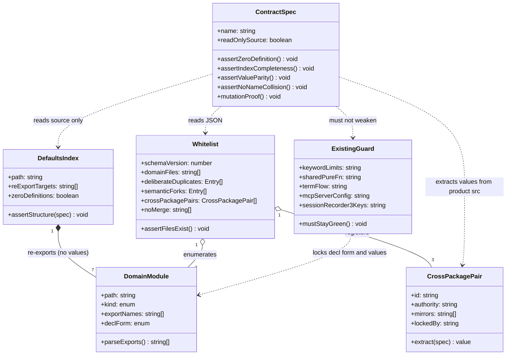
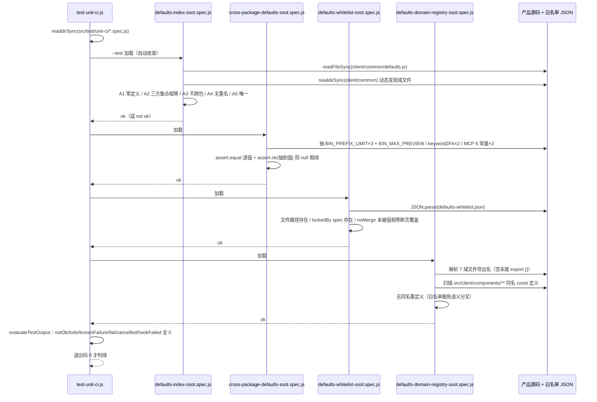
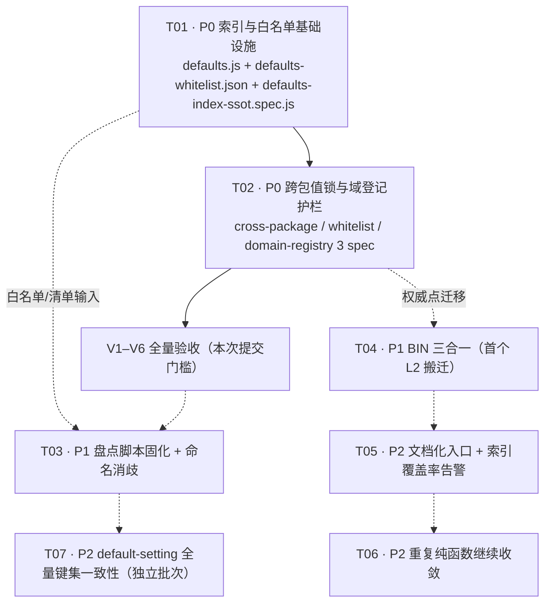

# 分析 - 全项目默认值与固定值 SSOT 化可优化点 - 2026-11-14

> **状态：待实施（工程师按本文档 T01/T02 落地）**。本文承载用户原始需求「先按建议分析出全项目可以优化的点和实施方案，落文档后，然后再按分析后的实施」的**前半程**：全项目可优化点总清单 + 实施方案 + 有序任务分解。
> **基线**：`master @ 9f2019ae`（`git log -1` 确证）。核验时 `git status --porcelain` 有 1 个未跟踪文件 `doc/PRD-全项目默认值与固定值SSOT化-2026-11-14.md`（PM 前序产出，**非本批次产物**）；提交树本身干净。
> **纪律**：本文只做源码核验、分析与方案设计，**不改任何源码、不创建 `common/defaults.js`、不跑测试、不提交**。所有「现状 / 已实现」结论均回源码核验并给 `file:line`（AGENTS.md §5.2.1）。
> **引用约定**：文中 `§x.y` 一律指仓库根 `AGENTS.md` 章节；本文自身章节写作「本文 1.1」「本文『二、』」等明示形式。
> **上游输入**：增量 PRD [`doc/PRD-全项目默认值与固定值SSOT化-2026-11-14.md`](./PRD-全项目默认值与固定值SSOT化-2026-11-14.md)（219 行，需求池 P0 6 条 / P1 4 条 / P2 3 条，Q1–Q7 待确认）；上一轮三层收敛建议（L1 跨包值 / L2 域级 SSOT / L3 单一索引），用户已回复「按建议落地实施」。
> **范围边界**：本批次实施范围 = PRD 锁定的「默认值 / 固定值三层收敛」；不承载七维度全量重构、竞品分析（PRD 已声明按简单 PRD 处理）。

---

## 结论摘要

1. **三层方向成立，但「已有 6 个域级 SSOT」不成立**。按「域内单点且无跨包副本」的窄口径，真正的域单点只有 `src/client/common/keyword-limits.js`（53 行）与 `src/client/common/db-session-const.js`（293 行）**2 个**；其余须按「跨包双份 / 聚合层 / ESM 镜像 / 组件内散落 / 契约覆盖缺口」分别定义，不能混为一谈（PM 修正，本文 2.0 复核）。
2. **常量计数绝对值不可复现，已固定口径 S 并实测**：四套口径得 838 / 1040 / 1138 / 1029 个定义行，文件数 234 / 284 / 256 / 251，上限类 328 / 254 / 257 / 310。**只有量级与「三大热点集合」稳定**（`client/common` · `client/components` · `app/lib`），绝对值不得作为验收判据（本文 1.1–1.5）。
3. **本批次最实质的漂移风险不是 `default-setting` 键集，而是「必须相等却无锁」的跨包同值**：`BIN_PREFIX_LIMIT = 4096` 在 app 侧 3 份（`mysql.js:247` / `postgres.js:411` / `sqlite.js:222`）与 client 侧 `BIN_MAX_PREVIEW = 4096`（`value-renderers/index.js:33`）共 4 处，`value-renderers/index.js:91` 注释直接引用 app 侧常量名；`keyword2FA` 默认串在 `config-default.js:25` 与 `default-setting.js:37` 双份；MCP 6 个镜像常量只有行为矩阵间接锁、无逐值锁。**三者都无契约锁**，是 P0 补锁的首选（本文 2.1 / 4.1）。
4. **L1 目前只有 term-flow 一对做到完整闭环**（JSON 单点 + CJS `require` + ESM 镜像 + 逐值 spec，`term-flow-contract.spec.js:21-40`）；MCP 对是「部分镜像 + 行为矩阵」，`default-setting` 对是「仅 3 个键正则双锁」（`session-recorder.spec.js:363-376`）—— 全项目一致性覆盖呈**点状而非面状**。
5. **L3 索引落在 `src/client/common/defaults.js`**，只对同包 7 个域文件做纯 re-export；核验得 7 文件共 209 个导出、**零重名**，`export *` 无静默丢名风险；因 `constants.js:9` 顶层读 `window` 且 import PNG，契约 spec **只读源码字符串、绝不 `import` 索引**（本文 4.3 / 6.3）。
6. **P0 只做「新增 1 个索引 + 1 个可机读白名单 + 3 个契约 spec + 本文档」，零产品源码改动**，一次提交可完成；所有需要动产品源码的搬迁（组件内 40+ 上限常量、BIN 三合一、两份 `default-setting` 全量键集）全部列为 P1/P2 独立批次（本文『五、』）。
7. **对 PRD Q1–Q7 逐条给了「采纳 / 调整 + 理由」**（本文 4.4）；其中 Q5 调整为「不硬合，但纳入索引的纯 re-export 与白名单登记」，Q2 调整为「索引收全部 7 个符合发现规则的域文件」，两处调整均不违反 N1/N2。

### 目录

1. [盘点口径与可重跑方法](#1-盘点口径与可重跑方法)
2. [全项目可优化点总清单](#2-全项目可优化点总清单)
3. [白名单（可机读）](#3-白名单可机读)
4. [实施方案（L1 / L2 / L3）](#4-实施方案l1--l2--l3)
5. [有序任务分解](#5-有序任务分解)
6. [风险与回退](#6-风险与回退)
7. [验收标准与七维度取舍](#7-验收标准与七维度取舍)
8. [附：源码核验索引](#8-附源码核验索引)

---

## 1. 盘点口径与可重跑方法

### 1.1 为什么绝对值不作判据（四套口径对照，均为实测）

| 口径 | 定义行正则要点 | 命中数 | 文件数 | 上限类 | 前三大热点目录 |
| --- | --- | --- | --- | --- | --- |
| lead 原始盘点（`/tmp/electerm-constants-inventory.txt`:1-12） | 全仓具名常量定义（含对象） | **838** | 234 | 328 | client/common 260 · client/components 200 · app/lib 196 |
| PRD 口径 A（`doc/PRD...md`:61） | 行首 `const`/`export const`/`exports.NAME` + 字面量 | 1040 | 284 | 254 | client/common 288 · client/components 277 · app/lib 232 |
| PRD 口径 B（`doc/PRD...md`:61） | 仅全大写命名 + 对象大写属性 | 1138 | 256 | 257 | client/common 355 · client/components 259 · app/lib 237 |
| **本文口径 S**（1.2 定义，本轮实测） | 全大写具名常量定义行，值为字面量/对象/`Object.freeze` | **1029** | **251** | **310** | **client/common 333 · app/lib 238 · client/components 234** |
| 本文口径 S′（对照，未采用） | 所有 `const NAME = 字面量`（含组件局部） | 2670 | 617 | 302 | client 1897 · app 773（二级目录） |

**结论**：绝对值随「是否含小写具名常量 / 是否含组件局部 / 是否含对象属性」在 **838–2670** 间浮动，文件数 234–617；`app/lib` 与 `client/components` 的先后在口径 S 下发生对调（238 vs 234），与前几轮口径排序不一致。**因此本文只固化一套口径 S 供前后重跑对比，绝对值一律不作验收判据**；稳定的只有：① 数百至两千余个定义行的量级；② 上限/默认类约占 1/4–1/3；③ 三大热点**集合**恒为 `src/client/common` · `src/client/components` · `src/app/lib`。

### 1.2 口径 S 定义（可直接复制重跑）

| 项 | 定义 |
| --- | --- |
| 文件集 | `src/app/**`、`src/client/**` 下所有 `.js` / `.jsx`。目录遍历天然排除 `src/test/`（测试）、`src/build/`（构建）、`work/`（产物）、`node_modules/` |
| 排除规则 | 文件名匹配 `/\.(spec|test)\.js$/` 的排除；只取**行首**（允许前导空白）的声明，不含注释行；不统计对象内部的大写属性（`statusMap` 之类） |
| 常量定义正则 | `^[ \t]*(?:(?:export[ \t]+)?const|(?:module\.)?exports\.)[ \t]*([A-Z][A-Z0-9_]{2,})[ \t]*=[ \t]*(?:-?\d|["'\[{]|true\b|false\b|null\b|Object\.freeze\b)` |
| 上限类正则（对命中名再筛） | `/MAX\|LIMIT\|DEFAULT\|THRESHOLD\|TIMEOUT\|CAP\|MIN\|INTERVAL\|BUDGET/` |
| 统计项 | `TOTAL`（定义行数）、`FILES`（命中文件数）、`UPPER_CLASS`（上限类行数）、`BY DIR`（按 `src/<包>/<目录>` 三级聚合 `TOTAL`） |
| 用途 | 仅用于「同口径前后对比 / 热点集合排序 / 生成 P1 清单输入」；**不作任何验收判据**，重跑允许小幅浮动 |

### 1.3 可重跑命令（只读，不落盘、不产生临时文件，符合 §1-3）

在仓库根执行：

```bash
node <<'NODE'
const fs = require('fs')
const path = require('path')
const ROOT = process.cwd()
const RE = /^[ \t]*(?:(?:export[ \t]+)?const|(?:module\.)?exports\.)[ \t]*([A-Z][A-Z0-9_]{2,})[ \t]*=[ \t]*(?:-?\d|["'\[{]|true\b|false\b|null\b|Object\.freeze\b)/
const UPPER = /MAX|LIMIT|DEFAULT|THRESHOLD|TIMEOUT|CAP|MIN|INTERVAL|BUDGET/
const files = []
const walk = d => {
  for (const e of fs.readdirSync(d, { withFileTypes: true })) {
    const q = path.join(d, e.name)
    if (e.isDirectory()) walk(q)
    else if (/\.(js|jsx)$/.test(q) && !/\.(spec|test)\.js$/.test(q)) files.push(q)
  }
}
;['src/app', 'src/client'].forEach(d => walk(path.join(ROOT, d)))
let total = 0, upper = 0
const hitFiles = new Set(), byDir = {}
for (const f of files) {
  const rel = path.relative(ROOT, f)
  fs.readFileSync(f, 'utf8').split('\n').forEach(line => {
    const m = line.match(RE)
    if (!m) return
    total++
    hitFiles.add(rel)
    if (UPPER.test(m[1])) upper++
    const key = rel.split(path.sep).slice(0, 3).join('/')
    byDir[key] = (byDir[key] || 0) + 1
  })
}
console.log('TOTAL', total, 'FILES', hitFiles.size, 'UPPER_CLASS', upper)
console.log('--- BY DIR ---')
Object.entries(byDir).sort((a, b) => b[1] - a[1]).slice(0, 12)
  .forEach(([k, v]) => console.log(v, k))
NODE
```

快速交叉核对（只需热点排序时）：

```bash
rg -c --no-heading '^[ \t]*(?:export[ \t]+)?const[ \t]+[A-Z][A-Z0-9_]{2,}[ \t]*=' \
  src/client/common src/client/components src/app/lib | wc -l
```

> 说明：`/tmp/electerm-constants-inventory.txt`（374 行，含 `--- UPPER CLASS ENTRIES (name | value | file) ---` 逐条清单，`:46-374`）是 lead 原始盘点素材，可作 P1-1 清单输入，**但口径与 S 不同，不得直接混用**。

### 1.4 本轮按口径 S 的复现结果（基线 `9f2019ae`，2026-11-14）

| 目录 | 定义行数 | 占比 | 说明 |
| --- | --- | --- | --- |
| `src/client/common` | 333 | 32.4% | 第一热点：`constants.js`（148 导出）、`db-session-const.js`（44 导出）、`db-sql-*`、`keyword-*` |
| `src/app/lib` | 238 | 23.1% | 第二热点（本口径下反超 components）：`db-client/{mysql,postgres,redis,sqlite}.js` 的上限族 |
| `src/client/components` | 234 | 22.7% | 第三热点：AI / database / remote-monitor 组件内局部上限常量 |
| `src/app/server` | 69 | 6.7% | xterm / RDP / 会话 |
| `src/app/common` | 56 | 5.4% | `vault-crypto.js` / `ssh-keygen.js` / `default-setting.js` |
| `src/app/mcp` | 48 | 4.7% | `config-validate.js` 15 常量等 |
| `src/app/widgets` | 46 | 4.5% | widget 协议 |
| `src/client/store` | 5 | 0.5% | 少量 |
| **合计** | **1029 / 251 文件 / 310 上限类** | — | 三大热点合计 **805 行（78.2%）** |

### 1.5 量级结论（写入验收口径）

> 全项目有**数百至两千余个**命名常量/固定值定义行，分布在**约 250 个**产品源码文件；其中**上限/默认类约 300 条（约占 1/3）**；**约 78% 集中在 `client/common` + `app/lib` + `client/components` 三个目录**。绝对值与目录先后随口径浮动，**不作验收判据**；实施前后按 1.3 命令同口径重跑，只需确认「无新增未登记域文件」与「热点集合不变」。

---

## 2. 全项目可优化点总清单

### 2.0 分类法（六类，互不重叠）

| 类 | 判定标准 | 本批次处置 |
| --- | --- | --- |
| A 真域单点 | 单模块定义一组域值，被 ≥2 个同包消费点引用，无跨包副本 | 纳入 L3 索引；既有契约锁不得退化 |
| B 跨包双份 | ESM 与 CJS 两侧各有一份物理副本（内容可同可不同） | 不硬合（N3/N4）；登记 + 补 L1 契约锁 |
| C 聚合层 | 由 `...defaultSettings` 展开叠加，不是定义源 | 不收进 L2；文档登记 |
| D ESM 镜像 | ESM 侧硬编码镜像 app 侧 JSON/CJS 权威点 | 作为 L1 参照模式；已有锁则保持 |
| E 组件内散落 | 上限/默认字面量定义在组件文件内 | 本批次只登记 + 护栏；搬迁列 P1 |
| F 契约覆盖缺口 | 跨包同值/镜像存在但无逐值一致性锁 | **P0 补锁**（本批次主要工作） |

> 「真域单点 2 个」（PM 窄口径）与「L3 索引域文件 7 个」（本文 1.2 发现规则宽口径）**是口径差异不是矛盾**：前者要求「无跨包副本」，后者只要求「单一模块承载一组域值」。本文 4.3 的 7 文件清单已逐个标注性质。

### 2.1 总清单（逐条 `file:line` / 现状 / 可优化点 / 收益 / 风险 / 归类 / 优先级 / 本批次）

| ID | 现状（源码证据） | 可优化点 | 收益 | 风险 | 归类 | 优先级 | 本批次 |
| --- | --- | --- | --- | --- | --- | --- | --- |
| O01 | `src/client/common/keyword-limits.js:13-29` `HIGHLIGHT_LIMITS` 冻结 8 值，`:38-52` `resolveHighlightOptions`；`keyword-limits-ssot.spec.js:17-27` 逐值锁、`:59-74` 扫 3 个消费文件 | 保持；作为 L2 样板，索引 re-export | 已闭环，零回归基线 | 改取值/声明形式即红（`shared-pure-fn-ssot.spec.js:103-109`） | A | P0 | ✅ 索引收录 |
| O02 | `src/client/common/db-session-const.js:22-36` 分页上限、`:247-292` 末尾集中 `export { 44 项 }`；`:13-15` 注释明确「行首 `const NAME =` 不带 export 前缀」为 `db-page-tree-filter.spec.js:79` 行首正则抽取所依赖 | 保持声明形式（N5）；索引 re-export | 已闭环 | 改 `export const` / 挪走即红（`db-page-tree-filter.spec.js:79-86`） | A | P0 | ✅ 索引收录 |
| O03 | `src/app/common/constants.js:5-58`（58 行 CJS：`userConfigId` / `serverManagedConfigKeys` / `instSftpKeys`）↔ `src/client/common/constants.js:9-49`（539 行 ESM：148 导出 UI 尺寸/主题/标志）**同名不同内容** | 不硬合；登记清单 + 白名单；client 侧纳入索引 | 消除「同名即同源」误判 | 硬合会改 config key 与 UI 常量结构（违反 N1/N2） | B | P0 | ✅ 登记（不改动） |
| O04 | `src/app/common/default-setting.js:5-124`（77 键）↔ `src/client/common/default-setting.js:7-115`（82 键）；逐键核验：**共有 73 键**、app 独有 4（`authHeaderNameAI` / `supportsImageAI` / `mcpServersAI` / `sessionBarInfoVisible`，见 `src/app/common/default-setting.js:81/:85/:89/:97`）、client 独有 9（`terminalBackgroundText` / `terminalBackgroundTextSize` / `terminalBackgroundTextColor` / `terminalBackgroundTextFontFamily`（`:30-33`）、`keyword2FA`（`:37`）、`sftpPathFollowSsh`（`:51`）、`autoReconnectTerminal`（`:96`）、`disableTabIndex`（`:103`）、`autoCloseEmptyPane`（`:108`）） | 不硬合；登记全量键集差异清单 + 白名单；client 侧纳入索引 | 明确「两份不是同一 SSOT 镜像」 | 硬合改配置结构与产品行为（N1/N2/Q5） | B | P0 | ✅ 登记（不改动） |
| O05 | `src/test/unit-ci/session-recorder.spec.js:363-376` 只用正则各锁 `recordInput`/`recordStripOsc`/`recordAvoidPassword` **3 个键**双处定义；**:368-369 无全量键集一致性锁**（PRD 指出的最实质漂移风险点） | 后续独立批次：全量 73 共有键的「键存在 + 取值相等」契约锁；本批次只登记 | 堵住 70 个键的静默漂移 | 直接加全量值锁可能因 app/client 独有键与历史差异变红，需先评审 | F | P0 | ⚠️ 仅登记（路线见 T07） |
| O06 | `src/app/common/config-default.js:1` `require('./default-setting')`、`:13` `...defaultSettings` 展开，`:4-12`/`:14-27` 自带 13 键（含 `keepaliveInterval: 10000`、`:25` `keyword2FA`） | 识别为聚合层，不收进 L2；文档登记 | 避免把聚合层误当域单点硬合 | 误收会改默认配置合并顺序 | C | P0 | ✅ 登记（不改动） |
| O07 | `src/app/common/term-flow-protocol.json:1-12`（JSON 单点）+ `src/app/common/term-flow-control.js:9-10`（CJS `require` JSON）↔ `src/client/common/term-flow.js:12-22`（ESM 硬编码镜像）；`term-flow-contract.spec.js:11-19` 正则抽 `literal`/`number`、`:21-40` 逐值 + `deepEqual(ctrl.limits, protocol.limits)` | 保持，作为 L1 唯一完整参照模式；ESM 镜像纳入索引 | 已有闭环 | 改任一镜像值即红 | D | P0 | ✅ 索引收录 |
| O08 | `src/client/common/mcp-server-form-validate.js:17-23`（6 常量）、`:200-207` 末尾 `export {}` ↔ `src/app/mcp/client/config-validate.js:17-27`（15 常量，其中 9 个不镜像：`MAX_SERVERS`/`DEFAULT_TIMEOUT_MS`/`MAX_ARGS`/`MAX_ARG_LENGTH`/`MAX_CWD_LENGTH`/`MAX_HEADER_VALUE_LENGTH`/`ENV_BLACKLIST`/`ID_PATTERN`/`ENV_KEY_PATTERN`）；`mcp-server-config.spec.js:72-101` 是**行为矩阵**逐字段对照，**无 6 常量逐值锁** | 补 6 常量逐值 `deepEqual` 契约锁（P0）；白名单标注「部分镜像，不要求全量对齐」 | 让「改一侧即红」从行为层下沉到取值层 | 不得要求 CJS 侧 9 个不镜像常量对齐（会误红） | B+F | P0 | ✅ 补锁 |
| O09 | `BIN_PREFIX_LIMIT = 4096`：`src/app/lib/db-client/mysql.js:247`、`postgres.js:411`、`sqlite.js:222`（**app 侧 3 份**）↔ `src/client/components/database/value-renderers/index.js:33` `BIN_MAX_PREVIEW = 4096`、`index.js:91` 注释「信封已截断到 `BIN_PREFIX_LIMIT`」；**共 4 处同值、4 处都无一致性锁** | 补跨包逐值锁（L1 P0）；app 侧三合一收口列 P1-T04 | 堵住「信封截断与预览截断错开 → 二进制预览错位」 | 收口需改 3 个 DB 适配器的 require 链，故不在 P0 做 | E+F | P0 | ✅ 补锁（收口 P1） |
| O10 | `keyword2FA` 默认串：`src/app/common/config-default.js:25` ↔ `src/client/common/default-setting.js:37` **同值长字符串双份**；`session-ssh-mfa.spec.js:499-574` 只测自定义/空值行为，不锁默认值一致 | 补跨包字符串逐值锁（L1 P0） | 堵住 2FA 关键词表一侧漏改 | 无（纯新增 spec） | B+F | P0 | ✅ 补锁 |
| O11 | `leftSideBarIcons`：`src/app/common/default-setting.js:115-123` 硬编码 7 项（含 `auditCenter`、**不含 `newBookmark`**，`:110-114` 注释「本文件是 CommonJS，无法直接 import 客户端的 `left-sidebar-icon-defs.js`」「默认隐藏 newBookmark」）↔ `src/client/common/left-sidebar-icon-defs.js:11-23` `defaultLeftSideBarIcons` **8 项**（含 `newBookmark`，顺序也不同）、`:30-38` `legacyDefaultLeftSideBarIcons` 7 项用于迁移判定 | 登记为「跨包双份 + 值刻意不同 + 无锁」白名单；**禁止**套用任何「全量值相等」断言 | 防止后续批次误合并导致存量用户图标迁移失效 | 值不同是刻意设计，任何自动对齐都会改产品行为（N1） | B | P0 | ✅ 白名单登记 |
| O12 | `src/client/common/sync-payload-limit.js:18` `maxSyncPayloadKb = 280`、`:4-7` 注释「与 `electerm-cloud/src/server/control/sync-limits.ts` 保持同步，客户端刻意自带副本」；`sync-payload-limit.spec.js:65` 只自锁 280 | 登记为「跨仓刻意副本」，白名单；本仓内不做跨仓锁 | 明确边界，避免误判为漏锁 | 跨仓，超出本仓契约范围 | B | P1 | ⚠️ 登记 |
| O13 | 组件内散落上限常量（口径 S 采样 40 条，见 2.3），例：`ai/agent.js:20` `MAX_ITERATIONS=150`、`ai/ai-chat.jsx:77` `MAX_HISTORY=500` vs `ai/ai-history.jsx:10` `MAX_HISTORY=20`、`remote-monitor/monitor-details.jsx:126` `DEFAULT_MAX_ROWS=10` vs `app/lib/db-client/insert-batch.js:76` `DEFAULT_MAX_ROWS=500` | 建立可机读「组件本地上限」基线 + 「域单点导出名不得在组件重定义」护栏（P0）；实际搬迁/消歧列 P1-T03/T04 | 让新增重复定义即红，且暴露同名不同值 | 40+ 条中大量是单消费点 UI 微调或语义分叉，逐一搬迁需产品语义判断 | E | P0(护栏)/P1(搬迁) | ✅ 护栏；❌ 不搬迁 |
| O14 | 全仓「同名不同值」无检测：口径 S 采样见 2.4（`MAX` 300/500、`ENC_PREFIX` `'enc:'`/`'enc1:'`、`SQL_READONLY_RE`/`SQL_WRITE_RE` 3 份、`MAX_PORT` 65535/65534 等）；上一轮仅靠 `shared-pure-fn-ssot.spec.js:79-85` 消歧 `MAX_WATCHER_COMMAND_LENGTH` 一对 | P1-T03 新增全仓同名导出常量检测 spec（白名单豁免 re-export / 别名 / 语义分叉） | 延续 P1-2 命名消歧 | 直接全仓断言会命中大量 re-export 与方言分叉，必须先建白名单 | F | P1 | ❌ |
| O15 | `src/client/common/defaults.js` / `src/app/common/defaults.js` **均不存在**（`Glob src/**/defaults.js` = No files found）；全仓无「查默认值去哪看」的唯一入口 | 新建 client 侧唯一索引（L3 P0） | G1 可发现性 | 索引不得跨包 re-export（`client→app import = 0`，见 4.0） | F | P0 | ✅ 新建 |
| O16 | 既有契约锁清单：`keyword-limits-ssot.spec.js` / `shared-pure-fn-ssot.spec.js` / `term-flow-contract.spec.js` / `mcp-server-config.spec.js` / `build-version-sync.spec.js` / `modal-scroll-unified.spec.js` / `db-page-tree-filter.spec.js` / `session-recorder.spec.js` / `ai-presets.spec.js` / `mcp-config-disk-form.spec.js`（PRD 5.4 表，本文逐项复核存在） | 本批次不得让任一变红或失去约束力（P0-6）；新增 spec 不得放宽既有断言 | 零回归 | 放宽断言 / 加白名单例外即视为违规 | F | P0 | ✅ 复核 |
| O17 | `src/build/bin/test-unit-ci.js:64-86` `evaluateTestOutput` 的 `green` 要求 `notOkCount===0 && knownFailureCount===0 && todo===0 && fail===0 && cancelled===0 && !hookFailed`；`:91-94` 自动收录 `src/test/unit-ci/*.spec.js`；`:113` 补非零退出码 | 新增 spec 直接放该目录即自动纳入 V2；验收判据按四者同时成立（PRD V2） | 避免「`# fail 0` 假绿」 | 只看 `# fail 0` 会漏 `hookFailed` / suite 级失败 | F | P0 | ✅ 落实 |
| O18 | `src/test/unit-ci/db-migrate.spec.js:63-65, 121` 断言 `migrate/db-defaults.js` / `.json` **不存在** | 新增文件**不得**命名为 `db-defaults.js`（会直接变红）；本方案命名 `defaults.js` | 规避命名冲突 | 命名冲突会让既有 spec 红 | F | P0 | ✅ 规避 |

### 2.2 与交接事实 / PRD 的差异（源码复核后明确指出）

| # | 交接 / PRD 结论 | 本文核验结果 | 处置 |
| --- | --- | --- | --- |
| D1 | 「工作树干净」 | `git status --porcelain` 有 1 个未跟踪文件 `doc/PRD-...md`（PM 前序产出），提交树 `9f2019ae` 本身干净 | 仅登记，非不符；V6 复核需 `git add -N` 才能把未跟踪文件纳入 `git diff --stat` |
| D2 | PRD 5.3「`maskSqlLiterals` 定义只在 client 侧 2 份，app 侧 mysql/postgres 只是引用方」（`PRD:65`） | **精确化**：app 侧确无名为 `maskSqlLiterals` 的定义，但 `mysql.js:1365` 与 `postgres.js:1154` 各有 1 份内联 `maskSqlText`，`mysql.js:1360-1361` / `postgres.js:1152-1153` 注释明写「与 `db-sql-complete.maskSqlLiterals` 同思路的极简版」「两适配器各自内联，避免互相依赖」。连同 `db-sql-complete.js:35` / `db-sql-risk.js:334`，**同思路词法掩码共 4 份** | 白名单必须同时收录 `maskSqlText` 两份，否则后续批次会误收口；PRD 结论在「同名定义」层面仍成立 |
| D3 | PRD 未登记 `leftSideBarIcons` 跨包对 | 见 O11：两侧**值不同且刻意**（7 vs 8 项），app 侧注释解释不能 import | 新增白名单条目（本文 3.2），并明确**禁止**对它套用「全量键集/值相等」锁 |
| D4 | PRD 未登记 `BIN_PREFIX_LIMIT` | 见 O09：app 侧 **3 份**（非 2 份）+ client 侧 1 份，共 4 处同值、互相注释引用、全无锁 | 提升为 P0 首个 L1 补锁对象 |
| D5 | PRD 口径 A/B 热点排序 `client/common > client/components > app/lib`（`PRD:61`） | 口径 S 实测 `client/common 333 > app/lib 238 > client/components 234`，后两者对调 | 只保留「三大热点集合」结论，排序不作为判据 |
| D6 | 「L2 已有 6 个域级 SSOT」 | 复核实为 2 个真域单点（O01/O02）+ 聚合层 1（O06）+ 镜像 1（O07）+ 跨包双份 2 对（O03/O04）；本文宽口径索引清单为 7 文件 | 按 2.0 六类分别定义 |
| D7 | 契约 spec 里 `value-renderers.spec.js:19-20` strip import 后注入 SSOT 的坑 | 复核：`.replace(/^import\s.*$/gm, '')` + `.replace(/^export\s+/gm, '')`，`:10` 注入真实 `isBinEnvelopeSSOT`；`db-page-tree-filter.spec.js:79-86` 另用 `^const NAME = .+$` 抽 `db-session-const.js` 函数体 | P0 不改任何既有域文件声明形式（N5），索引 re-export 不影响这两个 spec |

### 2.3 组件内散落上限常量（口径 S 采样，P1 输入）

> 以下均为 `src/client/components/**` 内的**模块级定义**，本批次**不搬迁**，只作为基线登记与「域单点导出名不得在组件重定义」护栏的输入。完整清单由 1.3 命令重跑生成。

| 文件:行 | 常量 = 值 | 备注 |
| --- | --- | --- |
| `ai/agent.js:20` | `MAX_ITERATIONS = 150` | 单消费点 |
| `ai/ai-attachments.js:7-8` | `MAX_ATTACHMENT_FILE_SIZE = 50*1024` / `MAX_ATTACHMENT_TOTAL_SIZE = 100*1024` | 成对策略值 |
| `ai/ai-chat.jsx:77` vs `ai/ai-history.jsx:10` | `MAX_HISTORY = 500` **vs** `= 20` | **同名不同值，语义分叉**（对话历史上限 vs 列表显示条数），禁止硬合 |
| `ai/ai-context.js:39` | `DEFAULT_CONTEXT_WINDOW = 128000` | 模型上下文窗口 |
| `ai/ai-image-attachments.js:15-27` | `MAX_IMAGE_INPUT_BYTES` / `MAX_IMAGE_BYTES` / `MAX_IMAGES_PER_MESSAGE=4` / `MAX_SESSION_IMAGE_BYTES` / `MAX_IMAGE_EDGE=1568` | 5 个一组，域内已集中 |
| `ai/ai-image-cache.js:14` | `DEFAULT_IMAGE_CACHE_BUDGET = 20*1024*1024` | — |
| `database/db-er-view.jsx:23-28` | `ZOOM_MIN=0.2` / `ZOOM_MAX=3` / `DRAG_THRESHOLD=3` / `LABEL_MAX=30` | UI 微调，模块私有 |
| `database/db-import-statements.jsx:16` | `MAX_SHOWN = 200` | — |
| `database/db-row-detail-utils.js:6` | `ROW_DETAIL_INLINE_MAX = 500` | — |
| `database/db-split-pane.jsx:12-13` | `MIN_PCT=15` / `MAX_PCT=85` | — |
| `database/db-sql-editor.jsx:64-65,114` | `MIN_HEIGHT=96` / `MAX_HEIGHT=260` / `MAX_OPTIONS=50` | — |
| `database/use-db-redis-console.js:31` | `HISTORY_MAX = 50` | — |
| `database/value-renderers/index.js:33` | `BIN_MAX_PREVIEW = 4096` | **跨包同值（O09），P0 补锁** |
| `layout/split-ratios.js:11` | `MIN_PANE_PX = 80` | — |
| `remote-monitor/custom-watcher-pool.js:18-20` | `MIN_TIMEOUT_MS=5000` / `MAX_TIMEOUT_MS=60000` / `MAX_BACKOFF_MS=60000` | 与 MCP `TIMEOUT_MIN_MS=5000` / `TIMEOUT_MAX_MS=300000`（`config-validate.js:20-21`）**取值不同、概念不同**，禁硬合 |
| `remote-monitor/monitor-details.jsx:126` | `DEFAULT_MAX_ROWS = 10` | 与 `app/lib/db-client/insert-batch.js:76` `DEFAULT_MAX_ROWS = 500` **同名不同值** |
| `remote-monitor/monitor-model.js:20,87` | `DEFAULT_REMOTE_MONITOR_ITEMS` / `REMOTE_MONITOR_INTERVALS` | `Object.freeze` 表 |
| `sftp/dir-mirror-modal.jsx:43` | `PLAN_LIMIT = 500` | — |
| `terminal/attach-addon-custom.js:31` | `DSR_REPLY_TIMEOUT = 1000` | — |
| `terminal/mixins/term-touch.js:56` | `DEFAULT_WORD_SEPARATOR` | 与 `src/app/common/default-setting.js:38` / `src/client/common/default-setting.js:45` 的 `terminalWordSeparator` **三份完全同值**（已逐字核验）；`term-touch.js:354` 以 `\|\| DEFAULT_WORD_SEPARATOR` 兜底 → P1 L2 候选，本批次只登记 |

### 2.4 同名不同值候选（P1-2 输入，口径 S 采样）

| 名字 | 不同取值 | 判定 |
| --- | --- | --- |
| `MAX_HISTORY` | 500 / 20 | 语义分叉（2.3） |
| `DEFAULT_MAX_ROWS` | 500 / 10 | 语义分叉（app 批量插入 vs UI 显示） |
| `DEFAULT_MAX_BYTES` | `1024*1024` / `64*1024` | 语义分叉 |
| `MAX_PORT` | 65535 / 65534 | 需评审（可能是边界口径差异） |
| `ENC_PREFIX` | `'enc:'` / `'enc1:'` / 别名引用 | 加密格式版本差异 + re-export 误判 |
| `MAX` | 300 / 500 / 第三份 | 命名过泛，P1 消歧候选 |
| `SQL_READONLY_RE` / `SQL_WRITE_RE` | 各 3 份 | 多引擎方言口径，**禁硬合**（白名单） |
| `FORMAT_OPENAI_CHAT` 等 | 字面量 / 同名标识符 | **re-export / 别名引用造成的口径误判**，P1 spec 必须先剔除这类假阳性 |
| `DANGEROUS_SESSION_FIELDS` | `require('./...')` / `require('../common/...')` | 引用路径差异，非取值差异 |

> **口径局限声明**：2.4 由「行首正则抽 `= 右侧文本`」生成，`FORMATS` / `SAFE_PREFIX` 一类会把「定义 + re-export + 别名引用」误判为同名不同值。它是 **P1-2 的候选输入，不是结论**；任何自动断言必须先按 3.2 白名单豁免 re-export / 别名 / 方言分叉。

---

## 3. 白名单（可机读）

### 3.1 四类定义与判定理由

| 类 | 判定理由 | 为什么不动 |
| --- | --- | --- |
| W1 刻意双份（已有契约锁） | ESM/CJS 物理隔离，`client→app import = 0`（`src/client` 全量扫描实测 0 处，本文 4.0），跨包值至少两份副本（PRD 5.1 / N3） | 硬合会打破包边界与 vite 打包链；已有锁逐项对照即足够 |
| W2 语义分叉 | 同名但方言口径 / 返回类型 / 终端-UI 分流 / 同名不同值 | 合并会丢方言正确性或改产品行为（N4） |
| W3 跨包双份（本批次不硬合） | 两份内容不同、职责不同、或值刻意不同 | 硬合改配置结构与产品行为（N1/N2/Q5）；仅登记 + 视情况补一致性锁 |
| W4 模块私有细节 | 单消费点、非跨包、非策略值的 UI 微调常量 | 收进域文件是无收益的搬运，反而扩大索引面（§5.1 SRP） |

### 3.2 白名单清单（可机读 JSON 的数据来源）

| # | 类 | 文件 / 对 | 既有契约锁 | 判定理由（源码证据） |
| --- | --- | --- | --- | --- |
| W1-1 | W1 | `src/client/common/mcp-server-form-validate.js` ↔ `src/app/mcp/client/config-validate.js` | `mcp-server-config.spec.js:72-101`（T05-01 行为矩阵） | `mcp-server-form-validate.js:6-7` 注释「仓库没有 renderer→app 的 import 先例，不赌打包配置」；**部分镜像**：ESM 侧 6 常量（`:18-23`、`:200-207`）vs CJS 侧 15 常量（`:17-27`），不要求全量对齐 |
| W1-2 | W1 | `src/app/common/term-flow-protocol.json` + `term-flow-control.js` ↔ `src/client/common/term-flow.js` | `term-flow-contract.spec.js:21-40` | `term-flow.js:4-6` 注释「常量值由 JSON 单点定义，本文件是 ESM 镜像，逐字一致性由 spec 锁定」；同时是 L1 参照模式 |
| W1-3 | W1 | `src/client/common/sync-payload-limit.js` | `sync-payload-limit.spec.js:65` 自锁 | `:4-7` 注释「与云端 `sync-limits.ts` 保持同步，客户端刻意自带副本，需在首次通信前告警」；跨仓副本不属于本仓契约范围 |
| W2-1 | W2 | `quoteIdent` **5 份**：`src/app/lib/db-client/mysql.js:530`、`postgres.js:155`、`sqlite.js:189`（方言内置、单参数）、`src/client/common/db-sql-snippets.js:24`、`db-ddl-generate.js:46`（带 `dialect` 参数） | 无（不需要） | 反引号 / 双引号 / 方括号方言不同；`sqlite.js:1207` 仅为导出点；合并丢方言正确性 |
| W2-2 | W2 | `maskSqlLiterals` 2 份：`src/client/common/db-sql-complete.js:35`（返回 `{masked, literals}`、`db-sql-complete.js:616` 解构）、`src/client/common/db-sql-risk.js:334`（返回 `scanSql(sql, dialect, false)`） | `db-sql-complete.spec.js:55-122` 行为锁 | 返回类型 / 结构不同 |
| W2-3 | W2 | `maskSqlText` 2 份（D2 补充）：`src/app/lib/db-client/mysql.js:1365`、`postgres.js:1154` | 无 | `mysql.js:1360-1361` / `postgres.js:1152-1153` 注释「与 `db-sql-complete.maskSqlLiterals` 同思路的极简版，两适配器各自内联，避免互相依赖」；名字不同、返回 masked 字符串而非对象 |
| W2-4 | W2 | `convertTheme` 2 份：`src/client/common/terminal-theme.js:95`、`src/client/common/ui-theme.js:39` | 无 | 终端主题 / UI 主题分流；`theme-form.jsx:177` 同时消费两路结果 |
| W2-5 | W2 | `MAX_HISTORY`（`ai-chat.jsx:77` 500 / `ai-history.jsx:10` 20）、`DEFAULT_MAX_ROWS`（`insert-batch.js:76` 500 / `monitor-details.jsx:126` 10）、`SQL_READONLY_RE` / `SQL_WRITE_RE` 各 3 份、`ENC_PREFIX` 3 份、`MAX_PORT` 2 份 | 无 | 同名不同值 / 方言正则口径；合并改行为 |
| W2-6 | W2 | `src/client/common/left-sidebar-icon-defs.js:30-38` `legacyDefaultLeftSideBarIcons` | 无 | `:25-29` 注释「存量用户迁移判定用，一旦把 `auditCenter` 加进来，normalize 旧默认判定恒不成立」；**禁止改动** |
| W3-1 | W3 | `src/app/common/default-setting.js` ↔ `src/client/common/default-setting.js`（73/4/9） | `session-recorder.spec.js:363-376`（3 键）、`ai-presets.spec.js`、`mcp-config-disk-form.spec.js` | 同名不同内容、非同一 SSOT 镜像（O04/O05）；PRD Q5 不收 |
| W3-2 | W3 | `src/app/common/constants.js` ↔ `src/client/common/constants.js` | `build-version-sync.spec.js` 等间接引用 | 58 行 config key 列表 vs 539 行 UI 尺寸常量（O03） |
| W3-3 | W3 | `leftSideBarIcons`（`app/common/default-setting.js:115-123` ↔ `client/common/left-sidebar-icon-defs.js:11-23`） | 无 | **值刻意不同**（O11 / D3）；`app/common/default-setting.js:110-114` 注释明确不能跨包 import。**禁止套用任何「值相等」断言** |
| W3-4 | W3 | `src/app/common/config-default.js`（聚合层） | 无 | `...defaultSettings` 展开（`:13`），不是定义源（O06） |
| W3-5 | W3 | `keyword2FA`（`src/app/common/config-default.js:25` ↔ `src/client/common/default-setting.js:37`）；`terminalWordSeparator` 三份（`src/app/common/default-setting.js:38` ↔ `src/client/common/default-setting.js:45` ↔ `src/client/components/terminal/mixins/term-touch.js:56`） | `session-ssh-mfa.spec.js`（仅行为） | `keyword2FA` 同值跨包双份，**本批次补逐值锁**（O10）；`terminalWordSeparator` 三份同值属 fallback 副本，本批次只登记（P1 收口候选）；均不改定义位置 |
| W4-1 | W4 | 2.3 表中除 `BIN_MAX_PREVIEW` 外的组件本地上限常量 | 无 | 单消费点 UI 微调 / 域内已集中；不做 L2 搬迁 |

### 3.3 可机读结构（`src/test/unit-ci/defaults-whitelist.json` schema）

> **关键防假绿设计**：白名单**只存文件路径、判定理由、`lockedBy` spec 文件名，绝不存取值**。取值一律由契约 spec 从**产品源码**用正则抽取后对照；否则「白名单写一个过期值」会与源码漂移而 spec 仍绿。

```json
{
  "schemaVersion": 1,
  "domainFiles": [
    "constants.js", "db-session-const.js", "default-setting.js",
    "keyword-limits.js", "sync-payload-limit.js", "term-flow.js", "theme-defaults.js"
  ],
  "domainFilePattern": "-(const|limits|limit|defaults|protocol)\\.js$|^(constants|default-setting|term-flow|theme-defaults)\\.js$",
  "deliberateDuplicates": [
    { "id": "W1-1", "files": ["src/client/common/mcp-server-form-validate.js", "src/app/mcp/client/config-validate.js"], "lockedBy": "mcp-server-config.spec.js", "reason": "..." },
    { "id": "W1-2", "files": ["src/app/common/term-flow-protocol.json", "src/app/common/term-flow-control.js", "src/client/common/term-flow.js"], "lockedBy": "term-flow-contract.spec.js", "reason": "..." }
  ],
  "semanticForks": [ { "id": "W2-1", "files": ["..."], "reason": "..." } ],
  "crossPackagePairs": [
    { "id": "O09-bin-4096", "authority": "src/app/lib/db-client/mysql.js", "mirrors": ["src/app/lib/db-client/postgres.js", "src/app/lib/db-client/sqlite.js", "src/client/components/database/value-renderers/index.js"], "lockedBy": "cross-package-defaults-ssot.spec.js" },
    { "id": "O10-keyword2FA", "authority": "src/app/common/config-default.js", "mirrors": ["src/client/common/default-setting.js"], "lockedBy": "cross-package-defaults-ssot.spec.js" },
    { "id": "W1-1-mcp-6", "authority": "src/app/mcp/client/config-validate.js", "mirrors": ["src/client/common/mcp-server-form-validate.js"], "lockedBy": "cross-package-defaults-ssot.spec.js" }
  ],
  "noMerge": ["W3-1", "W3-2", "W3-3", "W3-4", "W2-6"],
  "modulePrivateSample": ["...（2.3 表的路径:行，作 P1 基线，不作断言）"]
}
```

契约 spec 对白名单的断言：(a) 每个 `files` 路径存在；(b) `domainFiles` 与索引 re-export 目标集合、与动态发现集合**三方相等**；(c) 每个 `crossPackagePairs` / `deliberateDuplicates` 的 `lockedBy` 指向的 spec 文件存在且位于 `src/test/unit-ci/`；(d) `noMerge` 中的对**不得**出现在任何「值相等」断言里（由 `defaults-whitelist-ssot.spec.js` 反向检查）。

---

## 4. 实施方案（L1 / L2 / L3）

### 4.0 三层与包边界总图

```mermaid
graph LR
  subgraph APP["src/app（CJS 主进程，不建索引）"]
    J["term-flow-protocol.json<br/>JSON 单点"]
    C["term-flow-control.js<br/>require(JSON)"]
    CV["mcp/client/config-validate.js<br/>15 常量（权威）"]
    DS_A["common/default-setting.js<br/>77 键"]
    CD["common/config-default.js<br/>聚合层 ...defaultSettings"]
    DB3["db-client/{mysql,postgres,sqlite}.js<br/>BIN_PREFIX_LIMIT=4096 ×3"]
  end
  subgraph CLIENT["src/client（ESM 渲染层 / vite）"]
    IDX["common/defaults.js<br/>【L3 唯一索引·只 re-export】"]
    K["common/keyword-limits.js<br/>【L2 真域单点】"]
    DSC["common/db-session-const.js<br/>【L2 真域单点】"]
    TF["common/term-flow.js<br/>【L1 ESM 镜像】"]
    FV["common/mcp-server-form-validate.js<br/>6 常量镜像"]
    DS_C["common/default-setting.js<br/>82 键"]
    VR["components/database/value-renderers/index.js<br/>BIN_MAX_PREVIEW=4096"]
  end
  subgraph SPEC["src/test/unit-ci（node:test 契约锁）"]
    S1["defaults-index-ssot.spec.js"]
    S2["cross-package-defaults-ssot.spec.js"]
    S3["defaults-whitelist-ssot.spec.js"]
    S4["defaults-domain-registry-ssot.spec.js"]
    S0["既有 4 锁 + session-recorder 3 键锁"]
  end
  J -->|逐值正则 + deepEqual| TF
  C -->|deepEqual ctrl.limits| J
  CV -->|逐值锁（P0 新增）| FV
  CD -->|keyword2FA 逐值锁（P0 新增）| DS_C
  DB3 -->|BIN 4096 逐值锁（P0 新增）| VR
  IDX -.->|export * 纯 re-export| K
  IDX -.->|export * 纯 re-export| DSC
  IDX -.->|export * 纯 re-export| TF
  IDX -.->|export { default as ... }| DS_C
  S1 -.->|只读源码| IDX
  S2 -.->|只读源码抽值| APP
  S3 -.->|读 JSON| S4
  S0 -.->|既有锁不得退化| CLIENT
  APP -.->|"client→app import = 0（硬边界）"| CLIENT
```

> 硬边界实测：`src/client/**/*.{js,jsx}` 中 `from '<...>app/'` / `require('<...>app/')` 命中 **0 行**（只读 Node 扫描确证，PRD 5.1 结论复核成立）。`mcp-server-form-validate.js:6-7` 亦有同义注释。

### 4.1 L1 跨包值单点：具体做法 / 边界 / 失败模式

| 项 | 内容 |
| --- | --- |
| **做法** | 沿用 `term-flow-protocol.json` 既有形态，**不新造模式**：① 权威点 = app 侧已存在的一份（不新建 JSON，避免改产品源码）；② ESM 侧镜像保持原样；③ 新增 `cross-package-defaults-ssot.spec.js`，用正则从**产品源码**抽值后逐值 `assert.equal` / `deepEqual`；④ 变异自证 = 改任一侧任一值 → 红（PRD P0-1） |
| **P0 覆盖的 3 组** | O09 `BIN_PREFIX_LIMIT`/`BIN_MAX_PREVIEW` 4 处 4096；O10 `keyword2FA` 2 处字符串；W1-1 MCP 6 镜像常量（补既有行为矩阵之外的逐值锁）。term-flow 对已有 `term-flow-contract.spec.js`，本 spec 只以 `lockedBy` 登记、不重复断言 |
| **边界** | 不要求 CJS 侧 9 个不镜像的 MCP 常量对齐；不碰 W3-3 `leftSideBarIcons`（值刻意不同）；不把 `maxSyncPayloadKb` 与云端跨仓值纳入本仓锁；**不改任何产品源码取值来源**（「派生」路径留 P1-T04） |
| **失败模式** | ① 正则抽值失败返回 `null` 却 `assert.equal(null, null)` 假绿 → 每条断言先 `assert.ok(m, '未抽到定义')`；② 只改测试夹具不红 → 变异自证必须改**产品源码副本**；③ 白名单存值导致漂移仍绿 → 3.3 已禁止；④ 表达式型取值（如 `4*1024*1024`）无法用 `\d+` 抽 → P0 只锁本组 3 个**纯数字/纯字符串**值，表达式值留 P1 用 `vm` 求值 |
| **权威点登记** | `defaults-whitelist.json` 的 `crossPackagePairs[].authority` 指向 app 侧文件，`mirrors` 列其余；`lockedBy` 指向契约 spec |

### 4.2 L2 域级 SSOT：具体做法 / 边界 / 失败模式

| 项 | 内容 |
| --- | --- |
| **做法（P0）** | ① 保持 O01/O02 两个真域单点原样（N5：不改声明形式）；② 把 7 个域文件登记进 `defaults-whitelist.json.domainFiles`；③ 新增 `defaults-domain-registry-ssot.spec.js` 护栏：从 7 个域文件解析导出名（209 个，实测零重名），断言 `src/client/components/**` 中**不得**出现 `const <域导出名> =` / `export const <域导出名> =` 形式的同名重定义；④ 变异自证 = 在任一组件写 `const HIGHLIGHT_LIMITS = ...` → 红 |
| **做法（P1，本批次不做）** | T04 把 app 侧 3 份 `BIN_PREFIX_LIMIT` 收口到 `src/app/common/db-bin-prefix-limit.js` 单点；T03 处理 2.4 同名不同值消歧 |
| **边界** | 不扫描「裸值相等但名字不同」的重复（会误伤 W2/W4 大量存量，见 2.3/2.4）；不重排 `db-session-const.js` 的 `const NAME =` 行首形式（`db-page-tree-filter.spec.js:79-86` 依赖）；不改 `keyword-limits.js` 取值（`shared-pure-fn-ssot.spec.js:103-109` 锁 `coverageThreshold: 0.6`） |
| **失败模式** | ① 域导出名解析漏掉末尾 `export { ... }`（`db-session-const.js:247-292` 44 项）→ spec 必须同时解析 `export const/function` 与 `export { ... }` 块；② 组件里出现同名但语义不同的私有常量 → 用白名单 `semanticForks` 显式豁免，且豁免需在 spec 里可见；③ `export *` 同名静默丢名 → 已实测 209 导出零重名，并在 `defaults-index-ssot.spec.js` 加「导出名不重名」断言 |

### 4.3 L3 单一索引：落点 / 清单 / 断言设计

**落点**：`src/client/common/defaults.js`（**Q1 采纳**：绝大多数 L2 域文件在 client/common；`src/app` 不建第二份索引，理由见 4.4 Q1）。

**索引哪些域文件**（7 个，由 `domainFilePattern` 动态发现，实测各文件导出形式）：

| 域文件 | 行数 / 导出 | 性质 | 索引里的 re-export 写法 |
| --- | --- | --- | --- |
| `constants.js` | 539 行 / 148 导出（含 2 处 `export {}`） | W3-2 跨包同名双份，client 侧 UI 常量大表 | `export * from './constants.js'` |
| `db-session-const.js` | 293 行 / 44 导出（末尾 `export {}`，`:247-292`） | A 真域单点，N5 声明形式 | `export * from './db-session-const.js'` |
| `default-setting.js` | 116 行 / 1 个 `export default` | W3-1 跨包双份（Q5 不硬合） | `export { default as clientDefaultSetting } from './default-setting.js'` |
| `keyword-limits.js` | 53 行 / 2 导出 | A 真域单点（样板） | `export * from './keyword-limits.js'` |
| `sync-payload-limit.js` | 64 行 / 7 导出 | W1-3 跨仓刻意副本 | `export * from './sync-payload-limit.js'` |
| `term-flow.js` | 39 行 / 3 导出 | D ESM 镜像（L1 参照） | `export * from './term-flow.js'` |
| `theme-defaults.js` | 124 行 / 4 导出 | A 主题默认单点（无 `window` 依赖） | `export * from './theme-defaults.js'` |

> 行数按只读脚本 `split('\n')` 计，含末尾空行，较 PRD / 源码视觉行数多 1（`constants.js` 本文 539 vs PRD 538、`keyword-limits.js` 53 vs 52、`db-session-const.js` 293 vs 292、`default-setting.js` 116 vs 115）；导出数由解析 `export const/function` + 末尾 `export { ... }` 得到，**不受该 ±1 影响**。
> 实测：7 文件共 **209 个导出、重名 0**，`export *` 无静默丢名风险。`defaults.js` 自身不匹配 `domainFilePattern`，spec 仍显式排除它。
> **不收**：`src/app/**`（跨包，硬边界）、`term-flow-protocol.json`（非 JS 模块，ESM 直接 import 需额外 loader，按 Q2 用文档链接登记）、`config-default.js`（聚合层 C）、`left-sidebar-icon-defs.js`（`-defs.js` 不在发现规则内，因 W3-3 值漂移需先评审，列 P1 扩展候选）。

**索引文件完整内容（7 行，工程师照抄）**：

```js
// 默认值 / 固定值唯一索引：只 re-export，不定义任何值。
// 域文件清单、「新增域文件必须被索引」、「索引不得定义值」由
// src/test/unit-ci/defaults-index-ssot.spec.js 锁定。
export * from './constants.js'
export * from './db-session-const.js'
export { default as clientDefaultSetting } from './default-setting.js'
export * from './keyword-limits.js'
export * from './sync-payload-limit.js'
export * from './term-flow.js'
export * from './theme-defaults.js'
```

**契约 spec `defaults-index-ssot.spec.js` 断言设计**（全程 `fs.readFileSync` 读源码字符串，**绝不 `import` 索引**，理由见 6.3）：

| # | test 名 | 断言要点 | 变异自证（怎么触发红） |
| --- | --- | --- | --- |
| A1 | 索引只 re-export、零定义 | 剔除注释/空行后每行必须匹配 `^export\s+(?:\*\s+from|\{[^}]*\}\s+from)\s+'\./[^']+\.js'$`；`doesNotMatch(/export\s+(?:const|let|var|function|class)\b/)`；`doesNotMatch(/^\s*(?:const|let|var)\s+\w+\s*=/m)`；`doesNotMatch(/\b\d{2,}\b|Object\.freeze/)` | 在索引里写 `export const X = 1` → A1 红 |
| A2 | 域文件清单完整（新增域文件必须被索引） | `discovered = readdirSync(COMMON).filter(f => /…pattern…/.test(f) && f !== 'defaults.js').sort()`；`indexed = [...src.matchAll(/from '\.\/([^']+\.js)'/g)]…sort()`；`assert.deepEqual(indexed, discovered)`；另与 `whitelist.domainFiles` 三方相等 | 在 `src/client/common/` 新建 `foo-limits.js`（符合 pattern）但**不**加索引行 → A2 红 |
| A3 | 索引不跨包、不引入 CJS | `doesNotMatch(/\.\.\/\.\.\/app\/|src\/app|require\(|module\.exports/)`；每条 re-export 目标以 `./` 开头 | 把某行改为 `export * from '../../app/common/constants.js'` → A3 红 |
| A4 | 域文件间导出名不重名（`export *` 防吞名） | 解析 7 文件导出名求并集，断言 `union.size === sum(各文件导出数)`（当前 209 = 209） | 在任一域文件新增一个与别处同名的导出 → A4 红 |
| A5 | 索引文件唯一 | `readdirSync(COMMON)` 中只有 `defaults.js` 匹配「索引」定位；`src/app/common/defaults.js` 不存在（Q1 单索引决策） | 在 `src/app/common/` 新建 `defaults.js` → A5 红 |

### 4.4 对 PRD Q1–Q7 的逐条处置

| # | PRD 默认假设 | 本文处置 | 理由 |
| --- | --- | --- | --- |
| Q1 | 索引落 `src/client/common/`；若两包各一份则加「两索引条目集合一致」锁 | **采纳（单索引落 client）+ 明确不建 app 侧第二索引** | 7 个域文件全在 client/common；app 侧域值以 CJS `exports.NAME =` 分散且无跨包 re-export 可能（`client→app import = 0`）。建第二索引会引入额外「条目集合一致」锁、standard lint 面、vm 沙箱面，收益低风险高；app 侧由 `cross-package-defaults-ssot.spec.js` + 白名单 `crossPackagePairs` + 文档登记覆盖 |
| Q2 | 只收「域级单点模块 + 跨包值的本包 ESM 镜像」；JSON / 聚合层不收；索引零定义 | **调整（收窄口径但扩大文件数）**：收 **7 个**符合 `domainFilePattern` 的 client 域文件（含 `constants.js` / `default-setting.js` 的纯 re-export）；仍不收 JSON 与 `config-default.js` | 动态发现规则要求「每个符合规则的域文件都被索引」才能自证「新增假域文件不登记 → 红」。若把 `default-setting.js`/`constants.js` 排除，就得维护豁免清单，直接削弱 P0-3 变异自证。而**纯 re-export 不改这两个文件的任何定义与取值**，不违反 N1/N2/Q5「不硬合」，反而让 G1「查默认值去哪看」真正只有一个答案 |
| Q3 | 全项目清单/方案由另出的分析文档承载 | **采纳** | 即本文档；PRD 只锁需求与判据，本文只锁方案与任务，不越界 |
| Q4 | 绝对值不作判据；用统一口径重跑写入分析文档 | **采纳** | 本文 1.1–1.5 已固定口径 S + 可重跑命令 + 本轮实测；明确只保留量级与热点集合 |
| Q5 | 两份 `default-setting.js` / `constants.js` 本批次**不收**，仅登记清单与白名单 | **调整为「采纳『不硬合』+ 调整为『纳入索引的纯 re-export 与白名单登记』」** | 同 Q2：索引 re-export 它们不等于「收进 SSOT 合并」，不改定义、不改键集、不改取值；同时避免动态发现规则开豁免口。全量键集一致性锁仍**不在本批次**（O05），路线见 T07 |
| Q6 | 白名单外新跨包同值定义 → 补 L1 契约锁；语义分叉先评审入白名单 | **采纳 + 已执行** | 本批次核验新发现 O09（BIN 4096）、O10（keyword2FA）两对，均按 P0-1 补锁；W2-3 `maskSqlText`、W3-3 `leftSideBarIcons`、W2-6 legacy 列表按「语义分叉/刻意差异」入白名单，不静默合并 |
| Q7 | 沿用 `src/test/unit-ci/` + `*ssot*.spec.js` / `*contract*.spec.js`；具体由架构师定 | **采纳 + 具体化** | 4 个新文件：`defaults-index-ssot.spec.js`、`cross-package-defaults-ssot.spec.js`、`defaults-whitelist-ssot.spec.js`、`defaults-domain-registry-ssot.spec.js`；白名单 `defaults-whitelist.json` 同目录（JSON 不被 `test-unit-ci.js:91-94` 当 spec 收录）。**不得命名 `db-defaults.js`**（`db-migrate.spec.js:63-65,121` 断言其不存在） |

### 4.5 数据结构与接口（类图）



### 4.6 程序调用流（契约校验时序）



---

## 5. 有序任务分解

> **本次提交范围 = P0 的 T01、T02 两个任务，各含 3 个新增文件，共 6 个新增文件，零产品源码改动**。T03–T07 为后续独立批次候选（P1/P2），**不属于本次提交**，此处列出以保证工程师与 QA 知道边界与后续判据。
> 单批次内任务数 ≤ 3，任务按功能模块分组，不按单文件拆分；T01 是「项目基础设施」（索引 + 白名单 + 结构契约），T02 仅依赖 T01。

### 5.0 任务依赖图



### 5.1 P0 批次（本次提交，低风险 / 零行为变更 / 一次提交）

#### T01 — 项目基础设施：L3 索引 + 可机读白名单 + 索引契约锁

| 项 | 内容 |
| --- | --- |
| **目标** | 建立 G1 唯一入口、固化白名单、锁死「索引零定义 / 新增域文件必须被索引 / 不跨包 / 无重名」 |
| **依赖** | 无 |
| **实现顺序** | ① 建 `defaults-whitelist.json` → ② 建 `defaults.js` → ③ 建 `defaults-index-ssot.spec.js` → 单跑该 spec |

| 精确文件路径 | 改动要点 |
| --- | --- |
| `src/client/common/defaults.js`（**新增**） | 按 4.3 完整 7 行原样写入；**只 re-export、零定义**；不得被任何产品代码 import（本批次定位为「可发现性入口」，不进 vite 打包链） |
| `src/test/unit-ci/defaults-whitelist.json`（**新增**） | 按 3.3 schema 落 `schemaVersion:1`、`domainFiles`(7)、`domainFilePattern`、`deliberateDuplicates`(W1-1/W1-2/W1-3)、`semanticForks`(W2-1..W2-6)、`crossPackagePairs`(O09/O10/W1-1-mcp-6)、`noMerge`(W3-1..W3-4/W2-6)、`modulePrivateSample`(2.3 路径:行)。**不存任何取值**；`reason` 写 3.2 的判定理由；`lockedBy` 写 spec 文件名 |
| `src/test/unit-ci/defaults-index-ssot.spec.js`（**新增**） | CJS 风格（`require('node:test')` / `node:assert/strict` / `fs` / `path`，2 空格缩进、单引号，对齐 `keyword-limits-ssot.spec.js:1-8`）。实现 4.3 表 A1–A5 五个 test；`ROOT = path.join(__dirname, '../../..')`；`COMMON = path.join(ROOT, 'src/client/common')`；`DOMAIN_RE = /-(?:const\|limits\|limit\|defaults\|protocol)\.js$\|^(?:constants\|default-setting\|term-flow\|theme-defaults)\.js$/`；显式排除 `defaults.js`；A4 需同时解析 `export const/function` 与末尾 `export { ... }` 块。**注释写明「不 import 索引，因 `constants.js:9` 顶层读 window 且 import PNG」** |

| 验收判据 | 命令 |
| --- | --- |
| 新增文件存在、`standard` 不报错、索引单行结构合法 | `npm run lint`（V1） |
| A1–A5 全绿 | `node src/build/bin/test-unit-ci.js src/test/unit-ci/defaults-index-ssot.spec.js` |
| 变异自证 3 条（逐条改产品/索引文件 → 跑上面单 spec → 期望 `not ok` → 恢复） | ① 索引加 `export const X = 1` → A1 红；② `src/client/common/foo-limits.js` 新建空文件且不登记 → A2 红；③ 索引某行改成 `../../app/common/constants.js` → A3 红 |
| 零产品源码改动 | `git status --porcelain` 只有新增文件 |

#### T02 — 跨包值逐值锁 + 白名单可机读校验 + L2 域登记护栏

| 项 | 内容 |
| --- | --- |
| **目标** | 落实 P0-1（L1 逐值锁）、P0-2（L2 护栏形态）、P0-4（零取值变更）、P1-3（白名单可机读） |
| **依赖** | T01（读 `defaults-whitelist.json` 与 `defaults.js`） |
| **实现顺序** | ① `cross-package-defaults-ssot.spec.js` → ② `defaults-whitelist-ssot.spec.js` → ③ `defaults-domain-registry-ssot.spec.js` → 全量 V1/V2/V5/V6 |

| 精确文件路径 | 改动要点 |
| --- | --- |
| `src/test/unit-ci/cross-package-defaults-ssot.spec.js`（**新增**） | 3 组 test：<br/>**① BIN 4096**：从 `src/app/lib/db-client/{mysql.js:247, postgres.js:411, sqlite.js:222}` 用 `/const BIN_PREFIX_LIMIT = (\d+)/` 抽值，从 `src/client/components/database/value-renderers/index.js:33` 用 `/const BIN_MAX_PREVIEW = (\d+)/` 抽值；每个先 `assert.ok(m, '未抽到定义')` 防 null 假绿，再 `assert.equal(v, 4096)` 且四者互等（PRD P0-4 逐值风格）。变异：改任一侧数字 → 红。<br/>**② keyword2FA**：从 `src/app/common/config-default.js` 与 `src/client/common/default-setting.js` 用 `/keyword2FA:\s*'([^']*)'/` 抽串，`assert.equal(a, b)` 且断言非空。变异：改一侧串 → 红。<br/>**③ MCP 6 镜像常量**：从 `src/app/mcp/client/config-validate.js` 与 `src/client/common/mcp-server-form-validate.js` 按名抽 `TRANSPORTS`/`TRUST_LEVELS`/`TIMEOUT_MIN_MS`/`TIMEOUT_MAX_MS`/`MAX_NAME_LENGTH`/`MAX_COMMAND_LENGTH`（注意 ESM 侧在 `:18-23` 定义为 `const`、`:200-207` 末尾 `export {}`，CJS 侧在 `:17-27`），逐项 `deepEqual`/`equal`；**不得**断言 CJS 侧 9 个不镜像常量（W1-1 部分镜像白名单）。变异：改 ESM 侧 `MAX_NAME_LENGTH` → 红。<br/>另加一条「既有 term-flow 契约 spec 存在且被 unit-ci 收录」的登记断言（`lockedBy` 指向 `term-flow-contract.spec.js`），**不重复实现其断言** |
| `src/test/unit-ci/defaults-whitelist-ssot.spec.js`（**新增**） | 读 `defaults-whitelist.json`：① `schemaVersion === 1`；② 所有 `files` / `authority` / `mirrors` 路径 `fs.existsSync`；③ `domainFiles` 与 `domainFilePattern` 动态发现集合 `deepEqual`；④ 每个 `lockedBy` 指向的 spec 存在于 `src/test/unit-ci/`；⑤ `noMerge` 中的对**不出现**在 `crossPackagePairs[].lockedBy === 'cross-package-defaults-ssot.spec.js'` 的值相等断言里（反向检查：读该 spec 源码，断言不含 W3-3 的 `leftSideBarIcons` 等标识符）。变异：把白名单里一个文件路径改成不存在的 → ② 红；删一个 `lockedBy` → ④ 红 |
| `src/test/unit-ci/defaults-domain-registry-ssot.spec.js`（**新增**） | ① 从 7 个域文件解析导出名（`export const|let|var|function|class NAME` + 末尾 `export { A, B as C }` 块，取 `as` 后的名字），`assert.ok(names.length > 0)`；② 断言导出名并集无重名（与 T01 的 A4 同源但本 spec 独立复核，`209 === 209`）；③ 扫描 `src/client/components/**/*.{js,jsx}`（排除 `*.spec.js`），断言**不出现** `^\s*(?:export\s+)?const\s+(<域导出名>)\s*=` 形式的同名重定义；④ 对 `defaults-whitelist.json.semanticForks` 中登记的名字显式豁免并在注释说明。变异：在任一组件写 `const HIGHLIGHT_LIMITS = {}` → ③ 红 |

| 验收判据 | 命令 |
| --- | --- |
| 三个 spec 单跑全绿 | `node src/build/bin/test-unit-ci.js <三个 spec 路径>` |
| 全量 V1–V6（见 7.1） | `npm run lint` / `npm run test-unit-ci` / `npm run compile` / CDP 探针 / 变异自证 / `git diff --stat` |
| 既有契约锁不退化（P0-6） | 逐项复核 `keyword-limits-ssot.spec.js` / `shared-pure-fn-ssot.spec.js` / `term-flow-contract.spec.js` / `mcp-server-config.spec.js` / `session-recorder.spec.js` / `build-version-sync.spec.js` / `modal-scroll-unified.spec.js` / `db-page-tree-filter.spec.js` 仍绿 |
| 零取值变更 | T02 的三个 spec 逐值断言即快照；`git diff --stat` 无产品源码文件 |

### 5.2 P1 后续批次（不在本次提交）

| 任务 | 目标 | 精确文件路径 | 依赖 | 验收判据 |
| --- | --- | --- | --- | --- |
| **T03** 系统性盘点固化 + 命名消歧（P1-1/P1-2/P1-4） | 把口径 S 落成可重跑脚本；建立全仓同名导出常量检测（先按 2.4 剔除 re-export/别名假阳性） | 新增 `src/build/bin/inventory-defaults.js`（1.3 脚本固化，输出 1.4 四项统计，不进 unit-ci 主流程）；新增 `src/test/unit-ci/defaults-inventory-ssot.spec.js`（断言脚本可跑、输出与源码一致）；新增 `src/test/unit-ci/defaults-naming-ssot.spec.js`（同名不同值检测 + 白名单豁免）；更新本文档 §1 结果 | T01 白名单 | 脚本两次重跑输出一致；造一对同名不同值 → naming spec 红；清单覆盖三大热点 |
| **T04** L2 首个真实搬迁：BIN 三合一（O09 收口） | app 侧 3 份 `BIN_PREFIX_LIMIT` 收口到单模块，L1 权威点随之迁移 | 新增 `src/app/common/db-bin-prefix-limit.js`（`exports.BIN_PREFIX_LIMIT = 4096`）；**修改** `src/app/lib/db-client/mysql.js:247`、`postgres.js:411`、`sqlite.js:222`（删本地 `const`，改 `const { BIN_PREFIX_LIMIT } = require('../../common/db-bin-prefix-limit.js')`，**取值不变**）；新增 `src/test/unit-ci/db-bin-prefix-ssot.spec.js`（三处不再有裸定义、都有 require、与 client `BIN_MAX_PREVIEW` 相等）；**更新** `cross-package-defaults-ssot.spec.js` 的 authority 与 `defaults-whitelist.json` | T02；且需复核 §5.3 条件翻转（本任务**不**触碰弹层/滚动/DbGridTable 高度链/modal.jsx 键盘监听） | 三适配器单测 + 全量 V1–V6；变异：写回一处裸 `const BIN_PREFIX_LIMIT = 4096` → 红；改单点值而 client 不跟 → 红；`npm run compile` 通过 |

### 5.3 P2 后续批次（不在本次提交）

| 任务 | 目标 | 精确文件路径 | 依赖 | 验收判据 |
| --- | --- | --- | --- | --- |
| **T05** 文档化入口 + 索引覆盖率告警（P2-1/P2-3） | 「查默认值去哪看」唯一答案 + 新增值登记流程；spec 输出「未登记值数 = 0」 | 更新本文档（新增「维护者指引」节）；`AGENTS.md`（**本地文件、不进提交**，§5.2 可加一句索引入口）；`src/test/unit-ci/defaults-index-ssot.spec.js` 增加 `unregisteredCount` 输出断言 | T01 | 文档链接可达；造一个未登记域文件 → 非 0 且红 |
| **T06** 重复纯函数继续收敛（P2-2） | 延续 `isBinEnvelope` 3→1 / `escapeRegExp` 2→1，处理 2.4 新候选 | 候选：`SQL_READONLY_RE` / `SQL_WRITE_RE` 3 份、`ENC_PREFIX` 3 份、`FORMATS` 4 份、`MAX` 3 份；**先按 W2-5 判定语义分叉**，仅对确证同源者建单点 + re-export；新增 `src/test/unit-ci/shared-pure-fn-ssot-2.spec.js` | T03 清单 | 「只有一份实现、其余 re-export」且行为逐样本一致；不得放宽 `shared-pure-fn-ssot.spec.js` |
| **T07** 两份 `default-setting.js` / `constants.js` 全量键集一致性（**独立批次**，O05 / Q5 后续路线） | 解决 PRD 指出的「只锁 3 键」缺口，但**不硬合文件** | 新增 `src/test/unit-ci/default-setting-keys-ssot.spec.js`：① 从两份 `default-setting.js` 抽键集，断言**共有 73 键的取值逐键相等**（当前实测共有 73、app 独有 4、client 独有 9，见 O04）；② app 独有 / client 独有键列入白名单 `noMerge` 并显式登记；③ `src/app/common/config-default.js` 的 `...defaultSettings` 聚合层键集单独登记；④ `constants.js` 两份「同名不同内容」仅登记不比较 | T03；**必须先评审**：若实测 73 共有键中存在取值不等（历史上 `restoreLastSession` / `keyword2FA` 归属不同），须先出「差异清单 + 是否刻意」结论，**不得**靠加白名单例外让 spec 变绿 | 全量键集锁通过且**不改任何取值**；变异：改任一侧共有键值 → 红；白名单例外数固定且需在 spec 注释给出理由 |

> **T07 判据要点（回应 lead 的「后续独立批次路线与判据」）**：本批次 O05 只登记、不实现，原因是 PRD Q5 与 N1/N2 —— 硬合会改配置结构。独立批次的**准入条件**是：先产出「73 共有键逐键取值对照表」，凡取值不等的键必须判定为「刻意差异」（如 `leftSideBarIcons` 型）并单独登记，否则 spec 无法在不改取值的前提下变绿。**禁止**以「放宽断言 / 加白名单例外」方式通过（PRD P0-6）。

### 5.4 本次提交文件清单总表

| # | 路径 | 动作 | 归属任务 | 是否产品源码 |
| --- | --- | --- | --- | --- |
| 1 | `src/client/common/defaults.js` | 新增（7 行纯 re-export） | T01 | 否（新增索引，无引用） |
| 2 | `src/test/unit-ci/defaults-whitelist.json` | 新增 | T01 | 否 |
| 3 | `src/test/unit-ci/defaults-index-ssot.spec.js` | 新增 | T01 | 否 |
| 4 | `src/test/unit-ci/cross-package-defaults-ssot.spec.js` | 新增 | T02 | 否 |
| 5 | `src/test/unit-ci/defaults-whitelist-ssot.spec.js` | 新增 | T02 | 否 |
| 6 | `src/test/unit-ci/defaults-domain-registry-ssot.spec.js` | 新增 | T02 | 否 |
| 7 | `doc/分析-全项目默认值与固定值SSOT化可优化点-2026-11-14.md` | 本文档（架构师产出，工程师**不修改**） | — | 否 |

> **零产品源码改动**是 P0 的核心约束：`git diff --stat` 中不得出现 `src/client/**` 既有文件、`src/app/**` 任何文件的修改行。

---

## 6. 风险与回退

| # | 风险 | 触发条件 / 现象 | 防护 | 回退方式 |
| --- | --- | --- | --- | --- |
| R1 | **包边界被打破** | 索引出现 `../../app/...` 或 `require()`；`client→app import` 从 0 变非 0（实测基线 0 行） | T01 A3 断言；白名单 `noMerge`；`defaults.js` 只用 `./` 同包相对路径 | 删除交叉 re-export 行；索引无任何产品代码引用，直接改不产生运行时影响 |
| R2 | **ESM / CJS 混用** | 新增 spec 用 `require('../../client/common/defaults.js')` 或 ESM 索引被 CJS 侧引用 | 所有新 spec 用 CJS（`require('node:test')`，与 `keyword-limits-ssot.spec.js:1-8` 一致）；`defaults.js` 纯 ESM；`test-unit-ci.js:98` 已带 `--experimental-detect-module` 支持 ESM 域模块被 `await import` | spec 全部退化为 `fs.readFileSync` 源码正则，不执行任何模块 |
| R3 | **vite 打包链 / `constants.js` 顶层副作用** | `src/client/common/constants.js:9` 顶层读 `window.et.packInfo` / `window.pre.packInfo`，且 `:6-8` import 3 个 PNG；`db-session-const.js:18` import `db-engine-family.js`、函数体内读 `window.store`。若索引被产品代码 import，会把整条依赖链带进 bundle 或在 node 下抛 `ReferenceError` | **本批次索引不被任何产品代码 import**（只读目录定位）；契约 spec **只读源码字符串、绝不 `import` 索引**（4.3 / 6.3）；逐值断言只针对已在 node 下证明可导入的纯模块（`sync-payload-limit.spec.js:30` 已 `await import` 成功、`term-flow-contract.spec.js:93` 同） | 保持索引「不接线」定位；若将来必须接线，先单独评审 `constants.js` 的 PNG/`window` 在目标 bundle 环境可用性，并补 CDP 实机验证 |
| R4 | **vm 沙箱 strip import 的既有坑** | `value-renderers.spec.js:19-20` 用 `.replace(/^import\s.*$/gm, '')` + `.replace(/^export\s+/gm, '')` 加载源码，`:10` 注入真实 SSOT 函数；`db-page-tree-filter.spec.js:79-86` 用 `/^const isLeafNode = .+$/m` 等**行首正则**从 `db-session-const.js` 抽函数体进 `vm.runInNewContext`。改声明形式（加 `export` 前缀/挪走/换缩进）即抽不到 | N5：本批次**不改任何既有域文件**；索引只做 re-export，不改变源模块源码；`shared-pure-fn-ssot.spec.js:87-101` 还锁「vm 沙箱不注入裸限制值」，不得恢复 | 不动这些文件即无风险；若误改，`git checkout -- <域文件>` 恢复声明形式 |
| R5 | **契约假绿** | ① `export *` 同名导出被 ESM 静默丢弃 → 已实测 7 文件 209 导出**零重名**，T01 A4 / T02 ② 双向断言；② 正则未抽到值返回 `null` 却 `equal(null,null)` → 每条先 `assert.ok(m)`；③ 白名单存值导致「白名单过期而源码漂移仍绿」 → 3.3 禁止存值；④ 变异自证只改测试夹具 → 必须改**产品源码副本**；⑤ 只看 `# fail 0` → V2 四判据（`test-unit-ci.js:83-85`） | 见 7.2 变异自证实测清单 | 任一防护缺失即视为该 spec 无约束力，补断言后重跑 V5 |
| R6 | **AGENTS.md §5.3 条件翻转** | 按 PRD 6.1 逐条核对，P0 **不命中**（不升级 antd、不改 `modal-scroll.styl`、不改 Modal/Drawer 样式、不改 `.db-sticky-thead`、不改 `DbGridTable` 的 height/scroll/virtual、不改 `modal.jsx` 键盘监听）。但 PRD 有「条件翻转条款」 | T01/T02 只新增文件、不修改任何产品源码，从构造上不触碰触发清单；P1-T04 改 3 个 DB 适配器前须**重新逐条核对** | 若实施中实际改到任一触发项：先 `npm run compile`，再 `node self-test/modal-scroll-cdp-probe.js` + `node self-test/db-create-ui-cdp-probe.js`，**不得**只跑 `modal-scroll-unified.spec.js` 代替；「Esc 真实按键一级生效」不许 `blur()`/合成事件兜底 |
| R7 | **既有契约 spec 退化** | 新增文件命名 `db-defaults.js` → `db-migrate.spec.js:63-65,121` 红；改 `keyword-limits.js` / `db-session-const.js` 取值或声明形式 → 4 个既有锁红；放宽 `session-recorder.spec.js` 的 3 键正则 → P0-6 违规 | 5.4 清单严格限定 6 个新增文件；O18 命名规避；T02 逐项复核清单 | 命名冲突则改名（本方案为 `defaults.js`）；不得通过「放宽断言 / 加白名单例外」让既有 spec 变绿 |
| R8 | **standard lint** | 新增 `defaults.js` 纯 re-export 是合法 ESM；新增 spec 需符合 `standard`（2 空格、单引号、无未使用变量、`sourceType: module`，见 `package.json:177-195`） | 对齐 `keyword-limits-ssot.spec.js` 头部风格；JSON 不进 lint | `npm run fix` 仅格式化，不改语义；格式化后重跑 V1 |
| R9 | **未跟踪文件不进 `git diff --stat`** | 6 个新增文件默认未跟踪，V6 复核看不到 | V6 用 `git add -N <6 个文件>` 后再 `git diff --stat`（或同时看 `git status --porcelain`）；`AGENTS.md` 本身在 `.gitignore`（`:1-3` 声明），不进提交 | 无需回退，仅验收命令细节 |
| R10 | **全量单测假绿** | `node:test` suite `hookFailed` 只把子测试标 `cancelled`，TAP `# fail` 仍 0；suite 级 `not ok` 甚至退出码 0（`test-unit-ci.js:4-13`） | `test-unit-ci.js:64-86` 的 `green` 定义 + `:113` 补非零退出码；V2 必须**退出码 0 + `# cancelled 0` + `hookFailed no` + `# fail 0`** 四者同时 | 出现任一非 0 即判红，按 `[test-unit-ci] 非全绿` 摘要定位 |

---

## 7. 验收标准与七维度取舍

### 7.1 V1–V6 可执行命令（按此顺序）

| # | 门槛 | 命令 | 通过判据 | 顺序 |
| --- | --- | --- | --- | --- |
| V1 | lint | `npm run lint`（= `./node_modules/.bin/standard --verbose`，`package.json:17`） | `0 error`，无 warning 升级为 error | 1 |
| V2 | 全量单测 | `npm run test-unit-ci`（= `node src/build/bin/test-unit-ci.js`，`package.json:20`）；单跑：`node src/build/bin/test-unit-ci.js src/test/unit-ci/defaults-index-ssot.spec.js` | **四者同时**：退出码 `0` + TAP `# cancelled 0` + 摘要 `hookFailed=no` + `# fail 0`；并隐含 `todo=0` / `notOk=0`（`test-unit-ci.js:83-85`）。用例数较上轮 6279 上升属正常，以判据为准 | 2 |
| V3 | compile + 两端 version | `npm run compile`（`package.json:11`）；`node -e "console.log(require('./package.json').version, require('./work/app/package.json').version)"`；`node src/build/bin/test-unit-ci.js src/test/unit-ci/build-version-sync.spec.js` | 编译通过；两处 version 相等（当前 `5.10.1`，`package.json:3`）；`build-version-sync.spec.js` 绿；`src/client/entry/basic.js` 仍按 `packInfo.version` 拼 URL | 3 |
| V4 | 实机 CDP 探针（保守回归） | **先 V3**，再 `node self-test/db-create-ui-cdp-probe.js`、`node self-test/modal-scroll-cdp-probe.js`（日志 `>/dev/null 2>&1`，§3） | 退出码即结论；探针加载 `work/app` 产物，故必须先编译；真实滚轮 / 真实按键，不以 spec 代替。P0 按 §5.3 字面条件**不命中**，此项是 PRD 6.1 要求的保险门槛 | 4 |
| V5 | 契约锁 + 变异自证 | 见 7.2，逐条执行 | 每条变异实测为红、恢复后绿；既有 4 锁 + `session-recorder` 3 键锁逐项仍绿 | 5 |
| V6 | 零行为变更复核 | `git add -N <6 个新增文件>`；`git diff --stat`；`git status --porcelain` | diff 仅涉及「新增索引 / 新增白名单 JSON / 新增 3 个契约 spec / 文档」，**零产品源码修改行**；纳入值逐值相等由 T02 三 spec 断言为快照；`HIGHLIGHT_LIMITS` 仍 `Object.isFrozen`（`keyword-limits-ssot.spec.js:18`） | 6 |

> 新增 spec 放 `src/test/unit-ci/` 即被 `test-unit-ci.js:91-94` 自动收录（`filter(name => name.endsWith('.spec.js'))`），**无需改护栏入口**。

### 7.2 变异自证实测清单（V5 逐条）

| # | 变异操作（改**产品源码 / 索引文件**，不是测试夹具） | 期望红 | 恢复 | 关联判据 |
| --- | --- | --- | --- | --- |
| M1 | `src/client/common/defaults.js` 末尾加一行 `export const X = 1` | `defaults-index-ssot.spec.js` A1 红 | 删该行 | P0-3 (a) |
| M2 | 新建空文件 `src/client/common/foo-limits.js`（符合 `domainFilePattern`），**不**在索引登记 | `defaults-index-ssot.spec.js` A2 红 | `/usr/bin/rm -f -- <绝对路径>`（§1 直删，不进回收站） | P0-3 (b)(c) |
| M3 | 在 `src/client/components/database/db-highlight.jsx` 写回 `const maxHighlightLength = 4096` 裸值（或在任一组件写 `const HIGHLIGHT_LIMITS = {}`） | `defaults-domain-registry-ssot.spec.js` ③ 红（前者由既有 `keyword-limits-ssot.spec.js:68` 红，两者都属期望） | 还原 | P0-2 / P0-6 |
| M4 | 把 `src/app/lib/db-client/postgres.js:411` 的 `BIN_PREFIX_LIMIT = 4096` 改成 `4097` | `cross-package-defaults-ssot.spec.js` ① 红 | 改回 | P0-1 / P0-4 |
| M5 | 把 `src/client/common/default-setting.js:37` 的 `keyword2FA` 串改一个字符 | `cross-package-defaults-ssot.spec.js` ② 红 | 改回 | P0-1 |
| M6 | 把 `src/client/common/mcp-server-form-validate.js:22` 的 `MAX_NAME_LENGTH = 128` 改成 `129` | `cross-package-defaults-ssot.spec.js` ③ 红（且 `mcp-server-config.spec.js` 行为矩阵亦红，双重印证） | 改回 | P0-1 |
| M7 | 把 `defaults-whitelist.json` 中任一 `files` 路径改成不存在的路径 | `defaults-whitelist-ssot.spec.js` ② 红 | 改回 | P1-3 |

> 每条变异后跑 `node src/build/bin/test-unit-ci.js <对应 spec>`，确认 `[test-unit-ci] 非全绿` 摘要出现且退出码非 0；恢复后跑全量 V2。**所有变异文件必须恢复后再提交**（V6 复核）。

### 7.3 AGENTS.md §6 七维度取舍（每维一句）

| 维度 | 取舍结论 |
| --- | --- |
| 1 功能 | 零功能变更：只新增索引/白名单/契约 spec，不改任何产品源码；边界输入（空文件、重名导出、正则未抽到值）由 A2/A4/`assert.ok(m)` 显式断言，不留静默错路 |
| 2 性能 | 纯常量归属与 re-export，索引本批次不进 vite 打包链、无运行时热路径；契约 spec 的 `readdirSync`/`readFileSync` 只在 CI 测试进程执行，不进主路径 |
| 3 可靠性 | 契约锁「改一侧即红」为失败可见机制；不吞错误、不加 fallback 静默降级；V2 按四判据拦 `hookFailed` / suite 级假绿 |
| 4 资源 | 不新增常驻对象；盘点脚本与变异自证的临时文件走 `os.tmpdir()` + `/usr/bin/rm -f --` 直删不进回收站（§1-3），日志 `>/dev/null 2>&1`（§3） |
| 5 安全 | 不动 MCP / SQL 护栏与注入面；`quoteIdent` 5 份、`maskSqlLiterals` 2 份、`maskSqlText` 2 份、`convertTheme` 2 份列为语义分叉白名单不合并；白名单不存取值，避免过期值误导 |
| 6 可维护性 | 本批次即 §5.1 SSOT / §5.2.2 落地：G1 唯一索引 + G2 逐值契约锁 + G3 零回归；索引「以后能安全改」由「新增域文件必须被索引」「索引不得定义值」两个 spec 兜底 |
| 7 兼容性 | 跨平台 / 双引擎方言 / 主题分流不动；web 版与桌面版行为差异不引入新差异；ESM/CJS 边界不打破（`client→app import` 保持 0）；`standard` 与 `node:test` 分层沿用既有形态 |

### 7.4 条件翻转条款（PRD 6.1 落实）

P0 的 T01/T02 从构造上只**新增** 6 个文件、不修改任何产品源码，按 §5.3 触发清单逐条核对**不命中**（不升级 antd、不改 `modal-scroll.styl`、不改 Modal/Drawer 样式、不改 `.db-sticky-thead`、不改 `DbGridTable` 的 height/scroll/virtual、不改 `modal.jsx` 键盘监听）。V4 仍按 PRD 要求作为保守回归门槛执行。

> **若实施过程中实际改动到上表任一触发项**，§5.3 立即强制生效：必须**先 `npm run compile`，再跑 `node self-test/modal-scroll-cdp-probe.js`**，且不得只跑 `modal-scroll-unified.spec.js` 契约 spec 代替；探针里「Esc 真实按键一级生效」判据不许靠 `blur()` / 合成事件兜底。

---

## 8. 附：源码核验索引（关键 `file:line` 一览）

| 主题 | 位置 |
| --- | --- |
| 基线 / 脚本 | `9f2019ae`；`package.json:17`(lint) `:20`(test-unit-ci) `:11`(compile) `:3`(version 5.10.1) `:177-195`(standard 配置) |
| 测试护栏 | `src/build/bin/test-unit-ci.js:64-86`(green 定义) `:91-94`(自动收录 spec) `:98`(`--experimental-detect-module`) `:113`(补非零退出码) `:115-135`(非全绿摘要) |
| 域单点样板 | `src/client/common/keyword-limits.js:13-29` `:38-52`；`src/client/common/db-session-const.js:13-15`(N5 注释) `:22-36` `:247-292`(44 导出) |
| 契约 spec 风格 | `src/test/unit-ci/keyword-limits-ssot.spec.js:17-27` `:59-74`；`shared-pure-fn-ssot.spec.js:27-35` `:79-85` `:87-101` `:103-109`；`build-version-sync.spec.js:20-48` |
| L1 参照模式 | `src/app/common/term-flow-protocol.json:1-12`；`src/app/common/term-flow-control.js:9-10`；`src/client/common/term-flow.js:4-6` `:12-22`；`src/test/unit-ci/term-flow-contract.spec.js:11-19` `:21-40` `:93` |
| 跨包双份 | `src/app/common/constants.js:5-58` / `src/client/common/constants.js:9-49`；`src/app/common/default-setting.js:5-124` / `src/client/common/default-setting.js:7-115`；`src/app/common/config-default.js:1` `:13` `:25` |
| 3 键锁 | `src/test/unit-ci/session-recorder.spec.js:363-376` |
| MCP 部分镜像 | `src/client/common/mcp-server-form-validate.js:6-7` `:18-23` `:200-207`；`src/app/mcp/client/config-validate.js:17-27`；`src/test/unit-ci/mcp-server-config.spec.js:72-101` |
| BIN 4096 | `src/app/lib/db-client/mysql.js:247`、`:530`；`postgres.js:411`、`:155`、`:1152-1154`；`sqlite.js:189`、`:222`；`src/client/components/database/value-renderers/index.js:33`、`:63`、`:91`、`:104` |
| keyword2FA | `src/app/common/config-default.js:25`；`src/client/common/default-setting.js:37`；`src/test/unit-ci/session-ssh-mfa.spec.js:499-574` |
| 左栏图标 | `src/app/common/default-setting.js:110-123`；`src/client/common/left-sidebar-icon-defs.js:11-23` `:25-38` `:41` `:47-56` |
| 语义分叉 | `src/client/common/db-sql-snippets.js:24`；`db-ddl-generate.js:46`；`db-sql-complete.js:35` `:616`；`db-sql-risk.js:334`；`mysql.js:1360-1365`；`postgres.js:1152-1154`；`terminal-theme.js:95`；`ui-theme.js:39` |
| 跨仓副本 | `src/client/common/sync-payload-limit.js:4-7` `:18-24`；`src/test/unit-ci/sync-payload-limit.spec.js:30` `:65` |
| vm 沙箱坑 | `src/test/unit-ci/value-renderers.spec.js:10` `:19-20`；`db-page-tree-filter.spec.js:79-86` |
| 命名冲突 | `src/test/unit-ci/db-migrate.spec.js:63-65` `:121` |
| 包边界 | `src/client/**` → `src/app/**` import/require 实测 **0 行**；`mcp-server-form-validate.js:6-7` 同义注释 |
| 盘点素材 | `/tmp/electerm-constants-inventory.txt:1-12`(838/234/328 + BY DIR) `:46-374`(328 条 `name \| value \| file`) |
| 文档风格 | `doc/分析-数据库功能业界对标与待完善TODO-2026-11-06.md:1-43`；完成后移入 `doc/已完成/` |

---

> **交付说明**：本文为架构设计产出，工程师按 5.1 的 T01 → T02 实施，QA 按 7.1 的 V1–V6 验收。本文不替代 PRD；PRD 锁「需求与判据」，本文锁「方案与任务」。实施完成后本文移入 `doc/已完成/`。
