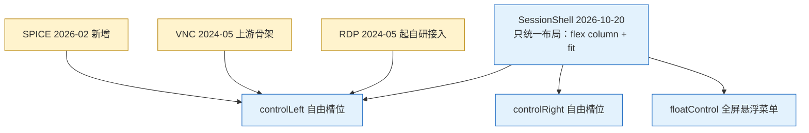

# 分析 - 远程会话顶栏差异与统一 - 2026-10-30

> 任务来源：用户 2026-10-30 提出「**VNC 的顶栏和 RDP 的顶栏有差异，分析原因**」，随后拍板「**做 N1+N2**」。
> 基线：本次三笔提交落在 `master @ 5f812da0` 上（批次 A/B 的三笔在 `dcdc4be7` / `bd26d045` / `81763fad`）。⚠️ 分析期间工作树仍被并行会话改写（G7 密钥与归档侧的非本次改动已自行提交），提交只带本文列出的路径。
> 配套：[`TODO-RDP自适应优先与自适应开销治理-2026-10-30.md`](./TODO-RDP自适应优先与自适应开销治理-2026-10-30.md)（批次 A/B/C 的确认门在它的 §0）
> 状态：✅ **N1 + N2 + N3 已落地**（见 §4、§5、§6）。N3 的条目契约在 2026-11-03 由用户改过一次方向：**显示控件（分辨率 / 选屏 / 缩放）留在顶栏左侧，不收进设置页**（§5）。批次 C（R5 真动态分辨率）同批决定**不做**——当前 VNC 与 RDP 的分辨率能力已够用。
> 图例：🔥 高优先 · ⏸ 待拍板 · ✅ 已落地

---

## 0. 一页结论

| # | 结论 | 处置 |
|---|---|---|
| 1 | **根因是"顶栏里该放什么"没人管**：`SessionShell`（2026-10-20 才引入）只统一了布局，对外是 `controlLeft` / `controlRight` 两个**自由槽位**，没有条目清单、没有顺序约定、没有控件类型约束 | ✅ N3 已落地（§5） |
| 2 | 三端顶栏是 **2024-05 ~ 2026-04 期间各自长出来的**，统一壳来得最晚，只是"把三个不同的栏装进同一个容器"，没回头收口内容 | 认知前提 |
| 3 | 协议决定的差异**不该抹平**：RDP 有分辨率下拉（客户端可协商 `DesktopSize`）、文件传输（ms-rdpefs）；VNC 有选屏（ExtendedDesktopSize）；VNC 的尺寸由 server 定 | ✅ 保留 |
| 4 | 历史偶然造成的漂移**要收口**：连接信息三端各写各的（VNC 缺 username 会渲染成 `@host:port`）、图标字号 16/14 混用、VNC 选屏有两个入口、**VNC 会话内改不了缩放**（批次 A/B 之后 RDP/SPICE 能改，VNC 反而被甩开） | ✅ N1 + N2 已做 |
| 5 | 条高差**不只是观感**：`.remote-session-control` 无固定高度、由内容撑开，RDP/SPICE 常驻 `Select`(32px) + `Switch`(22px) ≈ 40px，VNC 只有图标/文本 ≈ 29px → 同一窗口下 VNC 视口更高，`.fit` 缩放比例不同，且批次 A 的 R2 会让这 10px **如实进 RDP 首连位图高度** | ✅ N3 已解决：三端实测 32px 一行、视口同为 901px（§5、§6） |

---

## 1. 差异取证（2026-10-30 基线逐项；N3 落地后由 §5 的契约取代）

| 顶栏元素 | RDP | VNC | SPICE |
|---|---|---|---|
| 重连图标 | ✅ | ✅ | ✅ |
| 分辨率下拉 + 编辑入口 | ✅ 常驻 | ❌ 协议不适用 | ❌ |
| 栏内缩放开关 | ✅ | ❌ **缺**（→ N2 补） | ✅ |
| `ctrl ⇄ cmd` 开关 | ✅ 仅 macOS | ❌ | ❌ |
| 文件上传 / 下载 / wiki 帮助 | ✅ 三项 | ❌ 协议不适用 | ❌ |
| 多屏选择 | ❌ 未实现 | ✅ **两处**（左 Select + 右 `⋮` 子菜单） | ❌ |
| 连接信息 | `user@host:port` | `<b>桌面名</b> user@host:port` | `user@host:port` |
| `⋮` 菜单内容 | Ctrl+Alt+Del | Ctrl+Alt+Del + 屏列表 | Ctrl+Alt+Del |
| 栏内图标字号 | 16px（文件传输自写）/ 14px（其余） | 14px | 14px |

## 2. 原因：四层

| 层 | 原因 | 证据 |
|---|---|---|
| ① 结构 | 槽位是 `ReactNode`，加控件不需要过任何约定 | `session-shell.jsx#L117-L124`（**改造前**的行号；N3 已删除这两个自由槽位） |
| ② 时间 | 三端分别成型，壳最后才出现 | `rdp-session.jsx` 2024-05-12 `c6ac1131` · `vnc-session.jsx` 2024-05-26 `18eacbc3` · `remote-float-control.jsx` 2026-02-14 `80420408`（同笔给 VNC 加 `renderScreensSelect`）· `spice-session.jsx` 2026-02-21 `1cb43b93` · RDP 文件传输 2026-04-18 `5639f8f0` · `session-shell.jsx` **2026-10-20** `6323de6f` |
| ③ 协议 | 分辨率协商 / 文件通道 / 多屏能力本就不同 | IronRDP `DesktopSize`、VNC 帧缓冲由 server 定、`rdp.styl` 的传输按钮 |
| ④ 漂移 | 格式、字号、重复入口、VNC 缺会话内开关 | 见 §1 表末四行 |

## 3. 条高差与视口的连带影响

`.remote-session-control` 是 `flex 0 0 auto` + `padding 4px 8px` + `flex-wrap`，**没有固定高度**，条高由栏内最高的控件撑开。RDP/SPICE 常驻 antd middle `Select`（默认 32px）与 `Switch`（22px），VNC 原本只有图标与文本（行高约 21px）→ 估算差约 **10px**，直接进 `.remote-session-viewport`：

- 同一尺寸窗口下 VNC 可用视口更高 ⇒ `.fit` 缩放比例更大、letterbox 更窄；
- 批次 A 的 R2 把 RDP 首连位图尺寸改为"取实测视口"，这 10px 会**如实反映进协商的位图高度**。

> 数字来源：antd 6.5.1 token 默认值 + 已确认 `.remote-session-control` 作用域内没有 `ant-select` 高度覆写。这一估算已在 N3 落地后真机复核（§6）：改前口径的 ~10px 差确实存在，改后三端实测同一 32px / 同一视口高度。

## 4. N1 / N2 决策与落地

| 项 | 决策 | 理由 |
|---|---|---|
| 连接信息 | 抽 `formatConnInfo`（纯函数）+ `SessionInfo`（组件），三端共用 | 缺字段就**不渲染那一段**，不再补出半个 `@` 或 `:`；VNC 的 `@host:port`、`port=0` 的 `:0` 都被这条规则挡掉 |
| 桌面名 | 保留但降级为 `.remote-session-info-name`（600 字重），不再是 `<b>` 前缀 | desktopName 是远端上报、别处看不到的信息，值得留；但它不是主层级 |
| 图标字号 | 统一 **16px**，写在 `session-shell.styl`，只作用于栏的直接子图标 / HelpIcon 那层 span / 栏内 `⋮` | 16 是 RDP 已经选定的尺寸（比 14 更贴近可点目标）；Select 箭头与 Switch 由 antd token 管，跟着改会让控件变形 |
| VNC 选屏 | **只留顶栏左侧 Select**，删掉 `⋮` 里的子菜单（连带删 `RemoteFloatControl` 的 screens 分支与三个调用点的空参数） | 同一功能两个入口 = 用户不知道该点哪个；删后分支无人可达，留着就是债 |
| VNC 缩放 | 三层优先级 `本机逐 host 记忆 > 书签字段（含 profile 合并）> 默认开`，复用 `resolveScaleViewport`；栏内 `SwitchLabel`；改动 **live 生效**（setState 回调里 `updateViewLayout`） | 与批次 A/B 后的 RDP/SPICE 严格同构；noVNC 的 `scaleViewport` setter 本就即时生效，重连没必要 |
| VNC 首连 | `vncOpts.scaleViewport` 从 `this.state` 取，不再直接读 `tab` | 否则"本机记忆只在重连后生效、首连又从 tab 读"，两层打架 |
| 全屏时开关 | `checked: this.getFit()`（`getFit()` 在全屏强制 true，旧行为保留） | N2 当时加了 `disabled: fullscreen`；N3 查实整条在 fullscreen 下 `display:none`，开关根本不可达，那条 `disabled` 是死代码，已删（§5.2） |

**明确不动**：分辨率下拉、文件传输、多屏能力这些协议决定的差异。

## 5. ✅ N3：顶栏条目契约（已落地，2026-11-03）

任务来源：用户 2026-11-03 拍板「**做 N3，但是不做动态分辨率，当前 VNC 和 RDP 已够用**」——本节因此与原建议有一处关键不同：**不与批次 C（R5 真动态分辨率）合并**，`session.resize` / `rfb.resizeSession` 全部不动。

### 5.1 中途改的一次方向

第一版按"重控件（`Select` / `Switch`）收进 `⋮` 的弹出面板"实现，面板、设置行 CSS、嵌套下拉的 `rowPopupContainer` 都写完了。用户看完实机截图后否掉：「**显示缩放、屏幕选择都放在左侧，不收进设置页面！**」

理由站得住：这些是**决定画面之前就要看的东西**（当前哪一屏、什么分辨率、缩放开没开），藏进弹层等于把状态栏变成需要一次点击才可读的菜单；而 `⋮` 该是动作清单（Ctrl+Alt+Del、退出全屏），不是设置页。于是面板层整体回退，`⋮` 回到纯动作菜单。

### 5.2 最终契约

| 项 | 契约 | 落点 |
|---|---|---|
| 左栏顺序 | `重连图标` → `displayItems`（协议自己的轻量动作图标 + 显示控件） → `SessionInfo` | `SessionShell` 固定，协议不再自己摆 |
| 右栏顺序 | `全屏图标` → `⋮`（栏内一份）；全屏时另渲染浮层那份 `⋮` | 同上 |
| 自由槽位 | `controlLeft` / `controlRight` / `floatControl` **删除** | 协议只能交 `displayItems` / `info` / `fullscreenIcon` / `onSendCtrlAltDel` |
| 条高 | 单值 token：`--session-bar-h: 32px`（+ `--session-bar-pad-x`），条 `min-height` + `line-height` 都走它，`row-gap 0` | 栏内控件一律 `size='small'`，压在同一个 32px 行盒里 |
| 显示控件 | 分辨率/选屏 `Select`、缩放 `SwitchLabel` **留在左栏**，不进弹层 | RDP 分辨率 + 缩放 + `ctrl⇄cmd`；VNC 多屏 `Select`（仅 `screens.length > 1`）+ 缩放；SPICE 缩放 |
| 全屏 | 整条 `display:none`（`term-fullscreen.styl` 收 `.session-v-info`，栏 div 带这个类） | 栏内控件在全屏下不可达是**既有行为**，不是本次引入；`disabled={!!fullscreen}` 因此是死代码，已删 |
| `⋮` | 只有动作项：`退出全屏`（仅全屏）、`Send Ctrl+Alt+Del`；菜单外观交回 antd，不再包一层面板 | `remote-float-control.jsx` |

窄窗口时条仍会 `flex-wrap`，但三端**以同一方式换行**，视口高度不再按协议漂移——这才是 §3 那条要修的。

## 6. 验证与未验证

- `npx standard`：改动文件 + `self-test/remote-bar-n3-demo.js` 无输出。
- `npm run test-unit-ci`：**4607 pass / 0 fail**。其中 `remote-session-bar.spec.js` 覆盖条目契约：左/右顺序、`displayItems` 里才有 `Select`/`SwitchLabel`、`size='small'` 计数与控件计数相等、三端缩放开关同口径（`getFit()` 驱动 + 带文字）、`⋮` 无 `popupRender`/无设置行、面板 CSS 不留死样式、选屏只剩栏内一个入口。
- `npm run build`：exit 0。
- **运行时验证已补**（这次不再是缺口）：`self-test/remote-bar-n3-demo.js` 走 CDP + `xvfb-run`，用假 RFB（两屏）与打补丁的 `ws` 起真实会话，真鼠标点击。结果 **24/24**，截图在 `self-test/remote-bar-n3-shots/`：
  - VNC 条实测 `barH=32`、左组 `leftH=32`、三个条目中线偏移 `[0,0,0]` → 一行内不撑高；
  - 同窗口下 VNC / RDP / SPICE **视口同为 901px**（§3 的 ~10px 差消失）；RDP 左栏 6 图标 + 分辨率 Select（"自动（跟随窗口）"）+ 缩放开关，SPICE 只有缩放开关，都只有一行；
  - `⋮` 栏内菜单只有 `Send Ctrl+Alt+Del`，全屏浮层菜单是 `退出全屏` + `Send Ctrl+Alt+Del`，且 `panelWrapped=false`、`settingRows=0`（确认没有残留设置面板）；
  - 栏内 Select 真点开、选第二屏走产品链路（实例 `state.currentScreen=1`，栏内标签同步成 `Screen 2`），顶栏没被这次点击拆掉；
  - 缩放开关关掉即时推给 noVNC（`scaleWrites` 递增）并写 `vnc-scale-view-<host>`，不用重连；
  - 全屏下 `display:none` 且只有浮层那一份 `⋮` 可见（隐藏条里不留半个死图标）。
- 拆分提交：共享壳契约与 `⋮` 收口一笔、三端接线一笔、测试与实机脚本一笔、文档一笔（按功能点，方便 bisect）。

### N1 / N2 轮（2026-10-30）留档

- 那一轮拆到三笔提交：`f33fd0a1`（N1 · 共享层 + RDP/SPICE）、`9975b008`（N2 + VNC 侧接线）、文档一笔。拆的理由与上轮相同：spec 同时覆盖两批契约，合在一笔里会让 bisect 到 N1 时测试红灯。
- 当时 `npm run test-unit-ci` 为 **3572 pass / 0 fail**，自带 `remote-session-bar.spec.js` 16 条（`formatConnInfo` 脏值矩阵 6 条 + 接线契约 10 条）；`npx standard`、`npm run build` 均干净。
- mermaid 未跑 `validate_mermaid.cjs`：它需要仓库外装 `mermaid@8.8.3 + jsdom`，本仓库 `node_modules` 里没有，为了不制造依赖脏区没装；图已按 8.8.3 语法手写（`flowchart TD` + 引号包裹标签 + `classDef`，无 ASCII 图）。
- 更正上一轮分析中的一处口误：RDP 的 `renderInfo` 并**没有** `username || 'user'` 兜底（三端都是直接输出字段），所以"凭空打印假用户名"不成立；真实缺陷是缺字段时留下孤零的 `@` 与 `:`，N1 已按"缺段不渲染"修掉。
- 那一轮**未做运行时验证**（环境无可连的 VNC/RDP 服务），§3 的条高数字只有代码级证据——这条缺口由上面的 CDP 实机脚本补上。

## 7. 2026-11-04：条目顺序换成 A→B→C（连接信息在前）

用户看完统一草图后拍板：「**RDP 和 VNC 的顶栏没遵守信息和按钮显示规范，应该连接信息在前，操作按钮排在连接信息的后面**」。§5.2 / §6 里钉的"左 = 重连｜栏内条目｜信息"到这一轮作废，新契约：

| 区 | 内容 | 归属判据 |
|---|---|---|
| **A 连接信息**（最左） | 连接信息（桌面名 + `user@host:port`）；SFTP 面板标题的身份串 | 回答"我在哪" |
| **B 会话操作** | `重连` → `displayItems`；RDP 组内 `分辨率 + 编辑 → 缩放 → ctrl⇄cmd → 上传 / 下载 / help` | **改变远端会话的归 B**（文件传输走 ms-rdpefs、作用在远端磁盘上，所以不是窗口动作） |
| **C 窗口动作**（贴右） | `全屏 → ⋮` | **只改变本地窗口的归 C**（查找 / 全屏 / 退出全屏） |

终端页 `SessionControl`（信息 → 页签 → 状态 → 操作 → 查找/全屏）与数据库页 `.db-head`（引擎 · 目标 · 状态 → 工具组 → 查找/全屏）本来就是这个顺序，这次作为口径来源，没有改动。

**同批落地的三件事**

1. `SessionShell` 左栏改序，A 与 B 之间补一条 1px 竖线（`.remote-session-info::after`）。
2. **SFTP 面板标题行**（唯一两个方向都反的一栏）：原来整行 `alignright` 且刷新图标排在 `remote: user@host` 之前；改成左对齐、`.sftp-panel-title-text`（走 `formatConnInfo`，缺 username 不再拼出 `@host`）在左、刷新贴右。地址行保持浏览器习惯（导航在 URL 之前），与 web 页同一条例外。
3. 栏内条目不再自带 `mg1l/mg2l/mg1r`：左右外边距与壳的 `column-gap 8px` 叠加过，三端间距因此各走各的。垂直方向的 `mg*t` 不在禁列。

**图标字号规则的连带修正**：原来靠 `> .anticon` / `> span > .anticon` 两条子选择器给 16px，Tooltip 在 `span.anticon` 外面套了两层（`.ant-tooltip-open` 容器）时选不中，RDP 的文件传输图标实际一直吃的是 antd 默认 14px；改成后代选择器，并显式让 `.ant-select-arrow .anticon` / `.ant-select-suffix .anticon` 回退 `inherit`（Select 的箭头由 antd 的尺寸 token 管，撑大会变形）。`rdp.styl` 顶部那句"字号由顶栏统一规则给"到这一轮才真的成立。

**验证**

- `npx standard`：改动文件 + `self-test/topbar-order-probe.js` 无输出。
- `npm run test-unit-ci`：**4613 项 4612 通过 / 1 失败**，唯一失败是 `db-structure-v2.spec.js`「视图在树里的呈现」，断言的是并行会话正在改的 `db-session.jsx`（`.db-tree-name` 包装），与本批顶栏改动无关。`remote-session-bar.spec.js` 跟齐新契约：左栏顺序、RDP 组内顺序、`column-gap` 单点（反向：协议不再写左右外边距）、sftp 标题行顺序；字号那条改为钉后代选择器 + Select 箭头排除。
- **实机量测已补**：`self-test/topbar-order-probe.js`（`node self-test/topbar-order-probe.js`）把真实 `.styl`（theme / tokens / text / session-shell / sftp）编译成 CSS，喂 antd v6 真实 DOM 骨架，在 headless Edge 里量。结果 **9/9**：条高与左组同为 32px、左栏顺序 `信息 → 重连 → Select → 开关`、A/B 竖线 1×16px、栏内图标 16px 而 Select 箭头仍 12px、三个条目中线偏移 `[0,0,0]`、sftp 标题行 32px 一行且刷新贴右。
  - 为什么不用 `self-test/remote-bar-n3-demo.js`：它要先 `npm run build`，而 `work/app` 正被并行会话的 Electron（9333 端口）跑着，覆盖产物会打乱那一轮。本批改动全是显示层，静态实机量测足够答；那笔 CDP 脚本的期望（`firstIsReload` → `firstIsInfo`、左栏顺序判定）也已同步，等构建目录空出来再跑。
