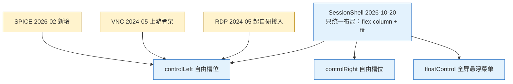

# 分析 - 远程会话顶栏差异与统一 - 2026-10-30

> 任务来源：用户 2026-10-30 提出「**VNC 的顶栏和 RDP 的顶栏有差异，分析原因**」，随后拍板「**做 N1+N2**」。
> 基线：本次三笔提交落在 `master @ 5f812da0` 上（批次 A/B 的三笔在 `dcdc4be7` / `bd26d045` / `81763fad`）。⚠️ 分析期间工作树仍被并行会话改写（G7 密钥与归档侧的非本次改动已自行提交），提交只带本文列出的路径。
> 配套：[`TODO-RDP自适应优先与自适应开销治理-2026-10-30.md`](./TODO-RDP自适应优先与自适应开销治理-2026-10-30.md)（批次 A/B/C 的确认门在它的 §0）
> 状态：✅ **N1 + N2 已落地**（见 §4、§6）；⏸ N3（顶栏条目契约）待拍板（§5）。
> 图例：🔥 高优先 · ⏸ 待拍板 · ✅ 已落地

---

## 0. 一页结论

| # | 结论 | 处置 |
|---|---|---|
| 1 | **根因是"顶栏里该放什么"没人管**：`SessionShell`（2026-10-20 才引入）只统一了布局，对外是 `controlLeft` / `controlRight` 两个**自由槽位**，没有条目清单、没有顺序约定、没有控件类型约束 | N3（⏸） |
| 2 | 三端顶栏是 **2024-05 ~ 2026-04 期间各自长出来的**，统一壳来得最晚，只是"把三个不同的栏装进同一个容器"，没回头收口内容 | 认知前提 |
| 3 | 协议决定的差异**不该抹平**：RDP 有分辨率下拉（客户端可协商 `DesktopSize`）、文件传输（ms-rdpefs）；VNC 有选屏（ExtendedDesktopSize）；VNC 的尺寸由 server 定 | ✅ 保留 |
| 4 | 历史偶然造成的漂移**要收口**：连接信息三端各写各的（VNC 缺 username 会渲染成 `@host:port`）、图标字号 16/14 混用、VNC 选屏有两个入口、**VNC 会话内改不了缩放**（批次 A/B 之后 RDP/SPICE 能改，VNC 反而被甩开） | ✅ N1 + N2 已做 |
| 5 | 条高差**不只是观感**：`.remote-session-control` 无固定高度、由内容撑开，RDP/SPICE 常驻 `Select`(32px) + `Switch`(22px) ≈ 40px，VNC 只有图标/文本 ≈ 29px → 同一窗口下 VNC 视口更高，`.fit` 缩放比例不同，且批次 A 的 R2 会让这 10px **如实进 RDP 首连位图高度** | ⏸ N3 一并解决（§3） |

---

## 1. 差异取证（当前 HEAD 逐项）

| 顶栏元素 | RDP | VNC | SPICE |
|---|---|---|---|
| 重连图标 | ✅ | ✅ | ✅ |
| 分辨率下拉 + 编辑入口 | ✅ 常驻 | ❌ 协议不适用 | ❌ |
| 栏内缩放开关 | ✅ | ❌ **缺**（→ N2 补） | ✅ |
| `ctrl ⇄ cmd` 开关 | ✅ 仅 macOS | ❌ | ❌ |
| 文件上传 / 下载 / wiki 帮助 | ✅ 三项 | ❌ 协议不适用 | ❌ |
| 多屏选择 | ❌ 未实现 | ✅ **两处**（左 Select + 右 `⋮` 子菜单） | ❌ |
| 连接信息 | `user@host:port` | `<b>桌面名</b> user@host:port` | `user@host:port` |
| `⋮` 菜单内容 | Ctrl+Alt+Del | Ctrl+Alt+Del + 屏列表 | Ctrl+Alt+Del |
| 栏内图标字号 | 16px（文件传输自写）/ 14px（其余） | 14px | 14px |

## 2. 原因：四层

| 层 | 原因 | 证据 |
|---|---|---|
| ① 结构 | 槽位是 `ReactNode`，加控件不需要过任何约定 | `session-shell.jsx#L117-L124` |
| ② 时间 | 三端分别成型，壳最后才出现 | `rdp-session.jsx` 2024-05-12 `c6ac1131` · `vnc-session.jsx` 2024-05-26 `18eacbc3` · `remote-float-control.jsx` 2026-02-14 `80420408`（同笔给 VNC 加 `renderScreensSelect`）· `spice-session.jsx` 2026-02-21 `1cb43b93` · RDP 文件传输 2026-04-18 `5639f8f0` · `session-shell.jsx` **2026-10-20** `6323de6f` |
| ③ 协议 | 分辨率协商 / 文件通道 / 多屏能力本就不同 | IronRDP `DesktopSize`、VNC 帧缓冲由 server 定、`rdp.styl` 的传输按钮 |
| ④ 漂移 | 格式、字号、重复入口、VNC 缺会话内开关 | 见 §1 表末四行 |

## 3. 条高差与视口的连带影响

`.remote-session-control` 是 `flex 0 0 auto` + `padding 4px 8px` + `flex-wrap`，**没有固定高度**，条高由栏内最高的控件撑开。RDP/SPICE 常驻 antd middle `Select`（默认 32px）与 `Switch`（22px），VNC 原本只有图标与文本（行高约 21px）→ 估算差约 **10px**，直接进 `.remote-session-viewport`：

- 同一尺寸窗口下 VNC 可用视口更高 ⇒ `.fit` 缩放比例更大、letterbox 更窄；
- 批次 A 的 R2 把 RDP 首连位图尺寸改为"取实测视口"，这 10px 会**如实反映进协商的位图高度**。

> 数字来源：antd 6.5.1 token 默认值 + 已确认 `.remote-session-control` 作用域内没有 `ant-select` 高度覆写。**未真机量过**，见 §6。

## 4. N1 / N2 决策与落地

| 项 | 决策 | 理由 |
|---|---|---|
| 连接信息 | 抽 `formatConnInfo`（纯函数）+ `SessionInfo`（组件），三端共用 | 缺字段就**不渲染那一段**，不再补出半个 `@` 或 `:`；VNC 的 `@host:port`、`port=0` 的 `:0` 都被这条规则挡掉 |
| 桌面名 | 保留但降级为 `.remote-session-info-name`（600 字重），不再是 `<b>` 前缀 | desktopName 是远端上报、别处看不到的信息，值得留；但它不是主层级 |
| 图标字号 | 统一 **16px**，写在 `session-shell.styl`，只作用于栏的直接子图标 / HelpIcon 那层 span / 栏内 `⋮` | 16 是 RDP 已经选定的尺寸（比 14 更贴近可点目标）；Select 箭头与 Switch 由 antd token 管，跟着改会让控件变形 |
| VNC 选屏 | **只留顶栏左侧 Select**，删掉 `⋮` 里的子菜单（连带删 `RemoteFloatControl` 的 screens 分支与三个调用点的空参数） | 同一功能两个入口 = 用户不知道该点哪个；删后分支无人可达，留着就是债 |
| VNC 缩放 | 三层优先级 `本机逐 host 记忆 > 书签字段（含 profile 合并）> 默认开`，复用 `resolveScaleViewport`；栏内 `SwitchLabel`；改动 **live 生效**（setState 回调里 `updateViewLayout`） | 与批次 A/B 后的 RDP/SPICE 严格同构；noVNC 的 `scaleViewport` setter 本就即时生效，重连没必要 |
| VNC 首连 | `vncOpts.scaleViewport` 从 `this.state` 取，不再直接读 `tab` | 否则"本机记忆只在重连后生效、首连又从 tab 读"，两层打架 |
| 全屏时开关 | `checked: this.getFit()` + `disabled: fullscreen` | `getFit()` 在全屏强制 true（旧行为保留），开关若仍可点就会显示"关"而画面在缩放，自相矛盾 |

**明确不动**：分辨率下拉、文件传输、多屏能力这些协议决定的差异。

## 5. ⏸ N3：顶栏条目契约（待拍板，未做）

把"摆什么"也交给共享壳：左 = 重连｜会话内显示项｜信息，右 = 全屏｜`⋮`；重控件（`Select` / `Switch`）收进 `⋮` 的弹出面板，三端条高严格一致（顺带解决 §3 的视口高度不一致）。要改 `SessionShell` 的对外 API，约 1 人日，需配 unit-ci 契约测试。**建议与批次 C（R5 真动态分辨率）合并做** —— 那时 RDP 的分辨率下拉可能被 `session.resize` 取代，条目清单才会稳定下来。

## 6. 验证与未验证

- 拆分交到了三笔提交：`f33fd0a1`（N1 · 共享层 + RDP/SPICE）、`9975b008`（N2 + VNC 侧接线）、本笔（文档）。拆的理由与上轮相同：spec 同时覆盖两批契约，合在一笔里会让 bisect 到 N1 时测试红灯。
- `npx standard`：本次 6 个改动文件 + 2 个新文件 + 1 个 spec 无输出。
- `npm run test-unit-ci`：**3572 pass / 0 fail**（含并行会话已提交的新增用例；本次自带 `remote-session-bar.spec.js` 16 条：`formatConnInfo` 脏值矩阵 6 条 + 接线契约 10 条）。
- `npm run build`：exit 0。
- mermaid 未跑 `validate_mermaid.cjs`：它需要仓库外装 `mermaid@8.8.3 + jsdom`，本仓库 `node_modules` 里没有，为了不制造依赖脏区没装；图已按 8.8.3 语法手写（`flowchart TD` + 引号包裹标签 + `classDef`，无 ASCII 图）。
- **未做运行时验证**：环境里没有可连的 VNC/RDP 服务（`ss -ltn` 无 5900/3389 监听），所以 §3 的条高数字、VNC 缩放开关的观感、`SessionInfo` 的实际排版都只有代码级证据，需真机确认。
- 更正上一轮分析中的一处口误：RDP 的 `renderInfo` 并**没有** `username || 'user'` 兜底（三端都是直接输出字段），所以"凭空打印假用户名"不成立；真实缺陷是缺字段时留下孤零的 `@` 与 `:`，N1 已按"缺段不渲染"修掉。
