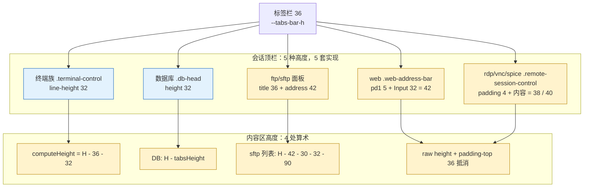
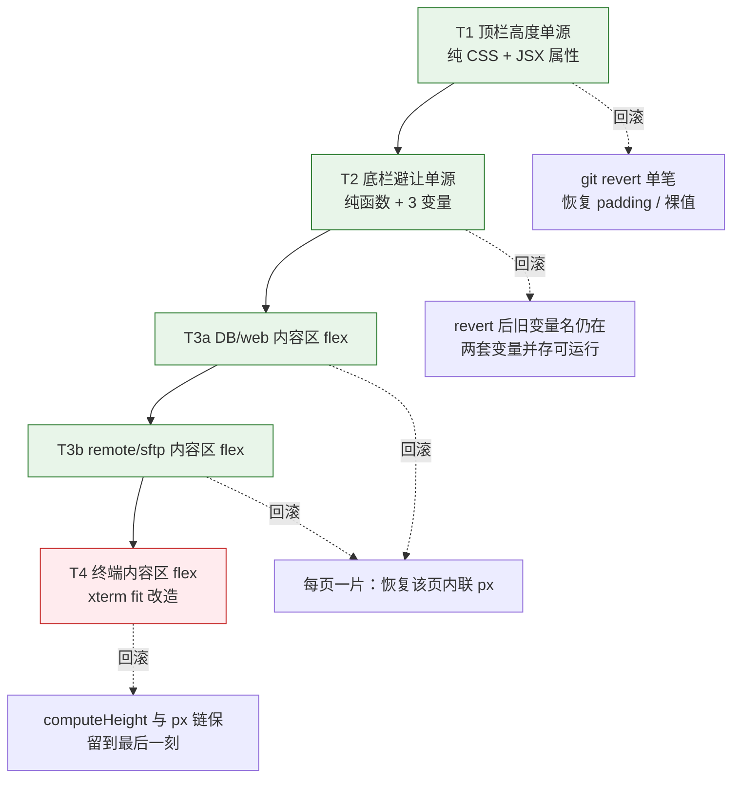
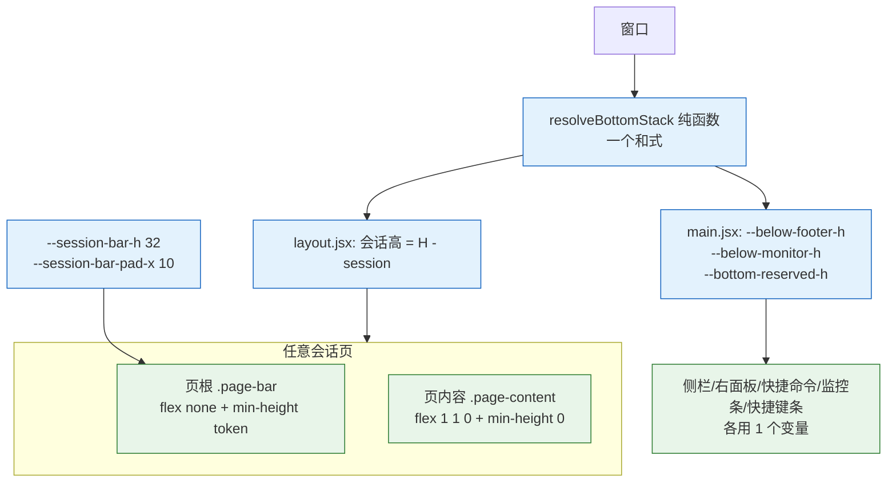

# 分析 - 顶栏高度与底栏避让统一 - 2026-10-30

> 任务来源：用户 2026-10-30 提出「**全仓库各类页面的顶栏高度其实可以统一，各页面只需保持"显示内容不同"；再加上"底栏避让"也统一口径，应该能让代码更简洁、更可控**」，要求先取证与判定，确认后再按批次落地。
> 基线：`master @ b83c5162`（批次 A/B 在 `dcdc4be7`/`bd26d045`/`81763fad`，N1/N2 在 `f33fd0a1`/`9975b008`/`b83c5162`）。本稿**不改代码**。
> 配套：[`TODO-顶栏高度与底栏避让统一-2026-10-30--已完成.md`](TODO-顶栏高度与底栏避让统一-2026-10-30--已完成.md)（批次 T1~T4、验收与风险）
> 前序：[`已完成/分析-布局与顶栏统一方案-2026-10-21.md`](分析-布局与顶栏统一方案-2026-10-21.md)（A′ 方案，S0~S4/S6 已落地）、[`TODO-顶栏与显示页统一执行计划-2026-10-21--已完成.md`](TODO-顶栏与显示页统一执行计划-2026-10-21--已完成.md)（本文取代其 S5）
> 状态：🟡 **分析稿，待拍板**（§7 的 D 列是确认门）
> 图例：🔥 高优先 · ⏸ 待拍板 · ✅ 已落地 · ⚠️ 本次新发现

---

## 0. 一页结论

| # | 结论 | 处置 |
|---|---|---|
| 1 | **顶栏高度不是"脏一点"而是真没单一来源**：同类"会话顶栏"当前并存 **5 种**高度 —— 32（终端族）/ 32（数据库）/ 38~40（rdp/vnc/spice）/ 42（web）/ 36+42（ftp、sftp 文件面板）。同一条 VNC 顶栏还会因远端显示器数量从 38 跳到 40 | 🔥 T1 |
| 2 | `--session-bar-h` 这个 token **已经存在**（2026-10-20 S2），但只被终端与数据库两处消费 → 上一轮"32px 的 5 处表达已消灭"**只对 2/5 类页面成立**，须更正（§3.4 第 1 条） | 🔥 T1 |
| 3 | **底栏避让有两套口径**：`layout.jsx` 的 JS 算术 + `main.jsx` 注入的 CSS 变量，且 6 个底部定位消费方各挑不同子集 → 已真实留下漏项（`.sidebar-panel` 只避让 footer，不避让快捷命令带/快捷键条） | 🔥 T2 |
| 4 | **内容区还在做 4 处 JS 算术**：`computeHeight`(H−36−32)、DB 的 `H−tabsHeight`、Splitter 容器高、以及上游遗留的 `H−42−30−32−90`（sftp 列表）。每处都是一个会随顶栏高度变化而失效的隐式契约 | 🔥 T3/T4 |
| 5 | 判定：本轮统一 **L1 骨架（高度/内边距/分隔线/移动端形态）+ 竖向避让**；L2 内容（连接信息、缩放/只读/刷新、地址栏）继续各自渲染；L3 窗口级动作（S1 已完成）与 L4 查找引擎（S3/S4 已完成）不动 | ✅ 范围锁定 |
| 6 | 方案：**高度 → 一个 token + `min-height`/`line-height`（不用固定 height，保住窄窗换行）；内容区 → flex 列，顶栏 `flex: none`、内容 `flex: 1 1 0; min-height: 0`；底栏 → 一个纯函数算出 3 个 CSS 变量**。三步可独立回滚 | ✅ §4 |
| 7 | 代价可控：T1/T2 是纯 CSS + 两个函数的接线（不动任何页面状态）；T3 按页切片（DB → web → remote → sftp），每片删一处算术；**只有 T4（终端 xterm）必须真机 + 打包实测** | ⚠️ §5 |



---

## 1. 取证：逐一列出带顶栏的页面

### 1.1 全景总表

| 页面 | 顶栏实现 | 高度怎么来的 | 当前实际高 | 这个数值在哪几处表达 |
|---|---|---|---|---|
| **终端族**（ssh / local / serial / telnet） | `.terminal-control`（`session-control.jsx:449`）+ 移动端 `.terminal-control.mobile-session-control`（`:433`） | CSS `line-height: var(--session-bar-h)`（`terminal.styl:17`）+ JS 扣减 `termControlHeight` | **32** | ①`tokens.styl:87` ②`constants.js:30` ③`sessions.jsx:32-39` ④`session-control.styl:4` **裸 32px**（移动端那条，未走 token） |
| **数据库** | `.db-head`（`db-session.jsx` 页内自渲染） | CSS `height: var(--session-bar-h)`（`db-session.styl:15`）；JS 只扣标签栏（`session.jsx:244`） | **32** | ①`tokens.styl:87` ②`db-session.styl:15` ③`session.jsx:244`（只扣 36，不含 32 —— S2 去掉了补偿） |
| **rdp / vnc / spice** | `.remote-session-control`（`session-shell.jsx:117`） | **无高度声明**：`padding 4px 8px` + `row-gap 4px` + `flex-wrap` 由内容撑开（`session-shell.styl:21-30`）；行盒由 `.session-v-info { line-height: 30px }`（`session.styl:77`）决定 | **38**（无 Select）/ **40**（有 Select=antd 默认 32） | ①`session-shell.styl:29` ②`session.styl:77`（30px 行高）③RDP 的分辨率 Select、VNC 的多屏 Select 直接决定是否 +2 |
| **web** | `.web-address-bar pd1`（`address-bar.jsx:50`） | **全仓库没有任何 `.web-address-bar` 的 CSS 规则**；高度 = `pd1`(5px) × 2 + antd Input 32 | **42** | ①`address-bar.jsx:50` 的 `pd1` ②`box.styl` 的 `pd1 = 5px` ③Input 的 antd 默认高（隐式） |
| **ftp / sftp 文件管理面板** | 两条叠放：`sftp-panel-title`（`sftp-entry.jsx:1294/1304`）+ `AddressBar`（`address-bar.jsx:197`，`pd1y`）；过滤时再加 `KeywordBar` | 全部内容撑开，无 token | **36 + 42 = 78**（过滤时 +约 28） | ①`pd1t/pd1b/pd1y` 三处竖内边距 ②Input 32 ③`KeywordBar` 的 `padding-top/bottom 4px` |
| **（边界，不纳入）** 传输面板 / 设置面板 / 快速命令 / 监控面板 / 空状态 | `transfer.styl:6` 36px、`responsive-tabs.styl:11` 36px、`no-session.styl:10` top 36px 等 | 各自内容或裸值 | — | 见 §3.5：不套 `SessionShell`，只用同一批 token |

### 1.2 逐页证据要点

**终端族（含 telnet）** —— 唯一"已经做对"的一类。高度只有一个 token + 一个 JS 镜像，且 `s2-tokens.spec.js` 用**反向断言**锁住了"裸 32px 不许回来"。漏洞是移动端那条：`.mobile-session-control { line-height: 32px }`（`session-control.styl:4`）是裸值，spec 只检查了 `terminal.styl` 的 `.terminal-control` 块 → 属于"守卫没盖到的同一概念第二实现"。

**数据库** —— S2 把"扣 32 再加回 32"的补偿换成了 `H − tabsHeight`（`session.jsx:239-247`，注释里写清了理由）。现在 DB 的顶栏高度**同时**由 CSS token 与"JS 不再扣 32"两个事实共同保证：只要有人给 `.db-head` 加 1px 边框，内容区就会多出 1px。这是"两处各算一半"的典型。

**rdp / vnc / spice** —— 最需要处理的一类，三个具体问题：

1. **38 / 40 双值**：条内是否出现 antd `Select`（高 32）决定高度；`.session-v-info` 的 `line-height: 30px` 让纯图标行只有 30 → `4+30+4=38`，有 Select 时 `4+32+4=40`。
2. **VNC 会动态变高**：`renderScreensSelect()` 在 `screens.length <= 1` 时 `return null`（`vnc-session.jsx:172`）→ 远端单屏 38、多屏 40。换台机器顶栏就长高 2px，内容视口跟着缩 2px。
3. **`width`/`height` props 是死参数**：`grep props.width/props.height` 在 rdp/vnc/spice 三文件里**零命中**，但 `session.jsx:281-299` 仍在传。`SessionShell` 用 ResizeObserver 实测（`session-shell.jsx:66-81`），这层传参是历史残留。

**web** —— 第 5 套条，且是唯一"可以整条消失"的（`tab.hideAddressBar`，`web-session.jsx` 里 `{!tab.hideAddressBar && <AddressBar/>}`）。`.web-address-bar` 类名在 `*.styl` 里**没有任何规则**（只有 `.pd1` 这个通用内边距类），高度完全由 antd Input 的默认尺寸漂移。

**ftp / sftp 文件管理面板** —— 顶层是**两行**（title + address），分屏时还是"面板级"（左右各一套）。它自带第三种"查找"（`KeywordFilter` 过滤列表语义）和第三种移动端收纳（`MobileAddressPrefix`）。本轮**不改它的信息架构**（仍两行），只让每一行对齐 token 的单行节奏。

### 1.3 内容区高度：4 处算术（这是"顶栏高度一改就崩"的根因）

| # | 位置 | 算式 | 谁受影响 | 备注 |
|---|---|---|---|---|
| A1 | `sessions.jsx:32-39` | `computeHeight = H − tabsHeight(36) − termControlHeight(32)` | 终端内容、sftp 内容、Splitter 容器高（`session.jsx:611`）、`onSplitResize` 的分母（`session.jsx:581`） | 一处函数、四处消费；顶栏加 1px 就要在 2 个常量间同步 |
| A2 | `session.jsx:244` | `H − tabsHeight` | 数据库 | 语义是"我不扣 32，因为顶栏在页面里" |
| A3 | `list-table-ui.jsx:366` | `H − 42 − 30 − 32 − 90` | sftp 文件列表可视高 | **上游 `e369763f`（2025-02-20, #3806）带入**；四个数只有 `42` 能与 CSS 对上（address 行 = `pd1y 10 + Input 32`），其余 30/32/90 在原文件无注释、无消费方 |
| A4 | — | 原始 `props.height` + `.session-wrap { padding-top: var(--tabs-bar-h) }`（`session.styl:57`） | web / rdp / vnc / spice | 靠"父容器 padding-top 抵消 + 子元素 height:100%"达成，注意 `.session-wrap` 的 inset 0 来自 `layout-alg.js` 的单格 `wrapStyles`，所以百分比是能解析的 |

`A1`/`A2`/`A3` 与顶栏高度**强耦合**：任何一条顶栏高度变化，都必须同步改这些数字，否则就是历史上反复出现的"底部被裁 / 底部留白"。

### 1.4 高度数值的重复表达清单

| 数值 | 出现位置 | 是否 token 化 |
|---|---|---|
| 32 | `tokens.styl:87`、`constants.js:30`、`sessions.jsx:34,38`、`terminal.styl:17`、`db-session.styl:15` | ✅（但 `session-control.styl:4` 移动端是裸 32） |
| 30 | `session.styl:77`（remote 条行高）、`remote-monitor-bar.styl:3`（bottom 30px）、`shortcut-bar.styl:110`（+30px）、`tokens.styl:94`（--footer-h） | ❌ 四处裸值，其中两处其实是"footer 高度"的复制 |
| 36 | `tokens.styl:90`、`init-state.js:291`、`no-session.styl:10`（裸）、`mobile.styl:97`（裸 line-height） | 半个 token |
| 4 / 5 / 8 | `session-shell.styl:29`（4px 8px）、`session-control.styl:4`（0 10px）、`db-session.styl:17`（0 10px）、`box.styl` 的 `pd1=5` | ❌ 左右内边距 8/10/5 三套 |
| 42 | `list-table-ui.jsx:366`、`address-bar.jsx:197`（实际值）、`sftp.styl:184`（padding-bottom 42px） | ❌ 同一个 42 在三处，两处是"address 行高"、一处是"给 pager 留位" |
| 180 | `constants.js:115`、`term-fullscreen.styl:94`、`qm.styl:70` | ❌ 两处裸值复制常量 |

---

## 2. 取证的第二面：底栏避让

### 2.1 谁在决定"可视高"

```
window height
  └─ layout.jsx:59  h = height − footerHeight − monitorHeight − qmPinnedHeight − (shortcut + kbOffset) + resizeTrigger
       ├─ .sessions / .layout-item 内联 height（pixed）
       │    └─ .session-wrap { position:absolute; inset:0 }（layout-alg.js 单格 wrapStyles）
       └─ main.jsx:213-217 再把同一批数字注入成 CSS 变量，供"不进 flex 流"的浮层自己避让
```

**两套口径的根因**：`.main-footer` / `.remote-monitor-bar` / `.qm-wrap-tooltip` / `.sidebar-panel` / `.right-side-panel` / `.shortcut-bar` 全部是 `position: absolute|fixed`（不参与文档流），所以"内容区"必须由 JS 扣，而这些浮层必须由 CSS 自己算 —— 于是同一个和式被手写了 6 遍。

### 2.2 底部常显栈的组成

| 层 | 高度 | 是否常显 | 来源 |
|---|---|---|---|
| footer | 30 | 常显 | `constants.js:113` / `tokens.styl:94` |
| 监控条 | 28 | 可选 | `constants.js:114` |
| 快捷命令带（钉住底栏时） | 180 | 可选 | `constants.js:115` / `--qm-bar-h` |
| 快捷键条 | 44 | 可选 | `constants.js:116` / `--shortcut-bar-h` |
| 软键盘偏移 | 变量 | 可选 | `--shortcut-bar-kb-offset` |

### 2.3 六个消费方的实际算式（含漏项）

| 消费方 | 实际写法 | 完整性 |
|---|---|---|
| `layout.jsx:59` | footer + monitor + qm + shortcut + kb **+ resizeTrigger(0/1)** | ✅ 唯一的 JS 真源 |
| `main.jsx:213` → `--footer-stack-height` | footer + monitor | 分层变量 |
| `main.jsx:214` → `--qm-bar-h` | qm | 分层变量 |
| `right-side-panel.styl:14` | footer-stack + qm + shortcut + kb | ✅ 完整 |
| `qm.styl:66` | footer-stack | 靠 `shortcut-bar.styl:116` 的 `.shortcut-bar-on` 规则补 shortcut |
| `shortcut-bar.styl:105-110` | footer：`shortcut + kb`；monitor：`shortcut + kb + 30px` | ⚠️ 裸 30px |
| `remote-monitor-bar.styl:3` | `bottom 30px` | ⚠️ 裸 30px（footer 高） |
| `sidebar.styl:9` | footer-stack | ⚠️ **缺 shortcut + kb**（快捷命令带钉住时也没有避让） |
| `mobile.styl:126` | footer-stack + shortcut + kb | ✅ 完整 |
| `term-fullscreen.styl:84/94` | footer-stack + shortcut + kb（+ **180px 裸值**） | ⚠️ 裸 180 |

**漏项 1（可视）**：`.shortcut-bar` 是 `z-index: 400`，`.sidebar-panel` 是 `200`。快捷键条打开时，侧栏面板底部 44px 被快捷键条压住 —— 侧栏底部的内容（列表最后一项、底部按钮）看不到也点不到。这是"两套口径 + 子集不全"的直接后果，不是我这次改造引入的。

**漏项 2（可视）**：`.remote-monitor-bar` 用裸 `30px` 而不是 `var(--footer-h)`；一旦 footer 高度调整（token 改动），监控条会错位。

### 2.4 历史上因两套口径并存导致的错位 / 留白

| 提交 | 现象 | 根因 |
|---|---|---|
| `2997836a` | SSH/SFTP 拆分视图两侧底缘差 518px，SFTP 底部 68px 被裁 | 终端侧用 `computeHeight`、Splitter 与 SFTP 侧用原始高（同一容器两套基准） |
| `2afc5af1` | 数据库内容伸到底栏之下 | 内容用原始高，未扣底部 |
| `4ab6164a` | 数据库底部 32px 留白 | "JS 扣减"与"页面自渲染 bar"两套口径并存 |
| `f23f1949` | 数据库页丢了全屏入口 | 动作集合不共享（L3，已在 S1 解决） |
| ⚠️ 本次新发现 | **全屏 SFTP 底部留白**：`term-fullscreen.styl` 全文 94 行**没有任何 `.sftp-wrap` 规则**，而 `.sftp-wrap` 的高度是内联 px（`sftp-entry.jsx:1452`，取自 `calcSftpWidthHeight` = H−68）。全屏时 `.session-wrap` 变成 `position:fixed; inset:0; height:100%`，但 sftp 仍按旧的布局高渲染 → 底部空一段 | A1 的 px 与"全屏换了一个坐标系"冲突 |
| ⚠️ 本次新发现 | `no-session.styl:10` 的 `top 36px` 与 `mobile.styl:97` 的 `line-height 36px` 都是 `--tabs-bar-h` 的裸复制，`s2-tokens.spec.js` 没覆盖 | 守卫覆盖不全 |
| ⚠️ 本次新发现 | `constants.js:39` `sftpControlHeight = 42 + 30` **全仓库零引用** | 早期方案残留的死常量 |

---

## 3. 判定范围（L1 / L2 / L3 / L4）

### 3.1 判定标准（沿用 2026-10-21 方案，未改动）

共享抽象成立的条件：**同一业务概念 + 同一协议/约束 + 因同一业务原因共同变化**。

### 3.2 本轮统一的是 L1 骨架的"竖向"部分

| 层 | 内容 | 本轮 |
|---|---|---|
| **L1 骨架** | 高度、底部分隔线、左右内边距、移动端形态、**以及内容区竖向避让** | ✅ **统一** |
| L2 内容槽 | 连接信息、缩放/只读/刷新开关、地址栏、SFTP 路径栏 | ❌ 不统一，各自渲染 |
| L3 窗口级动作 | 查找、全屏 | ✅ 已在 S1 统一（`session-bar-actions.jsx`），本轮不动 |
| L4 查找引擎 | xterm / DOM / 列表过滤 | ✅ 已在 S3/S4 分开，本轮不动 |

**"底栏避让"归到 L1 的理由**：它和顶栏高度是同一个变化原因 —— 设计规范调整骨架尺寸时，上下两条边界要同时改；把它拆到别层会重演本轮发现的漏项。

### 3.3 明确不做的事（避免伪抽象）

- 不抽 `items: []` 式声明协议：五类顶栏的**内容**变化原因不同（SSH 特性 / db-client / 远程桌面协议 / webview / 文件列表），配置化只会把 `L2` 变成间接层。
- 不把 DB 的只读/刷新、web 的 url、sftp 的路径上提到 `session.jsx` 或 store（`S5` 时代已判定为 (a) 受控化方案，收益/风险比不划算）。
- 不为"条高一样"去改页面信息架构：sftp 仍是两行（title + address），只让每行对齐单行节奏。

### 3.4 核对既有结论：哪些被后来的改动推翻（如实更正）

| # | 既有结论（2026-10-21 文档） | 现状 | 判定 |
|---|---|---|---|
| 1 | §三.2「32px 这个数在 5 处表达，统一为 token 后**两侧都不需要再做算术**」 | token 只覆盖终端/DB/tabs/footer 四类；remote/web/sftp **当时就没纳入**，且内容区 4 处算术全部还在 | **部分推翻**：S2 只完成了"2/5 类页面"，"两侧不再算术"从未成立 |
| 2 | §1.3「`.tabs height 38px`（注释写"对齐草图 38px"），与 store 36 / padding 36 三值并存」 | 已被 F/H 批次收敛：`.tabs` = `var(--tabs-bar-h)`、`.tabs-inner` = token−1、`.tab` = `--tab-item-h` 32（`tabs.styl:5,48`） | **已失效**，三个数字现在同源 |
| 3 | §1.3「显示页高度口径**四套算法**」 | DB 补偿已删（S2）→ 现在剩三套 + 上游一处四连减 | **需更正为数**：3 套（A1/A2/A4）+ A3 |
| 4 | §11.1「rdp/vnc/spice 顶栏**无固定高度**是刻意设计（flex-wrap）」 | wrap 依然要保留，但"无固定高度"导致 38/40 抖动与 VNC 随屏数变高 | **需细化**：换成 `min-height: token` + 行高 token，wrap 能力不变 |
| 5 | §11.7「非会话页面不纳入 SessionShell，但建议复用同一批 token」 | 仍然成立，而且本轮把 footer/monitor/tabs 的裸值换 token 正属这一条 | 不变 |
| 6 | §11.4「web 缺全屏入口」 | 已在 S1 补上（`web-session.jsx` 传 `onFullscreen` → `SessionBarActions`） | **已失效** |
| 7 | §11.3「telnet 整类动作缺失」 | 已在 S1 把 telnet 移出 `isNotTerminalType`（`session.jsx:386-397` 注释） | **已失效** |
| 8 | §1.4「查找两套实现」 | 已是三套（xterm / DOM / 列表过滤），S3 共享了 UI | **需更正为数**，结论方向不变 |

### 3.5 边界：不纳入同一骨架，但共用 token

传输面板（36）、设置面板（36）、快速命令、监控面板、空状态页、AI 面板：它们的"条"变化原因是**全局工具/设置**，与会话页不同，套 `SessionShell` 会制造伪抽象。但它们的**尺寸数值**应与会话页同源（`--session-bar-h` / `--tabs-bar-h` / `--bottom-reserved-h`），这是 token 单点化的顺带收益。

---

## 4. 方案（每个决策都选定一个，附理由与否决项）

### 4.1 决策 A：高度收敛成一个 token + `min-height`，**不用固定 `height`**

**选定**：`--session-bar-h: 32px`（已存在）作为**单行条**的唯一高度来源；消费方式统一为

```styl
.bar
  flex none
  min-height var(--session-bar-h)
  line-height var(--session-bar-h)
  padding 0 var(--session-bar-pad-x)   // 新增 token，10px
  display flex
  align-items center
  flex-wrap wrap                       // 远程页窄窗必须能换行
  row-gap 0
```

**理由**：
1. `min-height` + `line-height` 让"单行 = 32、两行 = 64"成为**自然结果**，不需要任何 JS 参与，也不需要 `height: 32 × n` 这种算不出来的 CSS。
2. 用 `line-height` 而不是给每个控件设高：图标、`span`、`Switch` 都会被行盒拉到同一节奏，只有 antd `Select`/`Input`（32）恰好等于 token，不会撑破。
3. 把 `.session-v-info { line-height: 30px }` 删掉 —— 这 30 就是 38/40 抖动的直接来源。

**否决项**：
- ❌「全部统一到 40」：终端/DB 已经 32 且被 spec 锁死，改成 40 要动 `termControlHeight` + `computeHeight` + 6 个 spec，收益只是"数字更大"。
- ❌「钉死 `height: 32px`」：窄窗换行会裁掉第二行按钮（远程页的既有诉求）。
- ❌「给 web/sftp 各留自己的高度，只统一终端/DB」：这就是现状，会继续漂。

**附带决策**：
- 左右内边距统一为 `--session-bar-pad-x: 10px`（现状 8/10/5 三套）。**理由**：`L1` 明确包含"左右内边距"，且这个值不随内容变。
- **移动端不引入第二套高度**（不做 `@media` 覆盖 `--session-bar-h`）。**理由**：`--session-bar-h` 与 JS `termControlHeight` 互为镜像（`s2-tokens.spec.js` 锁定），一旦移动端覆盖就把镜像打破；触摸目标靠图标自身的 padding 解决，不靠条高。

### 4.2 决策 B：分布规则 —— "一条 = 1 token，两条 = 2 token，内容区不算"

| 页面 | 目标 |
|---|---|
| 终端族 / 数据库 / rdp / vnc / spice / web | 单行条 = `--session-bar-h`（32） |
| ftp / sftp 文件管理 | title 行 32 + address 行 32（**保持两行**，D8 再议是否合一行）；过滤条按内容自适应，不参与节奏 |
| 面板/浮层（传输、设置、快速命令） | 不套骨架，但引用同一 token |

**理由**：把"几条"留在页面，把"一条多高"交给 token —— 这才是"各页面只需保持显示内容不同"。

### 4.3 决策 C：内容区改 flex 列，删掉 4 处算术

**选定**：让 `.session-wrap` 成为竖向 flex 容器，链路上每一层都是 `flex`：

```styl
.session-wrap            // 已是 position:absolute + inset:0（layout-alg 单格）
  display flex
  flex-direction column
  padding-top var(--tabs-bar-h)   // 保留：标签栏是兄弟节点，不在流里
  > *                    // 页根：.term-sftp-box（已经是）
    flex 1 1 0
    min-height 0

.page-root               // 终端 / DB / web / remote / sftp 各自的根
  display flex
  flex-direction column
  > .page-bar            // 顶栏
    flex none
  > .page-content        // 内容
    flex 1 1 0
    min-height 0
```

**与 `computeHeight` 的取舍**：

| 项 | 现状 | flex 后 |
|---|---|---|
| 终端内容高 | `computeHeight(H)` 显式 px | `flex: 1 1 0`，xterm `fit()` 读容器尺寸 |
| DB 内容高 | `H − tabsHeight` 内联 px | 删除 |
| sftp 内容高 | props 传 px（`renderSections` 内联 height） | 删除，`flex: 1` |
| sftp 列表高 | `H − 42 − 30 − 32 − 90` | 删除，`flex: 1 1 0; min-height: 0` |
| Splitter 容器 | `computeHeight(H)` px | `height: 100%`，`onSplitResize` 分母改**实测** `getBoundingClientRect().height` |
| 全屏 SFTP | 无规则 → 底部留白 | 自动铺满 |

**理由**：算术不可能在"顶栏高度可变（换行）、底栏可叠（监控条/快捷键条/快捷命令带）、全屏换坐标系"三种情况下同时正确。flex 让浏览器负责分配，页面只声明"我是顶栏 / 我是内容"。

**风险与缓解**（这是唯一有真风险的决策）：
- xterm `fit()` 依赖明确像素：改成"容器尺寸变化 → RO 触发 fit"，复制 `SessionShell` 已验证过的 `ResizeObserver` + 判等模式（`session-shell.jsx:66-81`）。
- 隐藏标签不得 fit：`isElementVisible()` 守卫（`term-resize.js:12`）**必须原样保留**，spec 加反向断言。
- 迁移期间不搞"大爆炸"：先让每个页根 `flex: 1` 而内容仍用旧 px（两者等值，视觉零变化），再逐页删算术。

### 4.4 决策 D：底栏避让 = 一个纯函数 + 三个 CSS 变量

**选定**：新增 `src/client/common/bottom-stack.js`（纯函数），把"底部常显栈"的全部组合算一次：

```js
resolveBottomStack({ footer, monitor, qm, shortcut, kbOffset })
// → { footer, monitor, qm, shortcut, kbOffset,
//     belowFooter,   // shortcut + kb            ← .main-footer 的 bottom
//     belowMonitor,  // footer + shortcut + kb   ← .remote-monitor-bar 的 bottom
//     reserved,      // footer + monitor + shortcut + kb ← 侧栏/浮层/内容避让
//     session }      // reserved + qm            ← 会话内容高（JS 唯一消费）
```

接线：
- `layout.jsx:59` 用 `session`（替换手写和式，**保留** `+ resizeTrigger`，见 §5.6）；
- `main.jsx` 注入 `--below-footer-h` / `--below-monitor-h` / `--bottom-reserved-h`（`--footer-stack-height` 与 `--qm-bar-h` 保留供过渡）；
- 6 个消费方各用一个变量；**删除** `.shortcut-bar-on` 里的两处特例（`shortcut-bar.styl:105-116`）、`remote-monitor-bar.styl:3` 的裸 `30px`、`term-fullscreen.styl:94` 的裸 `180px`、`constants.js:39` 的死常量。

**理由**：
1. 一个和式只有一个定义处，且**可单测**（纯函数 + 表驱动 8 种组合），这是本仓库既有的工程习惯（`remote-adapt.js` / `session-end-decision` 同款）。
2. `.shortcut-bar-on` 这类"条件作用域补丁"可以整段消失：变量为 0 时算式自然退化。

**否决项**：
- ❌「把 footer 改成 flex 兄弟节点，彻底不要 JS」：`.main-footer` 的 `left: var(--left-side-bar-width)` 与图标栏直通底部的视觉要求、`position: absolute` 的浮层（qm/AI/监控）都依赖"不占流"，改动会波及 `layout.jsx`/`main.jsx`（上游高频）且回归面是全屏/移动端/分栏三套叠加。**不划算**。
- ❌「维持现状，只补 sidebar 的漏项」：那只是修一个 bug，和式仍然分叉，下一根底部条还要再补 6 处。

### 4.5 决策 E：迁移顺序与回滚



**规则**：每一批都是"新机制先接入、旧机制后删除"的两步走 —— 任何一批合入后，旧路径仍然可用（`computeHeight`/内联 px 在 T4 之前不删），所以回滚永远是单笔 revert。

### 4.6 目标形态一张图



---

## 5. 约束与代价

### 5.1 窄窗换行：`min-height` + token，不钉死像素

- 远程页 `flex-wrap: wrap` 保留；单行靠 `min-height` + `line-height` 对齐 32，换行后每行仍是 32（行盒决定），总高 = 32 × 行数，**不需要 JS**。
- **不做** `height: calc(var(--session-bar-h) * n)`：CSS 无法知道行数；`min-height` 是唯一正确表达。
- 代价：换行时内容视口会变矮（今天也是），RDP 的 `handleViewportResize` 只在未连接时改位图尺寸（批次 A），不会因为一次换行触发重连。

### 5.2 不把页面业务状态上提到上游高频文件

| 文件 | 本轮的改动性质 | 是否上提状态 |
|---|---|---|
| `layout.jsx` / `main.jsx` | 只把和式换成函数调用 + 多写两个变量 | ❌ 无 |
| `session.jsx` | T3a/T3b 只**删**算术、T4 才动终端 | ❌ 无（且删除比新增冲突面小） |
| `sessions.jsx` | T4 删 `computeHeight` | ❌ 无 |
| DB / web / remote / sftp 页 | 各自删内联高度、根节点加 flex | ❌ 状态仍留在页内 |

### 5.3 重渲染面

| 批次 | 影响 |
|---|---|
| T1 | 纯 CSS（+ web/sftp 的 JSX 去掉 `pd1`/`pd1y` 类名）。remote 条变矮 6~8px → `SessionShell` 的 RO 触发一次 `onViewportResize`，与用户拖一次窗口等价 |
| T2 | 只重算 3 个变量；`layout.jsx` 本来就在每次 store 变化时重算，表达式复杂度不增 |
| T3a/T3b | 删除内联 px 后，`style` 对象变小，反而少一次 style diff；不新增订阅 |
| T4 | 终端 RO 每次尺寸变化触发一次 `fit()`（与今天 `triggerResize` 的效果相同），**不会**多出渲染；但 `fit()` 的时机是硬风险（见 §5.7） |

### 5.4 移动端

- 不引入第二套高度（§4.1 附带决策）；`.mobile-session-control` 的裸 32 换成 token。
- 移动端收纳形态不变：终端仍用 Popover、远程仍用 wrap、sftp 仍用 `MobileAddressPrefix`。**本轮不统一"收纳方式"**（那是 L3 交互，S1 已定"动作共享、收纳各页自定"）。

### 5.5 顶栏可被整条隐藏的页面（web）

`{!tab.hideAddressBar && <AddressBar/>}` 天然适配 `flex: none`：元素不在 → 内容 `flex: 1` 自动吃掉整高，**不需要任何补偿**。这也顺带解决了今天"地址栏隐藏后仍靠 `height:100%` 链条推算"的隐性依赖。

### 5.6 `+ resizeTrigger` 那个 1px

`layout.jsx:59` 末尾 `+ resizeTrigger`（`event.js:30` 在 0/1 之间翻转）—— 它的作用是**让内联高变化 1px 以强制重排**（`toggleSessFullscreen` 后 500ms 调 `triggerResize`）。代价是每次切换全屏多 1px。

**决策**：T2 内**保留原语义**（只换和式来源），T4 之后评估删除 —— 因为 flex 化后"内容高度由浏览器算"，不再需要靠 1px 抖动来通知重排。**理由**：删一个不知道谁在依赖的 1px，风险高于收益；先记录，等 T4 有实测再动。

### 5.7 代价清单

| 项 | 量 |
|---|---|
| T1 改动文件 | 12（`tokens.styl`、`session-shell.styl`、`session.styl`、`web.styl`（新建）、`web/address-bar.jsx`、`sftp-entry.jsx`、`sftp/address-bar.jsx`、`sftp.styl`、`list-table-ui.jsx`、`session-control.styl`、`no-session.styl`、`mobile.styl`）+ 1 新 spec |
| T2 改动文件 | 12（新建 `bottom-stack.js` + 1 spec，改 `layout.jsx`、`main.jsx`、`sidebar.styl`、`qm.styl`、`right-side-panel.styl`、`shortcut-bar.styl`、`remote-monitor-bar.styl`、`term-fullscreen.styl`、`mobile.styl`、`constants.js`）+ 1 接线 spec |
| T3 改动文件 | 每片 2~4 个（页组件 + 其 styl + `session.jsx` 的一处删） |
| T4 改动文件 | `session.jsx`、`sessions.jsx`、`terminal/*`（mixins/term-resize）、`terminal.styl` |
| 上游冲突面 | T1/T2 集中在 styl + 两个布局文件（`layout.jsx`/`main.jsx` 是上游高频，但改动是"换成函数调用"，冲突易裁决）；T3/T4 动 `session.jsx`（高频）→ 因此 T4 单独立项、需真机 |
| 必须真机/打包实测 | T3 的全屏 SFTP；T4 全部（xterm `fit()` 时机、隐藏标签、分屏拖拽、全屏、软键盘） |

---

## 6. 与既有计划的关系

- 本文**取代** `TODO-顶栏与显示页统一执行计划-2026-10-21.md` 的 **S5**（"内容区全量 flex 列模型（可选，单独立项）"）：S5 的目标被拆成 T3a/T3b/T4，并把它当年担心的三个风险（fit 时机、隐藏标签守卫、六项回归）写进了验收。
- 旧方案的 **D5（高度 token）** 当时只做了终端/DB；本文 T1 把它补齐到 remote/web/sftp，并新增 `--session-bar-pad-x`。
- 旧方案的 **D8（sftp 两行合一行）** 仍然不做：T1 只让每行对齐节奏，合一行需要单独设计与实测。
- `分析-RDP-VNC窗口自适应与资源开销-2026-10-30.md` 的结论不受影响：本轮的 remote 条高度变化是 6~8px，`SessionShell` 的 RO 会照常驱动 RDP 位图 / VNC 缩放路径（批次 A/B 的 `shouldReLayout` 与 `RESIZE_MERGE_MS` 照旧生效）。

---

## 7. 确认门（拍板后才动代码）

| # | 问题 | 建议 | 备选 |
|---|---|---|---|
| **D1** | 单行条目标高度 | **32**（沿用现有 token，最省回归） | 36（与标签栏同高，但要把 `termControlHeight` 与 `computeHeight` 全部跟着改） |
| **D2** | 左右内边距是否统一 | **统一 10px**（新增 `--session-bar-pad-x`） | 保持 8/10/5 三套 |
| **D3** | sftp / ftp 的"两行"是否本轮合并成一行 | **不合并**（只对齐每行 32） | 合并（需另立需求 + 实测） |
| **D4** | 内容区 flex 化范围 | **T3a（DB/web）→ T3b（remote/sftp）→ T4（终端）** 分批 | 只做 T3a/T3b，终端永远保留 `computeHeight` |
| **D5** | 底栏避让是否引入纯函数 | **引入 `bottom-stack.js` + 3 个变量** | 只补 `.sidebar-panel` 的漏项 |
| **D6** | `resizeTrigger` 的 1px | **T2 保留，T4 后评估** | 现在就删 |
| **D7** | 是否顺带修"全屏 SFTP 底部留白" | **跟 T3b 一起修**（flex 化后自动消失，不需要额外代码） | 单独立 bug 修复 |
| **D8** | 移动端是否用更大的条高 | **不用**（保持 32，触摸目标靠图标 padding） | 移动端覆盖 token（会打破 JS 镜像） |

---

## 8. 验证口径

| 项 | 命令 / 方法 | 适用批次 |
|---|---|---|
| lint | `npx standard <改动文件>` | 全部 |
| 单测 | `npm run test-unit-ci`（当前基线 **3582 pass / 0 fail**，2026-10-30 实测） | 全部 |
| 构建 | `npm run build` | 全部 |
| CDP 量高 | `document.querySelector('.xxx').getBoundingClientRect().height`，五类页面各量一次，断言 == 32 | T1 |
| CDP 换行 | 窗口缩到 500px 宽，远程条 `getBoundingClientRect().height % 32 === 0` 且第二行按钮可点 | T1 |
| CDP 避让 | 开快捷键条 + 钉住快捷命令带，量 `.sidebar-panel` 底缘 ≤ `.shortcut-bar` 上缘 | T2 |
| CDP 内容区 | DB `gapBelowBox === 0`；sftp 列表底边 == 面板底边；web 隐藏地址栏后 webview 高度 == 视口 | T3 |
| 真机/打包 | 终端首挂载 fit、隐藏标签不 fit、分屏拖拽比例、全屏、软键盘弹出 | T4 |
