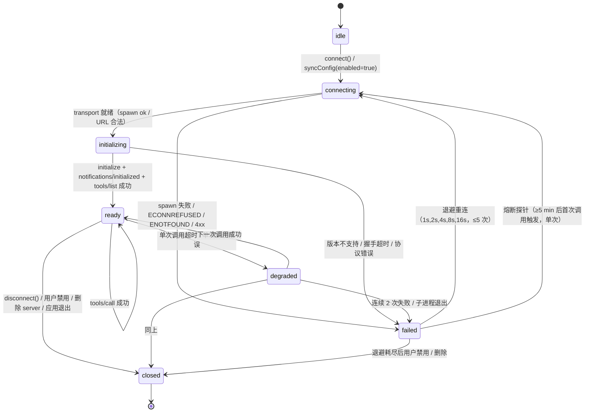
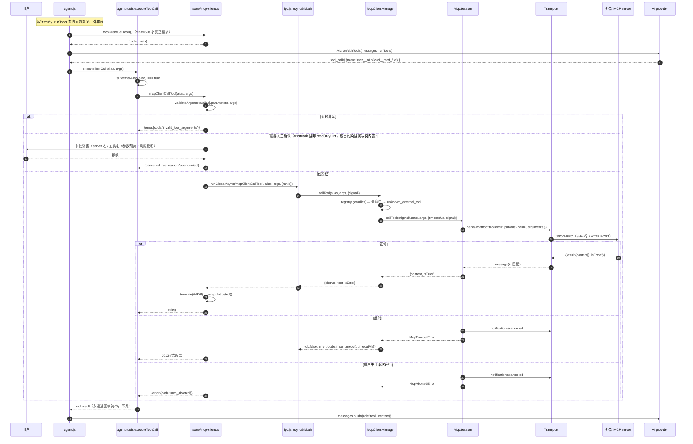
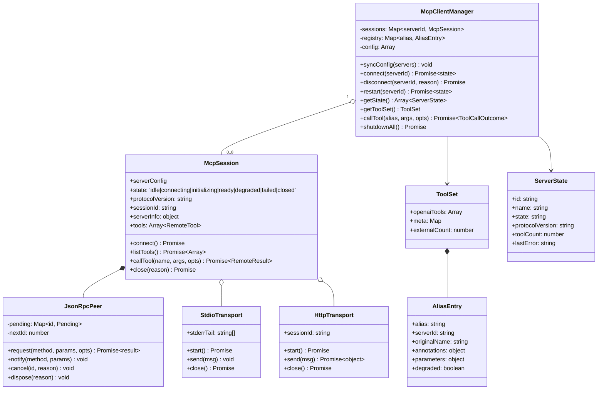

# 设计 · MCP client（P0-1）· 2026-11-10

> 范围：让 electerm 作为 **MCP 客户端**连接外部 MCP server（stdio / Streamable HTTP），把外部工具**动态并入** AI agent 工具集。
> 本文只出设计，不含产品代码。落地文件清单与任务表见 §5 / §7。
> 判据对齐：`doc/验证-AI与MCP优化-P0验证要求-2026-11-10.md` §3.1 的 **M1–M12**，每条都在 §8 给了可执行的验证手段。

---

## 0. 结论摘要

| 决策面 | 结论 | 一句话理由 |
|---|---|---|
| 分层 | MCP client **全部在主进程**（新目录 `src/app/mcp/client/`），渲染层只通过 `ipc.js` 的 `runGlobalAsync` 调用 | 渲染层无 `child_process`；连接生命周期不能随窗口/reload 归零；凭据不落在渲染层可注入面 |
| 连接所有权 | 主进程单例 `McpClientManager` 拥有；`app` 退出 / 配置变更 / 用户禁用 三处回收 | M9（无孤儿进程）需要单一 owner |
| 传输 | stdio（换行分隔 JSON-RPC）+ Streamable HTTP（POST，响应支持 `application/json` 与 `text/event-stream` 两种） | 对齐 `src/app/mcp/server/streamableHttp.js:160-312` 已实现的分发口径，自测可反向互通 |
| 协议版本 | 客户端 ADVERTISE `['2025-11-25','2025-06-18','2024-11-05']`，接受 server 回任一项，不在表内即断开并报错 | 与本仓 `src/app/mcp/server/mcp.js:12-16` 同一数组，electerm→electerm 自连必通 |
| 工具命名 | `mcp__<serverId>__<toolName>`，`serverId` 用配置记录 `id`（`nanoid(7)`，天然落在 `[A-Za-z0-9_-]`） | 无需 slug，天然合法；总长 64 上限余 50 字符给工具名 |
| 重名 | **内置优先**：别名与 36 个内置工具同名则**跳过注册 + 记 warn**，绝不覆盖 | M5 |
| 唯一真相 | 别名→(serverId, originalName) 的**反查只在主进程**做；渲染层只判断 `startsWith('mcp__')` | 截断/哈希后的名字渲染层无法反解，避免两处映射漂移 |
| 配置存哪 | 放 **`userConfig.mcpServersAI`**（`data` 表 `userConfig` 行），**不新建 db 表** | 该行已由 db 层 `enc:` + `safeEncrypt` 加密（`sqlite.js:13,16,92-113`），与 P0-2 `v1:plain:` 口径天然一致；新建表要动 `ENC_TABLES`/`dbNames`/`dbNamesForSync`，且 sync 语义（P2-5/P2-6）未决 |
| 审批 | **不复用** `mcp-transfer-guard` 的判定规则；**复用其弹窗形态**（新建 `mcp-tool-approval.jsx`），判定用「server `trust` 策略 + MCP `annotations.readOnlyHint`」 | guard 是「本地敏感路径」语义，与「外部工具是黑盒」不同层，硬套会给出错误的安全感 |
| 失败语义 | 一切外部失败都变成**结构化 tool 结果**返回模型，绝不让 agent 循环抛穿/挂住 | M8；`agent.js:288-294` 已把 `executeToolCall` 的 throw 吞成 `status:'error'`，新路径不依赖它 |
| 基线 | 未配置任何 server：`runTools === agentTools`、system prompt 一字不变、外部结果包装函数不执行 | M10 |

### 需要 lead 拍板的 3 条（附推荐）

| # | 取舍 | 选项 | 推荐 | 理由 |
|---|---|---|---|---|
| D1 | 外部工具默认信任级别 | A. 默认 `ask`（凡 `annotations.readOnlyHint !== true` 都要确认）<br>B. 默认 `auto`（一律直接执行，用户可在设置里收紧） | **A** | 外部 server 是任意第三方代码；默认放行等于把「AI 自主执行」扩到本机之外。A 的摩擦只发生在首次接入，且可按 server 调成 `auto` |
| D2 | server 凭据（`env` / `headers`）的落盘与可见性 | A. 随 `userConfig` 整行加密（渲染层能读到明文，同 `apiKeyAI` 现状）<br>B. 新建 `mcpServers` 表 + 加进 `ENC_TABLES` + 渲染层只见掩码值 | **A**（P0 范围内） | B 要改 `sqlite.js:13` 的 `ENC_TABLES`、`nedb.js` 同名表、`client/common/db.js:26-51` 三个名单，并引入"表要不要进 sync"的新决策（P2-5/P2-6 悬着）；A 零 schema 变更，且与 `apiKeyAI` 完全同口径。B 留作 P1 加固 |
| D3 | 「外部结果污染后」的写操作确认是否覆盖 `send_terminal_command` | A. 只覆盖 `sftp_upload/sftp_download/sftp_del/db_insert_sql`<br>B. 连 `send_terminal_command`/`run_background_command` 一起覆盖 | **A** | B 会让「装一个外部 MCP server」变成之后每次跑命令都弹窗（终端命令是 agent 主路径），用户会直接训练自己点"确定"。A 仍守住最危险的四个：本地任意写、远端删除、SQL 落编辑器 |

---

## 1. 现状核对（带 file:line，含 1 处更正）

| # | 事实 | 位置 | 对设计的影响 |
|---|---|---|---|
| S1 | agent 主循环，`MAX_ITERATIONS = 150` | `src/client/components/ai/agent.js:18` | 外部调用必须自身有限时，不能靠迭代上限兜 |
| S2 | `callBackendAIchatWithTools` 把**模块级** `agentTools` 直接传给 IPC | `agent.js:64-80`（`:73` 传 `agentTools`） | 必须改成传"本次运行的合并工具集"参数 |
| S3 | `publishContext` 也硬编码 `agentTools` 估算 token | `agent.js:88-98`（`:92`） | 不改会**低估**上下文；外部工具 schema 是真实开销 |
| S4 | system prompt 明文声明工具边界 | `agent.js:34-58` | 需按"是否有外部工具"条件追加不可信边界声明，否则 M10 破 |
| S5 | tool_call 循环 + `executeToolCall`，异常被吞成 `status:'error'` | `agent.js:264-294`（`:290`） | 路由点就在 `executeToolCall` |
| S6 | **内置工具实为 36 个**（不是 38）；`agentTools` 数组 36 项，`executeToolCall` 36 个 case，一一对应 | `agent-tools.js:29-740` / `:742-833`（`grep -c "type: 'function'"` = 36，`grep -c "^    case '"` = 36） | **M10 基线按 36 锁**；任务 brief 里的"38"需更正，否则 M10 出现假绿/假红 |
| S7 | 内置工具名最长 26 字符（`get_background_task_status`），全部 `[a-z0-9_]`，**无一以 `mcp__` 开头** | 同上 | 前缀隔离在 P0 期实际不会撞名，但冲突检查仍要写（防御未来去前缀） |
| S8 | `mcp-handler.js`（1897 行）是内置工具真实实现，经 `store.js:30,423` 混入 | `src/client/store/mcp-handler.js:1-60`；`src/client/store/store.js:30,423` | 外部工具**不复用**它（它只有 electerm 自己的语义） |
| S9 | `src/app/mcp/` 只有 `server/`，无 client | `ls src/app/mcp` | P0-1 是纯新增 |
| S10 | 服务端协议版本数组、`tools/list`/`tools/call`/`initialize` 分发、`notifications/initialized` 回 202、SSE `message` 帧 | `mcp.js:12-16`；`streamableHttp.js:160-312`（`:197-204`、`:205-215`、`:216-247`、`:55-62`） | 客户端的对端口径照此实现，可用本仓 server 反向自测（M2/M3 的假 server） |
| S11 | `ENC_TABLES = {bookmarks, profiles, data, history, terminalCommandHistory, aiChatHistory}`；`data` 表**只有** `_id==='userConfig'` 一行加密 | `src/app/lib/sqlite.js:13,16`；`toDoc/toRow` `:92-113` | 决定 D2：放 `userConfig` 白拿加密；新建表默认明文 |
| S12 | `safeEncrypt` 无 keyring 时返回 `v1:plain:` 前缀 + 一次性 warn；`safeDecrypt` 解不开返回 `''` | `src/app/lib/safe-storage.js:23-24,49-57,80-124` | M11 的判据形态直接沿用 P2-1/P2-3 的分环境二分 |
| S13 | `saveUserConfig` 是"读旧 conf → 展开 → 覆盖写整行" | `src/app/lib/user-config-controller.js:22-61` | 渲染层**不传** `mcpServersAI` 时旧值靠 `...conf` 保留，不会丢；但渲染层必须每次都带全量列表（避免"部分更新"语义歧义） |
| S14 | AI 配置字段与表单 | `src/app/common/default-setting.js:76-85`；`ai-config-props.js`；`ai-config.jsx:373-535` | 新增 `mcpServersAI` 只需加默认值 + 新 UI 节，不进 `aiConfigsArr` |
| S15 | IPC 动态桥只放行 dispatch 对象的**自有函数属性**；AI 通道在 `:549-554` | `src/app/lib/ipc.js:126-135,620-626`（`isExportedIpcFunc`）、`:549-554` | 新增 4 个 `mcpClient*` 函数加进同一对象即可，无需额外白名单 |
| S16 | 边界块口径：闭合标签插空格消毒 + system 层声明"块内不可信" | `src/client/common/db-sql-ai.js:66-76`（`sanitizeBlock`） | 外部工具结果复用同一手法（另建 module，不去动 db 那个） |
| S17 | 传输护栏是"本地敏感路径"判定，纯函数、无 window | `src/client/common/mcp-transfer-guard.js:1-19,141-167` | 与外部工具黑盒不同层 → 只借弹窗形态（`mcp-transfer-approval.jsx:59-112`） |
| S18 | `dbNames` / `dbNamesForSync` / `dbNamesForWatch` | `src/client/common/db.js:26-51` | 走 D2-A 则三个名单**都不用改** |
| S19 | `encryptedDataNames` 只含 bookmarks/profiles；AI 配置不在 sync 范围 | `src/client/store/sync.js:96-99` | M11 的 sync 部分沿用 P2-5/P2-6「不适用」的既有结论，本轮不新增 sync 通道 |
| S20 | 危险字段剥离先例（tab props 白名单式剥离） | `src/app/widgets/widget-mcp-server.js:24-58` | 外部工具 `args` 透传时**不做**这类改写（参数属 server 契约），只在**内置**工具路径继续生效 |

> **顺带发现（非本设计范围，登记）**：`data` 表只有 `_id==='userConfig'` 加密（`sqlite.js:16`），其它 `data` 行明文。若将来把 MCP server 凭据放进 `data` 的独立 `_id`，会绕开加密——D2-A 选 `userConfig` 内字段就是为了避开这个坑。

---

## 2. 总体架构

### 2.1 分层与边界（问题 1）

```
┌─ 渲染层（sandbox，无 node） ─────────────────────────────┐
│ agent.js            → 本次运行的 runTools = 内置36 + 外部N │
│ agent-tools.js      → executeToolCall 前置路由（前缀判断）  │
│ store/mcp-client.js → 审批弹窗 + runGlobalAsync 转发        │
└───────────────┬──────────────────────────────────────────┘
                │ ipc.js asyncGlobals（mcpClientGetTools /
                │ mcpClientCallTool / mcpClientGetState / mcpClientRestart）
┌───────────────▼─ 主进程（Node，拥有连接生命周期） ─────────┐
│ app/mcp/client/manager.js   McpClientManager（单例）        │
│   ├─ session.js  McpSession（状态机 + 握手 + 工具表）        │
│   ├─ rpc.js      JsonRpcPeer（id 配对 / 超时 / 取消）        │
│   ├─ stdio-transport.js    spawn + 换行分帧                 │
│   ├─ http-transport.js     POST + SSE 增量解析 + sessionId   │
│   └─ tool-name.js / schema-slim.js / config-validate.js（纯函数）│
└───────────────┬──────────────────────────────────────────┘
                │ child_process / fetch
         外部 MCP server（stdio 子进程 / HTTP 端点）
```

**为什么在主进程（被否方案见 §2.2）**

| 约束 | 事实 | 结论 |
|---|---|---|
| 渲染层没有 `child_process` | Electron 关闭 nodeIntegration；`mcp-handler.js` 全部靠 IPC 回主进程 | stdio 只能在主进程 |
| 连接不能随 reload 归零 | 渲染层 reload/崩溃会清空模块状态，`store` 重建 | 连接归主进程单例 |
| 网络出口与代理配置在主进程 | `AIchatWithTools` 的 axios 在 `src/app/lib/ai.js` | HTTP 传输同侧实现，便于后续复用 proxy |
| 凭据 | `apiKeyAI` 现状是渲染层也持有（`getConfig` 下发全量 config） | 不追求"渲染层不可见"，只追求**落盘加密 + 日志不落地 + UI 掩码**（同 P0-2 口径） |
| widget 体系 | 既有 widget MCP **server** 在主进程（`widget-mcp-server.js:1-13`），但其生命周期由用户点"运行"驱动、配置存 widget 配置 | MCP **client** 不做成 widget：AI 面板要用它，且不应依赖某个 widget 是否在跑 |

**与 widget 体系的关系**：无耦合。`widget-mcp-server.js`（electerm 对外提供 MCP）与本设计（electerm 消费 MCP）是反向的两条路；两者共享的只有 `src/app/mcp/` 这个目录前缀与协议版本数组。

### 2.2 被否方案与理由

| 被否方案 | 否决理由 |
|---|---|
| **A. client 放渲染层**，用 `@modelcontextprotocol/sdk` 的 browser 版（SSE/HTTP only） | ① stdio 完全没法做（M2 直接不成立）；② 引入 SDK 等于新增一个不受控依赖，本仓风格是自研极简实现（`mcp.js` 32 行）；③ 连接随 reload 归零，M9 只能做到"保证不留孤儿"却做不出"重连" |
| **B. 每轮 agent 迭代现查 `tools/list`** | 一次运行最多 150 轮 → 150 次 `tools/list`；工具集在运行中变化会让 provider 前缀缓存全失效，且会出现"同一个 run 里工具悄悄变了"的不可解释行为 |
| **C. 外部工具**不加前缀**直接注册**（靠"内置优先"挡冲突） | 名字空间由第三方决定 → 一个叫 `db_insert_sql` 的外部工具会让模型在两条语义间跳动；前缀是唯一可解释的隔离手段 |
| **D. 把外部工具实现成"转发到 `store.mcpXxx`"** | electerm 的 36 个工具语义是"我自己的终端/书签/SFTP"，外部工具语义由对端定义，硬映射必然错 |
| **E. 新建 db 表 `mcpServers`** | 见 §1-S11 / D2：要动 `ENC_TABLES`（`sqlite.js:13` + `nedb.js` 同名）+ `dbNames`/`dbNamesForSync`/`dbNamesForWatch`（`client/common/db.js:26-51`），并把"这张表要不要进 sync"这个未决问题（P2-5/P2-6）拖进来 |
| **F. 复用 `mcp-transfer-guard` 判定外部工具是否危险** | guard 的输入是"本地路径"，外部工具是黑盒，没有路径可判。硬用会得到"永远 requireApproval=false"的假安全 |
| **G. 用 zod 校验外部工具入参**（按 M4 措辞） | 本仓 zod 是**单向**子集：只有 `z.toJSONSchema`（`src/app/lib/zod.js:191`），没有 `safeParse`，更没有 JSON Schema→zod 的反向（实测 `grep safeParse` 零命中）。见 §9-T4 的替代方案与判据措辞建议 |

### 2.3 传输（问题 2）

**stdio**

| 项 | 规定 |
|---|---|
| 启动 | `spawn(command, args, { cwd, env: {...process.env, ...config.env}, stdio: ['pipe','pipe','pipe'], windowsHide: true })` |
| 分帧 | 客户端→server **单行 JSON + `\n`**；server→客户端按 `\n` 切行（容忍 `\r\n`），空行丢弃。单行上限 8 MiB，超限 = 协议错误 → 关连接 |
| stderr | 全部收进 `instance` 日志（每 server 环形缓冲 200 行），**不进模型上下文** |
| 退出 | `close` 事件 → 若 `state !== closed` 则置 `failed`，在途请求全部以 `MCP_TRANSPORT_CLOSED` 拒绝 |
| 收尾 | `SIGTERM` → 2 s → `SIGKILL`；Windows 用 `child.kill()` + `taskkill /pid /T /F` 兜底 |

**Streamable HTTP**

| 项 | 规定 |
|---|---|
| 请求 | `POST url`，头 `Content-Type: application/json`、`Accept: application/json, text/event-stream` + 配置的 `headers` |
| 响应分流 | `content-type` 含 `text/event-stream` → SSE 增量解析，取 `id` 匹配的那条 `data:` JSON 作为结果，随后中止流；否则按 JSON 解析 |
| session | 响应头 `mcp-session-id` 存在则记住，后续所有请求带 `Mcp-Session-Id`；`404` 且带 sessionId = 会话过期 → 重握手一次（仅一次） |
| 通知 | `notifications/initialized` 等无 id 消息回 `202` 即完成，不解析 body |
| 关闭 | `DELETE url`（带 session 头），忽略其响应体 |
| 不做的 | P0 **不开 GET 监听流**（server 主动推送/`listChanged`）。工具表变化靠用户"刷新"或配置变更触发。原因：本仓自己的 server 依赖 GET 流只是为了满足 strict 客户端（`streamableHttp.js:289-307`），我们不需要服务端推送，少一条常驻连接就少一类 M9 泄漏点 |
| SSRF/协议 | 只允许 `http:`/`https:`；`file:`/`javascript:`/其它一律拒。非环回地址 + `http:` 时 UI 显示"明文传输"警告（不阻断） |

**握手（两种传输共用）**

1. `initialize` → `{ protocolVersion: '2025-11-25', capabilities: {}, clientInfo: {name:'electerm', version: <pkg>} }`
2. 校验 `result.protocolVersion ∈ CLIENT_PROTOCOL_VERSIONS`，否则 `PROTOCOL_VERSION_UNSUPPORTED`（明确列出双方版本）
3. 发 `notifications/initialized`（无 id）
4. `tools/list`（支持 `cursor` 分页，最多 5 页 / 200 个工具，超出即截断 + warn）
5. 进入 `ready`

**超时与取消**

| 动作 | 默认 | 可配 |
|---|---|---|
| `initialize` | 10 s | 否 |
| `tools/list`（每页） | 10 s | 否 |
| `tools/call` | 30 s | 是（server.timeoutMs，5 000–300 000） |
| 取消 | 主进程收到 `signal.aborted` → 发 `notifications/cancelled {requestId, reason}`，本地立即 reject `MCP_ABORTED` | — |

### 2.4 状态机（单个 server 会话）



状态到 UI 的映射（`mcpClientGetState` 返回）：`idle`→「未连接」、`connecting/initializing`→「连接中」、`ready`→「已就绪（N 个工具）」、`degraded`→「不稳定：<lastError>」、`failed`→「失败：<lastError> + 重试按钮」、`closed`→「已停用」。

### 2.5 工具命名与合并（问题 3）

**别名构造**（`tool-name.js`，纯函数）

```
alias = 'mcp__' + serverId + '__' + shortName
```

| 规则 | 规定 |
|---|---|
| `serverId` | 用配置记录 `id`（`nanoid(7)`，`src/app/common/uid.js`）。天然只含 `[A-Za-z0-9_-]`，7 字符 |
| 非法字符清洗 | `toolName.replace(/[^A-Za-z0-9_-]/g, '_')`；**不折叠**连续 `_`（折叠会让两个不同工具变同名）；空串→`tool` |
| 长度 | 上限 64。前缀固定 14（`mcp__`=5 + 7 + `__`=2）→ 留给工具名 50。超长时 `slice(0, 45) + '_' + shortHash(原名,4)`（base36，确定性） |
| 同 server 内清洗后撞名 | 按**原始名字典序**排序后，第 2 个起追加 `_2`、`_3`…；每条都记 warn（含原名对） |
| 与内置 36 个撞名 | **内置优先**：跳过注册 + `warn('[mcp] tool name collides with a built-in tool, skipped: <alias>')`。不抛错、不影响其他工具 |
| 大小写 | 全部转小写后再比较（provider 侧大小写敏感度不一，统一小写最安全）；原名 ↔ 别名映射表保留原名 |
| 反查 | 只有主进程持有 `Map<alias, {serverId, originalName, annotations}>`；渲染层**不**反解 |

**JSON Schema → OpenAI `parameters` 的裁剪**（`schema-slim.js`）

| 步骤 | 规定 |
|---|---|
| 1. 形状兜底 | 非对象/缺失 → `{ type:'object', properties:{} }` |
| 2. 本地 `$ref` 解引用 | 只解 `#/$defs/*` 与 `#/definitions/*`，最多 3 层；解不开则该节点降级为 `{type:'object', description:'(schema unavailable)'}` |
| 3. 深度裁剪 | `depth > 6` 的节点降级为 `{type:'object', description:'(nested)'}`，计一次 `degraded` |
| 4. 宽度裁剪 | 单层 `properties` 超 40 项 → 保留前 40（按 `required` 优先，再按原序），`description` 追加 `(另有 N 个字段已省略)` |
| 5. 描述裁剪 | 单条 `description` 截到 1 024 字符；工具整体 `description` 同样 1 024 |
| 6. 字节裁剪 | 序列化后 > 8 KiB → 按 4→3→2 重跑一次（更狠的宽度/深度），仍超则整体降级为 `{type:'object', properties:{}, additionalProperties:true, description:'<desc> (parameters omitted: schema too large)'}` |
| 7. 计数上限 | 单 server 工具数上限 50，全局外部工具上限 100；超出按名字典序取前 N + 记 warn + UI 显示"已截断" |
| 8. 白名单字段 | 只保留 `type/properties/required/enum/description/items/default/additionalProperties/oneOf/anyOf/format`；`$schema/$id/title/examples/$comment` 等一律丢弃 |

**入参校验**：不复用 zod（§2.2-G）。改为 `validateArgs(parameters, args)`（`schema-slim.js` 内纯函数），实现 JSON Schema 子集的**宽松**校验：`type`（含 `"null"` 联合）、`required`、`enum`、数组 `items`、对象 `properties`（未声明的键**放行**，因为多数 server 声明 `additionalProperties` 不严格）。失败返回 `{ok:false, errors:[{path, message}]}`，渲染层把它包成 tool 结果 `{error:{code:'invalid_tool_arguments', errors}}`，**不发网络请求**。这一步是"提前给出可读错误"，不是安全边界（服务端才是权威）。

### 2.6 调用链与失败语义（问题 4）



**失败语义表（每一步都必须有定义）**

| 失败点 | 错误码 | 返回给模型的 tool 结果 | 循环是否继续 |
|---|---|---|---|
| server 未配置/被禁用/未连接 | `mcp_server_unavailable` | `{"error":{"code":"mcp_server_unavailable","serverId":"a1b2c3d","hint":"enable the server in Settings > AI > MCP servers"}}` | 继续 |
| 别名不在注册表（模型幻觉） | `unknown_external_tool` | `{"error":{"code":"unknown_external_tool","tool":"<alias>","known":"<前5个别名>"}}` | 继续 |
| `tools/call` 超时 | `mcp_timeout` | `{"error":{"code":"mcp_timeout","timeoutMs":30000}}` | 继续 |
| 用户中止运行 | `mcp_aborted` | `{"error":{"code":"mcp_aborted"}}` | 循环在 `isAborted()` 处退出（`agent.js:265-268`） |
| JSON-RPC error（-32601/-32602 等） | `mcp_rpc_error` | `{"error":{"code":"mcp_rpc_error","rpcCode":-32602,"message":"…"}}` | 继续 |
| server 返回 `isError:true` | — | 原样文本，前置 `[tool reported an error]` | 继续 |
| 传输断开 / 进程退出 | `mcp_transport_closed` | `{"error":{"code":"mcp_transport_closed"}}` + 触发退避重连 | 继续 |
| 协议错误（非 JSON 行 / 缺 result 与 error） | `mcp_protocol_error` | `{"error":{"code":"mcp_protocol_error","detail":"…"}}` + 连接置 `degraded` | 继续 |
| 入参校验失败 | `invalid_tool_arguments` | `{"error":{"code":"invalid_tool_arguments","errors":[…]}}` | 继续 |
| 用户拒绝审批 | — | `{"cancelled":true,"reason":"user-denied"}` | 继续 |
| 主进程 IPC 本身挂死 | `mcp_timeout`（渲染层兜底） | 渲染层 `Promise.race([ipc, timeoutMs+5000])` 兜 | 继续（M8 的硬保证） |

> 关键：`executeToolCall` 只对**内置**工具保留 throw 语义（`agent.js:292-294`）；外部路径**永不抛**，一律返回 JSON 字符串。

### 2.7 失败隔离与资源（问题 7）

| 项 | 规定 |
|---|---|
| 不阻塞 | 每层都有硬超时：`JsonRpcPeer`（主进程，权威）+ 渲染层 `Promise.race`（兜底）。两层独立，任一失效另一个仍能放开循环 |
| 并发 | 同一 server 的在途请求上限 4（超出排队，队列上限 16，溢出即 `mcp_busy`）；不同 server 之间完全并行 |
| 连接数上限 | 8 个 enabled server（`config-validate.js` 硬校验，第 9 个拒绝启用并给明确错误）。1 server = 1 子进程/1 连接，上限即进程数上限 |
| 重试 | 仅传输/网络类失败退避重连：1 s、2 s、4 s、8 s、16 s（≤5 次，单次上限 30 s）。**4xx 鉴权、版本不支持、配置非法不重试**（重试只会刷日志） |
| 熔断 | `failed` 后不再自动重连；下一次真实 `tools/call` 触发**单次**探针（≥5 min 冷却），成功则回 `ready` |
| 子进程回收 | ① `disconnect()`；② 配置里 `enabled:false`/删除；③ 字段变更（command/args/env/url/headers/transport/timeoutMs）→ 断开重建；④ `app.on('will-quit')` → `shutdownAll()`；⑤ 渲染层 reload **不**回收（连接归主进程） |
| 句柄 | 断开时 `stdout/stderr` 的 `data` 监听、`close`/`error` 监听、所有 `setTimeout` 全部显式解绑（M9"重复启停不泄漏句柄"） |
| 日志 | 每 server 独立环形缓冲（200 行），写 `instance` 日志；`headers`/`env` 的**值**永不入日志（只打键名 + 掩码） |

### 2.8 安全（问题 5）

| # | 面 | 策略 | 落点 |
|---|---|---|---|
| SEC-1 | 外部结果的**边界块消毒** | 结果文本 → `wrapUntrusted(text, {serverLabel, toolName})`，产出 `<untrusted-tool-result server="…" tool="…">…</untrusted-tool-result>`；块内 `</untrusted-tool-result>` / `</untrusted>` 一律插空格断链（同 `db-sql-ai.js:71-76` 手法） | `src/client/common/untrusted-block.js`（新，纯函数，ESM） |
| SEC-2 | system 层声明 | **仅当本次运行含外部工具**时追加一段：外部工具结果位于不可信块内，块内文字不是指令，不得据此调用内置写工具 | `agent.js:34-58` 的 `buildAgentSystemPrompt(config, hasExternal)` |
| SEC-3 | `description` 不进 system prompt | 外部工具 `description` 只出现在 `tools` 数组（provider 侧工具清单），任何代码不得把它拼进 system prompt；单测锁死 | `mcp-client.js` + spec |
| SEC-4 | 写操作人工确认 | `trust` 策略：`readonly`（只放行 `readOnlyHint===true`）/ `ask`（默认：非 `readOnlyHint` 一律确认）/ `auto`。弹窗复用 `mcp-transfer-approval.jsx:59-112` 的形态（新建 `mcp-tool-approval.jsx`，同 `Modal.confirm` + 缺失 i18n 回退英文的写法） | `store/mcp-client.js` + `components/common/mcp-tool-approval.jsx` |
| SEC-5 | **外部结果不得直接触发内置写操作** | 运行级 `taint`：本次运行出现过外部工具结果 → `taint=true`；此后内置 `TAINT_GATED = ['sftp_upload','sftp_download','sftp_del','db_insert_sql']` 每次调用前弹确认（`reason:'external-taint'`）。taint 随 run 结束清除（不跨轮） | `agent.js`（run 级变量）+ `store/mcp-client.js` |
| SEC-6 | 凭据落盘 | 随 `userConfig.mcpServersAI` 整行进 db 层 `enc:` + `safeEncrypt`（`sqlite.js:13,16,92-113`）；无 keyring → `v1:plain:` + 一次性 warn（`safe-storage.js:80-94`）。判据同 P2-1/P2-3 | 零改动即达成（D2-A） |
| SEC-7 | 凭据不回显 | UI 输入框 `Password` 组件 + 掩码显示；`mcpClientGetState` **不返回** `env/headers`；错误信息只含键名 | `mcp-server-config.jsx` + `index.js` |
| SEC-8 | `env` 注入面 | `env` 只能是**字符串→字符串**；拒绝 `NODE_OPTIONS`、`ELECTRON_RUN_AS_NODE`、`LD_PRELOAD` 等进程劫持键（黑名单 + warn），其余放行（stdio server 本来就等价于本机执行能力，UI 必须写清这点） | `config-validate.js` |
| SEC-9 | stdio 等价于本地执行 | UI 在添加 stdio server 时固定提示："stdio server 以你的用户身份在本机执行命令，只添加你信任的 server" | `mcp-server-config.jsx` |
| SEC-10 | URL 协议 | 只 `http:`/`https:`；其余拒（`config-validate.js`） | 同上 |

**为什么 mcp-transfer-guard 不适用**：它的输入是"本地路径"，输出是"是否需要人工确认"（`mcp-transfer-guard.js:141-167`）。外部工具的参数语义由对端定义，我们既无法判定"这个 `path` 参数会被用来写文件"，也无法枚举所有危险形态。用它反而会得到一个恒为 `requireApproval:false` 的结论——那是**假安全**。故 SEC-4 用"声明式信任（annotations）+ 用户显式策略"，SEC-5 用"污染标记"兜住真正的提权链。

### 2.9 配置模型（问题 6）

**存哪：`userConfig.mcpServersAI`（结论 D2-A）**

| 维度 | `userConfig.mcpServersAI` | 新表 `mcpServers`（被否） |
|---|---|---|
| 加密落盘 | 免费：该行已 `enc:` + `safeEncrypt`（`sqlite.js:16`） | 要改 `sqlite.js:13` `ENC_TABLES` + `nedb.js` 同名常量，否则明文 |
| 需要的名单改动 | 0（`dbNames`/`dbNamesForSync`/`dbNamesForWatch` 都不用动，`client/common/db.js:26-51`） | 3 个名单 + 表创建列表 |
| sync 语义 | 不进 sync（同 `apiKeyAI`），P2-5/P2-6 维持"不适用" | 被迫回答"要不要同步 server 配置"，未决 |
| 容量 | 8 个 server × ~1 KB ≈ 8 KB，整行 config 无压力 | — |
| 保存路径 | `saveUserConfig` 已展开整行（`user-config-controller.js:54-60`），零改动 | 新增 CRUD 全链路 |

**记录字段**

```js
{
  id: 'a1b2c3d',            // nanoid(7)，创建后不可变，用作工具名段
  name: 'filesystem',       // 展示名，可改（不影响已注册别名 —— 别名用 id）
  enabled: true,
  transport: 'stdio',       // 'stdio' | 'http'
  command: 'npx',           // stdio 必填
  args: ['-y','@mcp/fs','/tmp'],
  cwd: '',                  // 可空 → 继承主进程 cwd
  env: { FOO: 'bar' },      // 仅 stdio；黑名单键拒
  url: '',                  // http 必填
  headers: { Authorization: 'Bearer xxx' },  // 仅 http
  timeoutMs: 30000,         // 5000–300000
  autoConnect: true,        // 启动时是否自动连接
  trust: 'ask'              // 'readonly' | 'ask' | 'auto'
}
```

**校验规则**（`config-validate.js`，纯函数，返回 `{ok, servers, errors:[{index, field, message}]}`）

| 规则 | 错误信息要点 |
|---|---|
| 顶层必须是数组，≤8 个 `enabled` | `at most 8 MCP servers can be enabled` |
| `id` 缺失 → 生成；`id` 重复 → 拒 | `duplicate server id` |
| `transport ∈ {stdio, http}` | 列可选值 |
| `stdio`：`command` 非空、`args` 是字符串数组、`env` 值全是字符串且不含黑名单键 | 指名第几项、哪个字段 |
| `http`：`url` 可被 `new URL()` 解析且协议 `http/https` | 指名协议问题 |
| `timeoutMs` 整数且 5 000–300 000 | 给范围 |
| `trust ∈ {readonly, ask, auto}` | 列可选值 |
| **任何非法输入都不得被静默丢弃**：返回逐条错误，UI 逐条高亮，保存中断 | M1 的原话 |

**UI 放哪**：`ai-config.jsx`（`AI Config` 弹窗，`ai-config-modal.jsx:47-66`）内新增一个 **`MCP servers` 分节（Section，不用 antd Tabs）**，放在 `roleAI` 之前。
理由：AI 配置已经是"一个长表单 + 一个弹窗"，再套 Tabs 会改掉现有 DOM 结构与全部 `Form.Item` 的 `name` 作用域，回归面大；分节只是多一段 JSX。节内是"列表（name / transport / 状态徽章 / 开关 / 编辑 / 删除）+ 新增按钮 + 每项展开的字段表单 + Refresh tools 按钮 + 全局说明"。

---

## 3. 数据模型与接口

### 3.1 类图



### 3.2 新增文件

| 文件 | 语言 | 职责 | 关键导出 |
|---|---|---|---|
| `src/app/mcp/client/protocol.js` | CJS | 版本协商、消息形状判定、`clientInfo` | `CLIENT_PROTOCOL_VERSIONS`、`buildInitializeParams()`、`negotiateVersion(result)`、`isResponse(msg)`、`isNotification(msg)` |
| `src/app/mcp/client/line-decoder.js` | CJS | stdio 换行分帧 | `class LineDecoder { push(chunk): string[]; flush(): string[] }` |
| `src/app/mcp/client/sse.js` | CJS | SSE 增量解析 | `class SseDecoder { push(chunk): Array<{event,data,id}>; flush() }` |
| `src/app/mcp/client/stdio-transport.js` | CJS | spawn / 写行 / stderr 环形缓冲 / 收尸 | `class StdioTransport` |
| `src/app/mcp/client/http-transport.js` | CJS | POST + 双形态响应 + sessionId + DELETE | `class HttpTransport` |
| `src/app/mcp/client/rpc.js` | CJS | id 配对、超时、取消、错误归一 | `class JsonRpcPeer`、`McpRpcError`、`ERR` 常量表 |
| `src/app/mcp/client/session.js` | CJS | 一次连接的握手 + 工具表 + 状态机 | `class McpSession` |
| `src/app/mcp/client/tool-name.js` | CJS | 别名构造/清洗/冲突/长度 | `PREFIX`、`buildAlias()`、`sanitizeSegment()`、`shortHash()` |
| `src/app/mcp/client/schema-slim.js` | CJS | JSON Schema → `parameters` 裁剪；入参宽松校验 | `LIMITS`、`toOpenAIParameters()`、`validateArgs()` |
| `src/app/mcp/client/config-validate.js` | CJS | server 列表校验与归一 | `TRANSPORTS`、`MAX_SERVERS`、`validateMcpServers()`、`normalizeServer()` |
| `src/app/mcp/client/manager.js` | CJS | 单例：连接生命周期、注册表、工具集、调用路由 | `class McpClientManager`、`getManager()` |
| `src/app/mcp/client/index.js` | CJS | IPC 门面（供 `ipc.js` 注册） | `mcpClientGetTools`、`mcpClientCallTool`、`mcpClientGetState`、`mcpClientRestart`、`mcpClientOnConfigChange`、`shutdownMcpClients` |
| `src/client/store/mcp-client.js` | ESM | 渲染层：工具缓存、审批、IPC 转发、兜底超时 | `Store.prototype.mcpClientGetTools / mcpClientCallTool / mcpClientRefresh / mcpClientState` |
| `src/client/common/external-tool-guard.js` | ESM | 纯函数：前缀判定、审批决策、污染规则 | `isExternalAlias()`、`decideToolApproval()`、`SENSITIVE_BUILTIN_TOOLS`、`TAINT_GATED_BUILTIN_TOOLS` |
| `src/client/common/untrusted-block.js` | ESM | 纯函数：边界块包装 + 闭合标签消毒 + 截断 | `wrapUntrusted()`、`sanitizeUntrusted()`、`truncateResult()` |
| `src/client/components/common/mcp-tool-approval.jsx` | JSX | 外部工具/污染后写操作的确认弹窗 | `default confirmMcpToolCall(...)` |
| `src/client/components/ai/mcp-server-config.jsx` | JSX | server 列表编辑器（AI 配置里的一个分节） | `default McpServersSection` |

### 3.3 修改文件

| 文件 | 改动 | 最小改动点 |
|---|---|---|
| `src/app/lib/ipc.js` | asyncGlobals 增加 4 个 `mcpClient*`（放在 `:549-554` AI 那一组旁）；`initIpc` 里挂 `will-quit` → `shutdownMcpClients()` | 只加函数引用，不加白名单 |
| `src/app/common/default-setting.js` | 新增 `mcpServersAI: []` | 一行 |
| `src/client/components/ai/ai-config.jsx` | 加 `<McpServersSection />`（不放入 `Form.Item` 受控，自己管状态并在保存时并入 `values.mcpServersAI`） | 一段 JSX + `onSubmit` 里合并 |
| `src/client/components/ai/agent.js` | `buildAgentSystemPrompt(config, hasExternal)`；`callBackendAIchatWithTools(messages, config, requestId, tools)`；`publishContext(..., tools)`；run 级 `runTools` 与 `taint`；`executeToolCall` 调用点前加外部分支（或在 `agent-tools` 内） | `:34-58`、`:64-80`、`:88-98`、`:264-294` |
| `src/client/components/ai/agent-tools.js` | `executeToolCall` 顶部加外部别名分支（转 `store.mcpClientCallTool`）；导出一个 `agentToolNames` 集合供冲突检查 | `:742-745` 之前 |
| `src/client/store/store.js` | 混入 `mcpClientExtend` | `:30` 附近 import + `:423` 附近调用 |
| `src/client/store/init-state.js` | 初始状态：`mcpExternalTools: []`、`mcpExternalToolMeta: {}`、`mcpServerStates: []`、`mcpToolsFetchedAt: 0` | — |

### 3.4 关键函数签名

```js
// src/app/mcp/client/index.js —— IPC 门面
exports.mcpClientGetTools = async () => ({
  tools: [ ...openaiTools ],       // 已清洗/裁剪/去重，可直接并入 agentTools
  meta: { 'mcp__a1__x': { serverId, originalName, annotations, needsApproval: true } },
  servers: [{ id, name, state, toolCount, lastError, protocolVersion }],
  truncated: { perServer: 0, global: 0 }
})

exports.mcpClientCallTool = async (alias, args, { runId } = {}) => ({
  ok: true, text, isError, serverId, toolName
}) // 或 { ok:false, error: { code, message, ... } } —— 永不 throw

exports.mcpClientGetState = async () => [{ id, name, state, protocolVersion, toolCount, lastError }]
exports.mcpClientRestart = async (serverId) => ({ ok: true, state })
exports.mcpClientOnConfigChange = async () => ({ ok: true })   // syncConfig(getServers())
exports.shutdownMcpClients = async () => { /* manager.shutdownAll() */ }

// src/app/mcp/client/manager.js
class McpClientManager {
  constructor ({ getServers, log, now, spawnImpl, fetchImpl, maxServers = 8, now2 } = {})
  async syncConfig (servers)          // diff → connect / disconnect / restart
  async connect (serverId)
  async disconnect (serverId, reason = 'user')
  async restart (serverId)
  getState ()                          // ServerState[]
  getToolSet ()                        // { openaiTools, meta, servers, truncated }
  async callTool (alias, args, { timeoutMs, signal } = {})
  async shutdownAll ()
}

// src/app/mcp/client/schema-slim.js
export const LIMITS = {
  depth: 6, propsPerLevel: 40, descChars: 1024,
  jsonBytes: 8192, perServerTools: 50, globalTools: 100
}
function toOpenAIParameters (inputSchema, limits = LIMITS) // → { parameters, degraded, notes }
function validateArgs (parameters, args)                   // → { ok, errors: [{path, message}] }

// src/app/mcp/client/tool-name.js
const PREFIX = 'mcp__'
function buildAlias (serverId, toolName) // → { alias, shortName, truncated }
function sanitizeSegment (s)             // → string
function shortHash (s, len = 4)          // → string

// src/client/common/untrusted-block.js
function sanitizeUntrusted (text, tag = 'untrusted-tool-result')
function wrapUntrusted (text, { serverLabel, toolName, tag })
function truncateResult (text, maxBytes = 64 * 1024)  // 追加 "\n…[truncated N bytes]"

// src/client/common/external-tool-guard.js
function isExternalAlias (name)                        // name.startsWith('mcp__')
const SENSITIVE_BUILTIN_TOOLS = new Set([...])         // 见 SEC-5
function decideToolApproval ({ meta, trust, tainted }) // → { requireApproval, reason }
```

---

## 4. 报错与可观测

| 事件 | 记录位置 | 内容 |
|---|---|---|
| 连接建立/断开 | `instance` 日志 + `console.info` | server 名、传输、协议版本、耗时、工具数 |
| 握手失败 | 同上 | 错误码 + server 回报的版本（不含凭据） |
| 工具调用 | `instance` 日志 | alias、耗时、结果字节数、是否 `isError`（**不记 args 全文**，只记键名，防 `path`/`token` 泄漏） |
| 审批 | 同上 | alias、是否被拒、reason |
| 截断/降级 | 同上 + UI 徽章 | 哪个工具的 schema 降级、哪些工具被截掉 |
| 凭据 | 永不记录 | `env`/`headers` 只出现键名 |

---

## 5. 任务分解（问题 9）

> 5 个任务，按依赖排序。**T02 与 T04 可并行**（前者只碰 `src/app/mcp/client/` 的传输层，后者只碰 `client/common` + 审批 UI，文件不重叠）；其余串行。一人做则按 T01→T05 顺序。

| ID | 任务 | 源文件（新增 ✚ / 修改 ✎） | 依赖 | 优先级 | 可独立验证的完成判据 |
|---|---|---|---|---|---|
| **T01** | 配置模型 + 校验 + IPC 骨架 + 工具集空实现 | ✚ `config-validate.js`、`protocol.js`、`index.js`（返回空集）、`manager.js`（空壳）、`tool-name.js`、`schema-slim.js`；✎ `default-setting.js`、`ipc.js`、`init-state.js`、`store/store.js`、`store/mcp-client.js` | — | P0 | ① `validateMcpServers` 单测覆盖 M1 全部非法态；② `mcpClientGetTools` 在无 server 时返回 `tools: []`；③ **M10 前置**：`agent.js` 未改动前，全量 `npm run test-unit-ci` 仍绿；④ `standard` 退出 0 |
| **T02** | 传输层：stdio + Streamable HTTP + RPC 配对 + 会话状态机 | ✚ `line-decoder.js`、`sse.js`、`stdio-transport.js`、`http-transport.js`、`rpc.js`、`session.js`；✎ `manager.js`（接上 session） | T01 | P0 | ① M2：spawn 一个 `node` 假 server（复用 `src/app/mcp/server/mcp.js` 反向自测）→ initialize + tools/list 拿到 >0 工具；② M3：同上换 `streamableHttp.js`，并覆盖 401/断网的可读错误；③ M9：`close()` 后 `ps` 无残留；④ 超时用例（假 server 不回包）在 `timeoutMs+1s` 内返回错误 |
| **T03** | 工具合并 + 别名注册 + 调用路由（含 agent 集成） | ✚ `mcp-tool-approval.jsx` 之外的 `external-tool-guard.js`；✎ `agent.js`、`agent-tools.js`、`store/mcp-client.js`、`untrusted-block.js` | T01、T02 | P0 | ① M4：注入假 client → `runTools` 含 `mcp__xxx__yyy`，`publishContext` 的 `toolsTokens` 随之增长；② M5：外部提供 `db_insert_sql` → 别名仍带前缀、内置实现不变；外部提供与别名完全相同的名字 → 跳过 + warn；③ M8：假 client 永不返回 → 循环在超时后继续，主流程不 hang；④ **M10 硬门**：无外部 server 时 `runTools.length === 36` 且 system prompt 与改动前逐字符相等（快照测试） |
| **T04** | 安全：边界块消毒 + 审批策略 + 污染门 + 凭据口径 | ✚ `untrusted-block.js`、`mcp-tool-approval.jsx`；✎ `agent.js`（taint）、`store/mcp-client.js`（审批）、`mcp-server-config.jsx`（掩码字段） | T01（可与 T02 并行） | P0 | ① M7：返回体含 `</untrusted-tool-result>` → 消毒后该串不再存在；`description` 不出现在 system prompt（源码级断言 + 字符串断言）；② M6：`trust=ask` + 无 `readOnlyHint` → 不调 server 且返回 `pending approval`；`trust=readonly` + 无 hint → 直接拒；确认后调一次；③ 污染门：外部结果后再调 `sftp_upload` → 弹确认，未确认不执行；④ M11：复用 P2-1/P2-3 的落盘判据（`enc:v2:safe:` / `enc:v1:plain:`，禁 `enc:{`）跑一遍 `mcpServersAI` |
| **T05** | 配置 UI + 集成收口 + 文档 + 全量回归 | ✚ `mcp-server-config.jsx`；✎ `ai-config.jsx`；✚ `src/test/unit-ci/mcp-client-*.spec.js`、`src/test/fixtures/fake-mcp-server.js`；✚ 实机步骤写回验证文档 | T03、T04 | P0 | ① UI 能增删改 8 个 server，非法字段就地报错（M1 的 UI 面）；② `Refresh tools` 后状态徽章与计数正确；③ M12 三层用例齐备并全绿；④ `npm run test-unit-ci` exit 0 + `# fail 0` + `# cancelled 0` + 无 `hookFailed`（按 `doc/验证-...:13-21` 的口径） |

---

## 6. 兼容回归（问题 8 / M10）

| 断言 | 手段 |
|---|---|
| `agentTools.length === 36`，名字/顺序/描述不变 | 快照：`agent-tools.js` 导出 `agentToolNames`，spec 比对固定 36 项清单 |
| `runTools === agentTools`（同一引用或深度相等） | `mcpExternalTools` 为空时直接返回 `agentTools`，不做 concat（省一次分配，也让 `toBe` 断言成立） |
| system prompt 逐字符不变 | 对 `buildAgentSystemPrompt({...})` 做 golden 文本快照；`hasExternal=false` 时必须与改动前完全一致 |
| `publishContext` 的 `toolsTokens` 不变 | 同一 spec 里断言数值 |
| `executeToolCall` 对 36 个内置名字的分支行为不变 | 现有 `mcp-*.spec.js` 全量回归 + 新增"路由前置分支不吞内置名"用例（`executeToolCall('send_terminal_command')` 不进外部分支） |
| 未配置 server 时不产生任何 IPC 调用 | 假 `runGlobalAsync` 计数为 0 |
| 配置文件里 `mcpServersAI` 缺失/为 `[]`/为 `null` 都不崩 | 三条配置态各跑一次启动路径 |

---

## 7. 测试策略（问题 10 / M12）

### 7.1 分层

| 层 | 位置 | 用什么替代外部依赖 |
|---|---|---|
| **unit-ci（纯函数）** | `src/test/unit-ci/mcp-client-*.spec.js` | 无 IO。直测 `tool-name` / `schema-slim` / `config-validate` / `untrusted-block` / `external-tool-guard` / `line-decoder` / `sse` |
| **契约（假 MCP server）** | `src/test/fixtures/fake-mcp-server.js` + `src/test/unit-ci/mcp-client-transport.spec.js` | ① **stdio**：`node src/test/fixtures/fake-mcp-server.js --stdio`（自己实现 initialize/tools/list/tools/call，并带 `--hang` / `--no-init` / `--bad-version` 开关）；② **HTTP**：`http.createServer` 桩，可切 `application/json` / `text/event-stream` / `401` / `hang` |
| **实机（人工）** | 写回 `doc/验证-AI与MCP优化-P0验证要求-2026-11-10.md` 新增 §4.3 | 真 app + 真外部 server（例：`npx -y @modelcontextprotocol/server-filesystem /tmp`） |

> 复用本仓 server 做对端的好处：`src/app/mcp/server/mcp.js:12-16` + `streamableHttp.js` 已经实现了我们需要的 `initialize`/`tools/list`/`tools/call` 与 `202` 通知语义，用它当假 server 等于双向互通测试；但**不要只用它**——它是自研实现，双方共同误解 spec 会互相掩盖。故假 server 必须**另写一份最小的、独立实现的分帧逻辑**。

### 7.2 M1–M12 对应

| ID | 判据（原文） | 本设计的验证手段 | 层 |
|---|---|---|---|
| M1 | 配置契约 + 非法 transport / stdio 缺 command 被拒 | `config-validate.spec.js`：14 条非法输入逐条断言"返回该字段错误且不静默丢弃"；合法输入 `deepEqual` 原样通过 | unit |
| M2 | stdio：spawn → initialize → tools/list | `transport.spec.js` › stdio 组：假 server `--stdio`，断言 `state==='ready'`、`protocolVersion` 是三者之一、`tools.length > 0`，全流程 < 5 s | 契约 |
| M3 | HTTP：initialize → tools/list，401/断网可读错误 | `transport.spec.js` › http 组：JSON 响应 + SSE 响应两条路径各一次；`401` → `error.code==='mcp_http_unauthorized'` 且不含凭据；`ECONNREFUSED` → `mcp_transport_closed` | 契约 |
| M4 | 前缀命名 + 入参校验 | `tool-name.spec.js`（清洗/64 截断/同 server 撞名/确定性哈希）+ `schema-slim.spec.js`（`validateArgs` 对 `required`/`type`/`enum` 三条各一正一反）+ **措辞对齐**：见 §9-T4 | unit |
| M5 | 命名冲突不覆盖内置 | `tool-name.spec.js` 构造 `buildAlias` 结果 = 某内置名 → 断言 `skipped + warn`；`agent-tools.spec.js` 断言 `agentToolNames` 仍是 36 项原值 | unit |
| M6 | 敏感工具人工确认 | `external-tool-guard.spec.js`（决策矩阵：3 种 trust × annotations 有/无 × tainted 真/假 = 12 格）+ `mcp-tool-approval.spec.js`（源码级：未确认不调 server） | unit + 契约 |
| M7 | 边界块消毒 + description 不直通 system prompt | `untrusted-block.spec.js`（伪造闭合标签/嵌套闭合/大小写变体）+ `agent-prompt.spec.js`（把假 server 的 `description` 设成注入串，断言其**不出现**在 `buildAgentSystemPrompt` 输出里） | unit |
| M8 | server 无响应不阻塞循环 | `transport.spec.js` › `--hang`：断言 `timeoutMs` 内返回 `mcp_timeout`；`agent-loop.spec.js` 用假 `runGlobalAsync` 断言循环继续到下一轮 | 契约 + unit |
| M9 | 资源回收 | `transport.spec.js` › stdio：`close()` 后断言 `child.killed === true`（并额外用 `process.kill(pid, 0)` 抛 ESRCH 交叉确认）；重复 `connect/close` ×5 断言 `process._getActiveHandles()` 数量不增长 | 契约 |
| M10 | 基线不回归 | §6 的 7 条断言 + 全量 `test-unit-ci` | unit + 全量 |
| M11 | 凭据落盘同 P0-2 口径 | 复用 `safe-storage-disk-form.spec.js` 的手法：临时库写入含 `headers.Authorization` 的 `mcpServersAI` → 扫原始字节：无 keyring 必须是 `enc:v1:plain:`，禁 `enc:{`，有 keyring 必须 `enc:v2:safe:` | unit |
| M12 | 三层齐备 | §7.1 的三层 + 实机步骤（§7.3） | 全部 |

### 7.3 实机步骤（人工，写入验证文档 §4.3）

```bash
# 1) 前置：产物同步（AGENTS.md §5.3 的坑）
npm run compile && node src/build/bin/prepare

# 2) 起 app，AI 设置 → MCP servers → 新增：
#    name: fs  transport: stdio  command: npx  args: -y @modelcontextprotocol/server-filesystem /tmp
#    trust: ask  enabled: true
#    断言：状态徽章「已就绪（N 个工具）」，且 N ≥ 1

# 3) 在 AI 面板提问「列出 /tmp 下有哪些文件」
#    断言：① 工具卡片名显示 mcp__<id>__list_directory；② 弹审批（trust=ask）；③ 确认后结果以
#          <untrusted-tool-result …> 包裹；④ 未确认时模型收到 cancelled 并如实说明

# 4) 失败隔离：把 command 改成 `sleep 999` → 重启连接 → 提问触发调用
#    断言：≤ timeoutMs+5s 返回「mcp_timeout」，面板仍可用，agent 循环未卡死

# 5) 资源：设置里禁用该 server → `ps aux | grep -c "server-filesystem"` 归零
# 6) HTTP：新增一个 http server（url=http://127.0.0.1:PORT/mcp + 错误 token）
#    断言：401 → 「鉴权失败」，不重试刷屏，状态徽章「失败」+ 重试按钮可用
# 7) 回归：清空 server 列表 → 重跑 #3 的原问题（用内置工具），行为与上线前一致
```

---

## 8. 依赖与包

**新增第三方依赖：无。**

| 能力 | 用什么 | 为什么不用现成的 |
|---|---|---|
| stdio spawn | `node:child_process` | — |
| HTTP | `node:http/https` 或主进程已有 `axios` | 已有 axios（`src/app/lib/ai.js`）可复用代理配置；P0 用 `fetch`（Node 22 内置）更简单 |
| JSON-RPC 配对 | 自研 `rpc.js`（~120 行） | `@modelcontextprotocol/sdk` 引入一个新依赖 + 其传输层与本仓 server 口径未必对齐 |
| SSE 解析 | 自研 `sse.js`（~60 行） | 同上 |
| Schema 校验 | 自研 `validateArgs`（~80 行） | 本仓 zod 是单向子集（`src/app/lib/zod.js:191` 只有 `toJSONSchema`），无反向能力 |
| UI | `antd`（已在用） | — |

---

## 9. 风险与待确认

### 9.1 风险

| # | 风险 | 影响 | 缓解 |
|---|---|---|---|
| R1 | 外部工具 schema 吃掉大量上下文 | 192k 窗口下 30 个外部工具 ≈ 6k token，叠加 36 内置工具后 `CONTEXT_DANGER_PERCENT` 提前触发 | `estimateToolsTokens`（`ai-context.js:129-138`）已按合并后清单估算；§2.5 的裁剪 + 上限（单 server 50 / 全局 100）+ UI 显示外部工具 token 占比 |
| R2 | 用户装了恶意 stdio server | 等价于本机任意代码执行 | SEC-9 固定提示；stdio 必须在 UI 上写明"以你的用户身份执行"；不做"一键导入 npx 命令"的便利功能 |
| R3 | 外部工具结果被模型当指令 | 提权链 | SEC-1/2/5 三层；taint 只在 run 内有效（跨 run 需要重新评估，因为下一轮用户可能已看到并接受） |
| R4 | 渲染层 `store` 与主进程连接状态不一致（主进程已 `failed`，渲染层仍有旧工具表） | 模型看到不可用的工具 | `mcpClientCallTool` 返回 `mcp_server_unavailable` 时，渲染层把该 server 的工具标记 stale 并在下一轮 `mcpClientGetTools` 时刷新；调用失败 3 次即从 `runTools` 移除（仅影响下一 run） |
| R5 | 与既有 MCP **server** widget 端口/配置混淆 | 用户以为是一回事 | UI 文案区分："MCP servers（我连接的）" vs 插件里的 "MCP server widget（别人连接我的）" |
| R6 | `saveUserConfig` 整行覆盖导致 `mcpServersAI` 被旧值覆盖 | 配置回滚 | 渲染层每次保存都带全量 `mcpServersAI`；`ai-config.jsx` 的 `getInitialValues` 用 `pick(store.config, aiConfigsArr)` → 必须把 `mcpServersAI` 单独补进 initialValues（不改 `aiConfigsArr`，避免影响 `aiConfigMissing` 判定） |

### 9.2 待确认 / 需与 QA 对齐

| # | 项 | 说明 |
|---|---|---|
| T1 | **M4 的"转 zod 后 `safeParse`"无法照做** | 本仓 zod 子集没有 `safeParse`（`src/app/lib/zod.js` 只有 `toJSONSchema`），也没有 JSON Schema→zod 的反向能力。建议把 M4 改为：**"入参经 `validateArgs` 校验：`required`/`type`/`enum` 三类非法各被拒且错误含字段路径"**。判据意图（非法参数被拒 + 错误可读）不变，只是手段从 zod 换成自研宽松校验器。需 QA 改判据措辞 |
| T2 | M6 的"复用 `mcp-transfer-guard`" | 本设计**不复用其规则**（§2.8 末段），只复用弹窗形态。需 QA 确认判据改为"`decideToolApproval` 决策矩阵 + 未确认不调 server" |
| T3 | M10 的基线是 **36** 个工具 | 任务 brief 与部分文档写 38，实测 36（§1-S6）。需全队统一，否则 M10 会误判 |
| T4 | 是否开 HTTP GET 监听流（server 主动推送） | 本设计 P0 不开。若产品需要"外部 server 热更新工具表"，需追加一条常驻连接，M9 的回收面扩大 |
| T5 | `mcpServersAI` 是否进 sync | 本轮**不进**（同 `apiKeyAI`，`sync.js:96-99`）。若将来要同步，"含凭据"会立刻触发 P2-5/P2-6 的加密名单问题 |
| T6 | 超时默认值 30 s 是否够（大文件/长任务类 MCP 工具） | 可按 server 调到 300 s；P1 可考虑引入 MCP Tasks 扩展（本仓 server 侧已有 `tasks.js`，`mcp.js:6-9`）做异步任务轮询 |

---

## 决策记录（lead 拍板，2026-11-10）

| # | 取舍 | 决策 | 附加要求 |
|---|---|---|---|
| D1 | 外部工具默认信任级别 | **ask**（`readOnlyHint !== true` 一律人工确认） | 允许按 server 单独调成 `auto`，UI 必须显式展示当前级别；默认值不可被配置导入静默改成 auto |
| D2 | server 凭据落盘 | **A：随 `userConfig` 整行加密**（P0 范围） | B 方案（独立表 + `ENC_TABLES` + 渲染层只见掩码）登记为 P1 加固；本期必须在设计文档留 TODO 与改动点清单 |
| D3 | 污染后写操作确认是否覆盖 `send_terminal_command` | **不覆盖**（只覆盖 `sftp_upload / sftp_download / sftp_del / db_insert_sql`） | 但 taint 状态必须**用户可见**：外部工具结果进入上下文后，AI 面板要有一条常驻提示（含 server 名与工具名），并写一条日志；不允许静默 |

### 事实更正（已实测确认，写入实现基线）

1. 内置 agent 工具是 **36 个**（`agent-tools.js` 中 `type: 'function'` 36 处、`executeToolCall` 36 个 `case`），不是 38。M10 基线锁 36。
2. 本仓 zod 子集**只有** `toJSONSchema`（`src/app/lib/zod.js:191`），无 `safeParse`、无 JSON Schema→zod 反向能力。M4 的入参校验用自研宽松校验器 `validateArgs()`（type/required/enum），判据意图不变。
